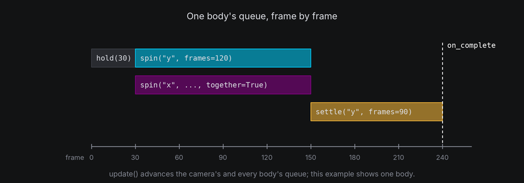
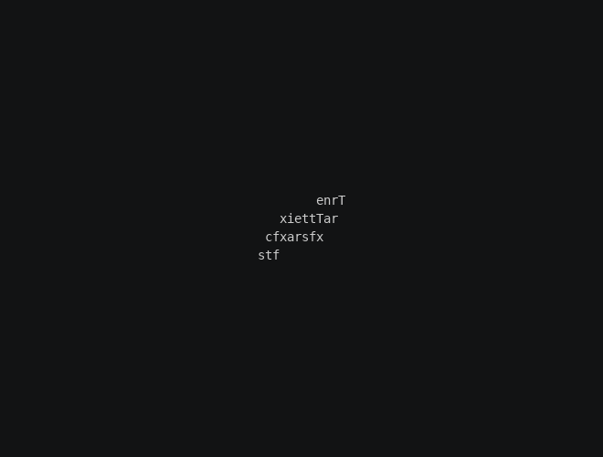
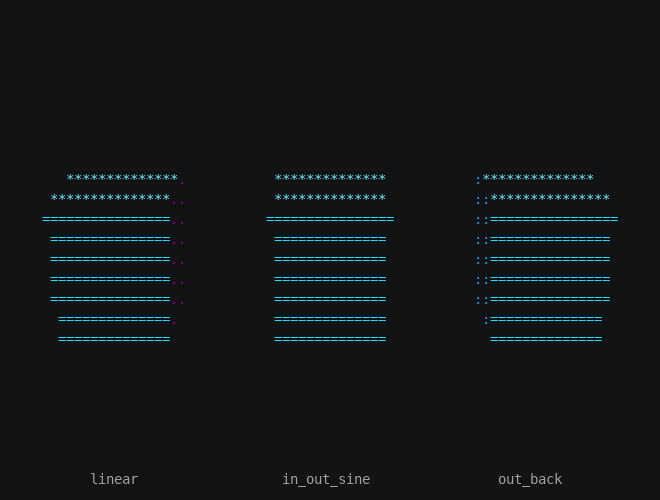
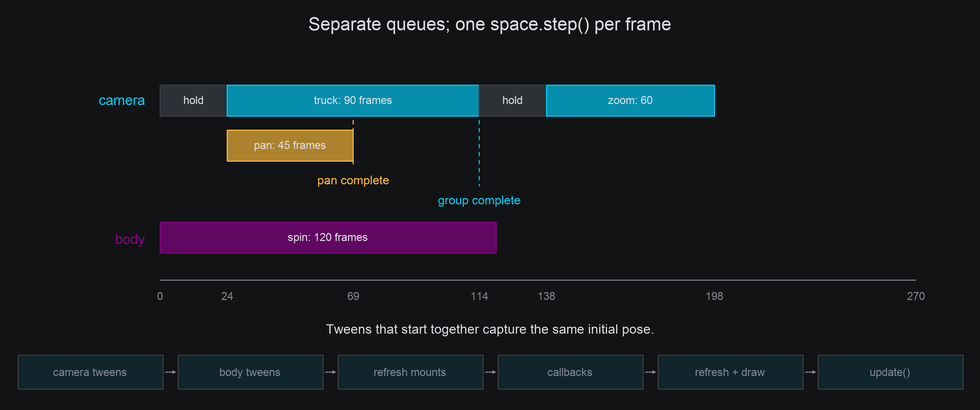
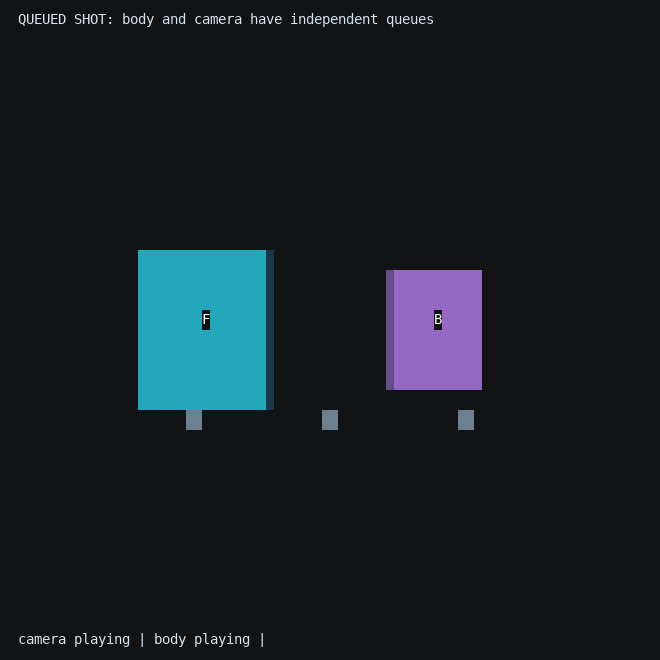
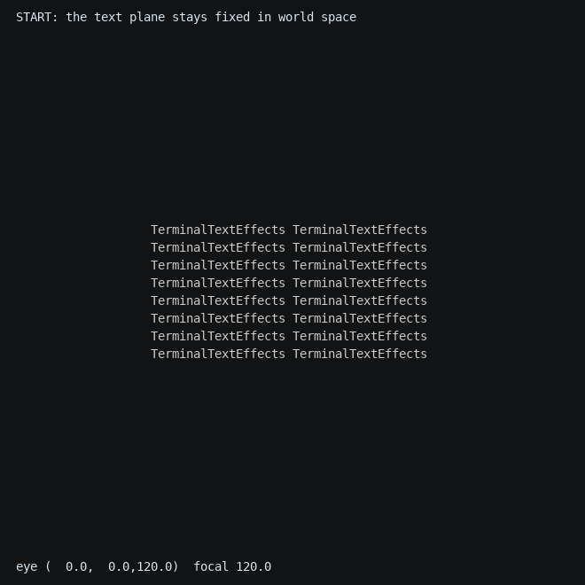

# Animating in 3D

A 3D effect is still a frame-by-frame effect. Bodies and the camera move a little every frame, either because your code moves them
or because they're playing **tweens**. This chapter covers both, how tweens are timed, and how to hand the text back
to the ordinary 2D engine once the 3D part is over.

## The idea

There are two ways to animate a body, and they work together:

- **Step by step**: your `__next__` changes the body directly, with `rotate`, `move_by`, `set_rotation` and the rest.
  You're in full control, frame by frame. Use this when the motion depends on something else in the effect.
- **Tweens**: you describe a change once, such as "two turns about y over 120 frames, easing out", and the space
  plays it a frame at a time. Use this for motion you can describe up front.

Tweens **queue**. Each one starts when the one before it finishes, so a body's queue is its script. A tween queued with
`together=True` joins the one before it and runs at the same time.



Tweens add their change to the body rather than setting it, so step-by-step calls and tweens combine. A spin keeps
turning a body that your code is also nudging.

Each tween has a length in frames and an optional **easing** function, the same ones paths use (see
[Motion](../engine/motion.md#easing)). Easing changes how the motion is spread over its frames, not how long it
takes.

## In TTE

The Handoff example flings the text plane far away, brings it back with a spin that settles exactly at rest, and then
releases every character to an ordinary 2D hop. The 3D part is four calls:

```python
self.plane.set_rotation(rotation_about("x", 60) * rotation_about("y", 200)).set_position(0, 0, -300)
self.plane.move_to(0, 0, 0, frames=150, ease=easing.out_cubic)
self.plane.settle("y", turns=1, frames=150, ease=easing.out_cubic, together=True)
self.plane.on_complete(self.hand_off)  # hand_off releases the characters and starts their hops.
```

??? example "handoff.py"

    Save it in your community effects directory as `handoff.py`.

    ```python
    --8<-- "docs/effectguide/examples/3d/handoff/handoff.py"
    ```

```bash
tte --input-file concept_input.txt --canvas-width 80 --canvas-height 24 --anchor-text c handoff
```



- `set_rotation(...)` and `set_position(...)` place the body at its starting pose at once. `move_to(..., frames=0)`
  would do the same as a tween.
- `move_to` and `settle(..., together=True)` run together, so the text turns as it flies in. Both bring their part of
  the pose home, position and rotation, so it lands where the text plane was built and every character meets its
  input cell.
- `on_complete(callback)` runs when the last queued tween finishes, after the final pose is applied. The example
  releases the characters there.
- `release_all()` hands each character back on the cell its anchor projects to at that moment, with nothing left of the
  mount, so a new path starts from exactly that cell. That holds even if the callback changes the pose before
  releasing.

Other tweens: `turn_to(rotation)`, `turn_to_rest()`, `scale_to(scale)`, `hold(frames)`, and `random_pose()` and
`random_position()` for scattered starts. `body.animating` tracks that body; `camera.animating` tracks the camera; `space.animating` combines both. They tell
you whether their tweens are still queued. They say nothing about mounted characters, blends or the 2D paths you start after a release, so end the
effect on `active_characters` too (see [the frame loop](index.md#mounted-text)).

### Mounting mid-effect

Mounting and paths are both part of a character's `Motion`, so they hand off cleanly in both directions:

- `space.mount(character, anchor, blend_frames=30, ease=...)` lets a character travel to its anchor from wherever it is,
  instead of jumping.
- Activating a path releases the mount, and mounting deactivates the path.
- The `MOUNT_COMPLETE` and `MOUNT_RELEASED` events, and the `MOUNT` and `UNMOUNT` actions, chain mounts with paths and
  scenes through the [event handler](../engine/events.md). `space.new_mount()` creates a mount for the `MOUNT` action
  without starting it.

## Mount readings

Every active mount measures its anchor in `space.step()`, so read these after `step()` and before `update()`:

| Reading | What it is |
| --- | --- |
| `coord` | The cell the anchor projects to |
| `depth` | Distance along the current view axis, in columns: smaller is nearer. Either body or camera motion can change it |
| `nearness` | 0 at the farthest point the body can reach at its size, 1 at the nearest, measured from the body's own center. Pure translation does not change it; turning the body or camera changes which side is nearer |
| `facing`, `facing_amount` | Whether the anchor's surface faces the viewer, and how squarely, from -1 (away) to 1 |
| `light` | How directly the surface faces the light, from 0 to 1 |
| `projected` | Whether the anchor is in front of the near plane; the other readings keep their last values while it isn't |

`facing`, `facing_amount` and `light` need an anchor with a [normal](coordinates.md#normals-for-anchors). Without
one they stay at `True`, 1 and 1.

Scenes can follow two readings without any code in `__next__`: `sync=Scene.SyncMetric.LIGHT` picks the frame from
`light`, and `sync=Scene.SyncMetric.DEPTH` from `nearness`, so the near side of a turning body can show a brighter
color than the far side. For anything else, read the mount yourself. This thins out characters as they turn
edge-on:

```python
self.space.step()
for character, mount in self.space.mounts.items():
    symbol = "·" if mount.facing_amount < 0.3 else character.input_symbol
    character.animation.set_appearance_if_changed(symbol)
self.update()
```

A blend is different: it advances when the character ticks, not in `step()`. `mount.arrived` turns true and
`MOUNT_COMPLETE` fires on the tick the character reaches its anchor.

## Lifecycle

`body.cancel()` discards queued tweens and completion callbacks while keeping the current pose.
`reset()` also restores the starting pose. Both allow new tweens afterwards.

Use `space.remove(body)` to stop tracking a body: it cancels tweens, releases mounts, and hides
surface cells immediately. Repeated removal is harmless; a body from another space is rejected.
Removed bodies are no longer drawn or stepped and their anchors cannot be mounted again.
Create a new body to add geometry back. `space.clear()` removes all current bodies; it does not cancel camera
tweens. Call `space.camera.cancel()` as well when ending all scene animation.
The space retains its surface-character pool for reuse; `erase()` alone only stops surface drawing.


## Under the hood

A tween is a function of progress from 0 to 1. Each frame, `step()` advances the front of the camera's queue and each body's queue by one
frame, eases the progress, and applies the change since the last frame. That's why tweens compose: each applies a
difference, not an absolute pose. `settle` and `turn_to` use `Rotation.slerp` to find the orientation at each step.

## At cell resolution

- Easing matters more in cells than in pixels. A linear spin starts and stops with a visible jolt, and an eased one
  doesn't. The Eases example gives three cubes the same quarter turns with different easing functions:

    ```bash
    tte --input-file concept_input.txt --canvas-width 80 --canvas-height 24 --anchor-text c eases
    ```

    

    `turn_to`, `turn_to_rest`, `settle`, `move_to` and `scale_to` take the same `ease` argument. The example's source
    is `docs/effectguide/examples/3d/eases/eases.py` in a TTE checkout.
- Hold a moment at rest before releasing text, so the reader sees it land.
- After the hand-off, characters are ordinary characters. Their scenes, colors and layers are what you left them as,
  so reset anything the 3D part changed.

## Waiting for a group or a blend

`on_complete(callback)` belongs to the last individual tween. Use
`body.on_group_complete(callback)` to wait for the longest tween in the last queued parallel group.
The hook runs after mount readings refresh, so it can release mounted characters at the final pose.
Groups queued after the hook are independent; cancelling or resetting discards pending hooks.

`space.animating` tracks camera and body tweens. Mount travel is separate: use `space.blending` to wait for
active blends, or `mount.blend_progress` for the fraction of blend frames elapsed before easing.
Blends advance when characters tick, and a zero-frame blend reports 1 immediately.


## Camera shots and timing

The camera owns its own queue. A camera group and a body group begin independently; `together=True` groups actions
on the **same owner**, not across the camera and a body. Two actions on the camera that start together capture the
same starting pose before either applies a frame. In particular, a simultaneous pan does not alter the forward axis
captured by `dolly_by`.



This shot gives the body a 120-frame turn, while the camera waits, trucks for 90 frames and pans for 45 of them, then
zooms. `on_complete` belongs to the last individual tween, so the pan's callback fires while the truck is still moving.
`on_group_complete` waits for both. Both callbacks receive the camera and return `None`:

```python
--8<-- "docs/effectguide/examples/3d/cameralab/cameralab.py:sequence"
```

```bash
tte --input-file concept_input.txt --canvas-width 80 --canvas-height 32 --anchor-text c cameralab --lesson sequence
```



In each frame, `space.step()` advances camera tweens, then body tweens, refreshes mount readings, runs camera
callbacks followed by body callbacks, refreshes again after callbacks, and draws surfaces. The iterator then calls
`update()` to tick the characters. A camera completion can therefore read final mount coordinates or release text
at the final view, just like a body completion.

### Immediate calls, zero frames and deltas

`set_position`, `move_by`, `dolly`, `set_rotation` and `zoom` apply now. Pan, tilt, roll, truck, pedestal, `look_at`
and `orbit` also apply now when `frames` is omitted. Supplying `frames=0` makes them queued zero-frame actions:
they wait behind earlier groups rather than jumping ahead. Negative frame counts raise `ValueError`.

Camera tweens apply **changes** rather than overwrite the pose. For example, after a move tween has begun, an
immediate `move_by(y=2)` adds an offset that the remaining tween preserves. Local travel captures its direction at
the start; turns continue to compose with immediate turns; zoom changes multiply, so an immediate `zoom(2)` doubles
the remaining zoom trajectory. With concurrent edits, the final pose includes those edits and may differ from the
original absolute target.

### Tracking a body tween

[Immediate target movement](camera-movement.md#a-sampled-target-and-a-moving-target) is simple: move the body,
call `camera.look_at(body)`, then step the space. A body **tween** moves inside `space.step()`, after camera tweens.
Aiming before that step sees the body's previous position. To follow the current frame's tweened position, schedule
a one-frame camera hook whose callback aims after body motion:

```python
from terminaltexteffects.engine.space3d import Camera


# A method on the effect iterator:
def aim_after_motion(self, camera: Camera) -> None:
    camera.look_at(self.target)

# In __next__, while the target's animation is running:
self.space.camera.hold(1).on_complete(self.aim_after_motion)
self.space.step()   # Body motion, then the aiming callback, then refreshed projection and drawing.
self.update()
```

Keep the camera queue free for those one-frame hooks; if a shot is already queued, the hook waits behind it.
Do not call `space.step()` a second time to refresh a manual camera change: that would advance both queues twice.
For a fixed sampled aim, use one `look_at(body, frames=...)` instead of scheduling tracking hooks.

## Returning the view before release

`camera.cancel()` clears its tweens and pending callbacks but holds the current view. `camera.reset()` also restores
all camera settings captured at camera creation: position, orientation, focal length, projection, center, near plane
and row scale. Reset is immediate; it does not accept `frames`. Neither operation resets body transforms.

Text anchors built with `text_plane` use the initial camera configuration. To land text on its input cells, return
the body to the pose where those anchors were built and return the camera home too. For an eased camera return,
capture its public readouts before changing it, then tween position, orientation and focal length together:

```python
# Before changing the initial camera:
home_position = camera.position
home_rotation = camera.rotation
home_focal = camera.focal or camera.distance

# When returning, after other shot edits are finished:
camera.move_to(home_position.x, home_position.y, home_position.z, frames=90)
camera.turn_to(home_rotation, frames=90, together=True)
camera.zoom_to(home_focal, frames=90, together=True)
camera.on_group_complete(release_text)  # release_text(camera) releases the mounts.
```

If projection, row scale, optical center or near plane were also changed, restore those settings explicitly, or use
`reset()` when a cut is appropriate. The eased return above makes focal length explicit; a later `reset()` restores
the original `focal=None` relationship as well.

```bash
tte --input-file concept_input.txt --canvas-width 80 --canvas-height 32 --anchor-text c cameralab --lesson restore
```



The camera lab captures its initial view in `setup_restore`, keeps the body's pose unchanged, and releases in the
returning group's completion hook. Its complete return script is:

```python
--8<-- "docs/effectguide/examples/3d/cameralab/cameralab.py:restore"
```
