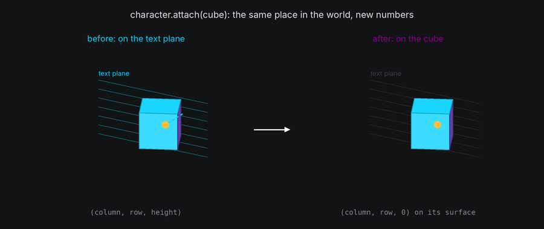
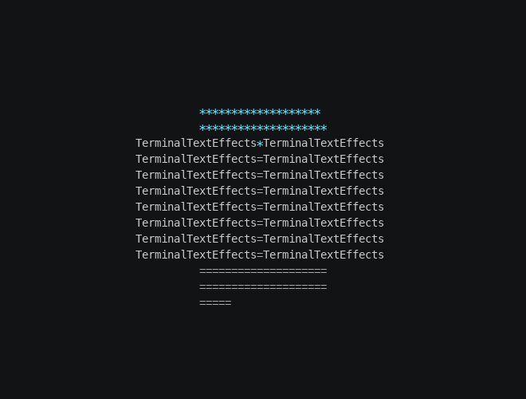

# Attaching and Detaching

A node's parent decides what carries it. Attaching moves a node under another body, so that from then on it moves,
turns and scales with that body; detaching sets it free in the world. Paths do the travelling in between, and a path
can head for a target that is itself moving.

## The idea

- `node.attach(body)` makes the node a child of `body` **without moving it**: its position is converted into the new
  parent's frame, so it stays exactly where it is in the world, and on screen.
- `node.attach(body, at=position)` places it at `position` in the new parent's frame instead, now.
- `node.detach()` leaves the current parent and stays where the node is, free in the world. It's the same as
  `node.attach(world.root)`.
- Attaching cancels the node's active path, because its waypoints were measured in the old frame.
- Characters and bodies attach the same way. A body keeps its place, and its rotation and scale stay relative to its
  new parent.

So attaching never moves anything by itself. To bring a character onto a body, fly it there with a path, then attach
it where it lands. To send it home, attach it to the text plane where it is, then give it a path to its input cell.



## In TTE

The Flight example sends every character to a random spot on a spinning cube. Each one lands, rides the cube, and
then flies home to its input cell:

```python
target = self.cube.surface.target(self.cube.surface.random_coord())
flight = character.motion.new_path(speed=1.2, ease=easing.in_out_sine, path_id="flight")
flight.new_waypoint(target, bezier_control=Vec3(column, row, 30))
character.event_handler.register_event(
    EventHandler.Event.PATH_COMPLETE, flight, EventHandler.Action.ATTACH, self.cube
)
```

??? example "flight.py"

    Save it in your community effects directory as `flight.py`.

    ```python
    --8<-- "docs/effectguide/examples/3d/flight/flight.py"
    ```

```bash
tte --input-file concept_input.txt --canvas-width 80 --canvas-height 24 --anchor-text c flight --ride-frames 120
```



- `surface.target(position)` is a **live target**: a spot on the cube's surface that moves with the cube. A path
  heading for it reads where it is on every tick, so the character arrives on the spot however far the cube has turned
  in the meantime.
- The flight's waypoint and control point are measured in the character's frame, the text plane. The control point is
  above the character's own cell, 30 units toward the viewer, so each character rises off the text before it heads
  away.
- The `ATTACH` action attaches the character to the cube when the flight completes. It keeps the character's place,
  which is on the target, so the character is now on the cube's surface and turns with it.
- Riding needs no path. A character on a moving body is placed by the body every frame, so the riders don't even need
  to be active.
- `len(self.cube.children)` counts the riders. It reaches the total once every character has landed.

## Live targets

Any node can be a waypoint. A path heading for a node follows it to wherever it is when the character arrives:

| Target | Made with | Follows |
| --- | --- | --- |
| A spot on a surface | `body.surface.target(column, row, height)`, or `target(position)` | That spot, as the body moves, turns and scales |
| A body | The body itself | The body's origin |
| A character | The character itself | Wherever that character is |

```python
chase = character.motion.new_path(speed=0.8)
chase.new_waypoint(leader)  # Catch up with another character, wherever it goes.
```

A path measures its length when it is activated, with each live target where it is at that moment, so it takes the
same number of frames however the target moves afterward. Each tick reads the target again and places the character
that far along the way to where the target is now. It arrives on the spot exactly when the path finishes, even when
the target moves quickly.

Bezier control points can be live targets too. A curve bends toward wherever its control node is on each tick.

## Coming home

A character that leaves the text plane keeps its `input_coord`, so going home is two steps:

```python
character.attach(self.world.text_plane)  # Where it is: its position is now on the text plane.
home = character.motion.new_path(speed=1.0, ease=easing.in_out_cubic)
home.new_waypoint(character.input_coord)  # A Coord means height 0.
character.motion.activate_path(home)
```

The character flies from wherever it was, on any body or free, back down onto the text plane and across to its cell. As
long as the text plane and the camera are back at their starting pose when it arrives, the character is drawn in
exactly its input cell.

To put a character home at once, attach it there: `character.attach(world.text_plane, at=character.input_coord)`.

## Events

| Event | When | The caller is |
| --- | --- | --- |
| `ATTACHED` | A node is attached to a body other than the root | The new parent |
| `DETACHED` | A node leaves a body other than the root | The old parent |

A move from one body to another triggers `DETACHED` and then `ATTACHED`. `node.detach()` triggers only `DETACHED`, and
attaching a free node triggers only `ATTACHED`.

Two node actions do the same as the methods, so a chain of paths and scenes can move a node between bodies:

| Action | Target | Does |
| --- | --- | --- |
| `ATTACH` | A body | `node.attach(body)`, keeping its place |
| `DETACH` | None | `node.detach()` |

Bodies have event handlers too, with the node actions: `ACTIVATE_PATH`, `DEACTIVATE_PATH`, `SET_COORDINATE`,
`ATTACH`, `DETACH` and `CALLBACK`. A body can land on another body at the end of its own path, exactly as a character
does.

## Detaching into the world

A free node is a child of `world.root`, so its position is a world point `(x, y, z)`. That suits motion that belongs to
no body: debris thrown off a spinning shape, a character falling away from the text.

```python
character.detach()  # Same place, now measured in world units.
fall = character.motion.new_path(speed=0.6, ease=easing.in_quad)
fall.new_waypoint(Vec3(character.world_position.x, -60, character.world_position.z))
character.motion.activate_path(fall)
```

`world.remove(body)` detaches every child of the body too, each one where it is.

## Under the hood

`attach` without `at` works out the node's world position with its old parent's `to_world`, then converts it into the
new parent's frame with `from_world`. On a body with a surface, that is the surface position nearest the point, with
its height off the surface. The node's place in the world is unchanged, to within rounding, so it lands in the same
cell on the next frame.

A body's rotation and scale are not converted: they stay relative to whichever parent the body has. Attaching a body
under a turned parent turns it with the parent at once. Set its rotation in the same frame to compensate when that
matters.

## At cell resolution

- Attaching mid-flight, at the end of a path, never jumps. Attaching with `at` jumps at once, to the new place.
- A character attached to the back of a shape is hidden by the shape's drawn cells in front of it, or, without a
  drawn shape, can be hidden by `hide_facing_away` (see [Depth](depth.md)).
- A live target that leaves the canvas takes its followers with it. They are drawn wherever they are, even off screen,
  and can't be seen from behind the camera.
