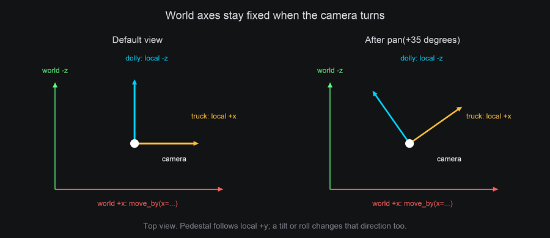
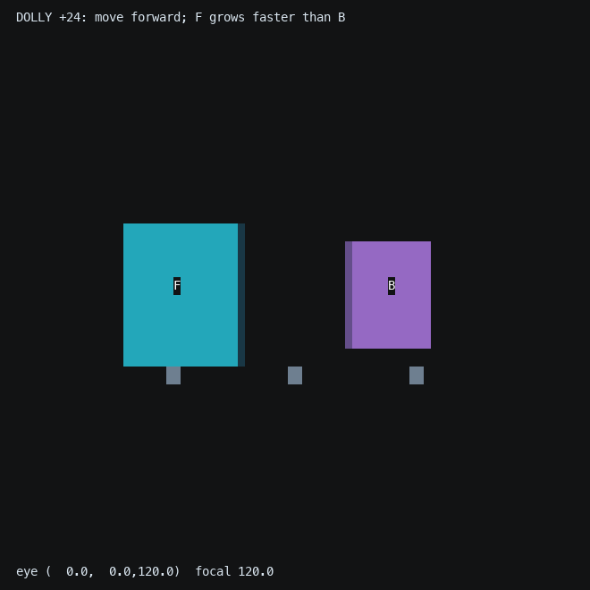
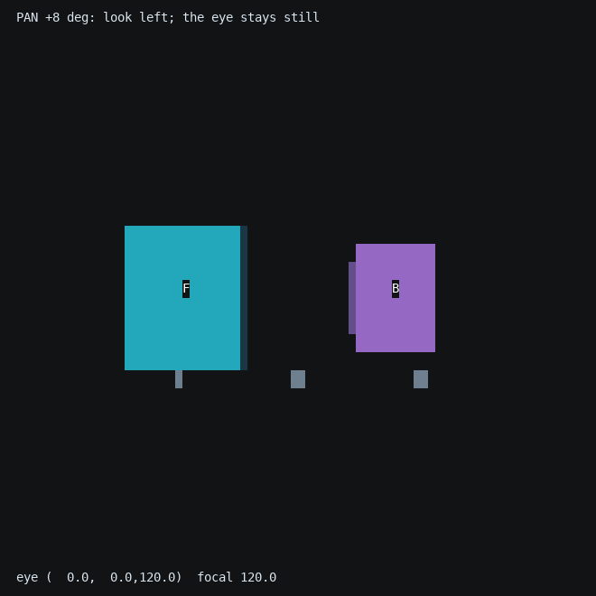
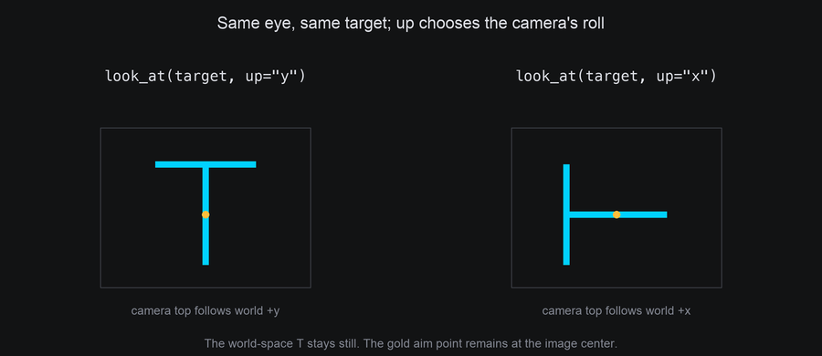
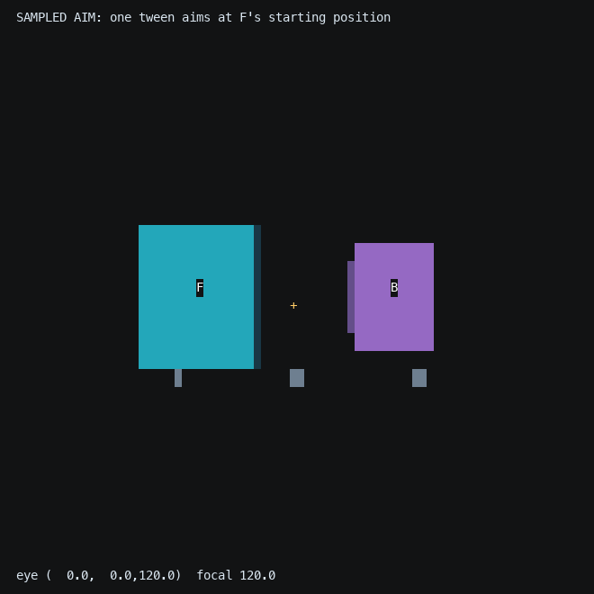
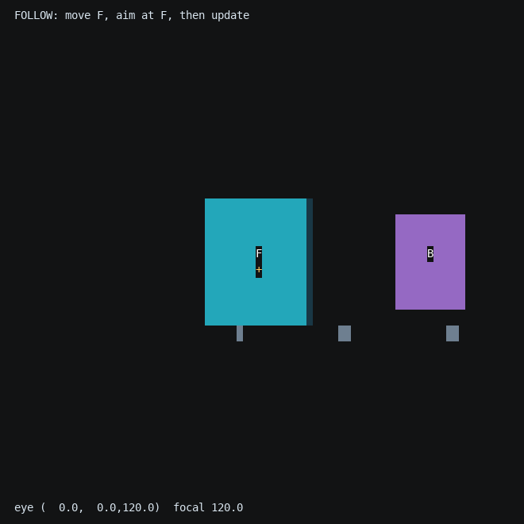

# Moving the Camera

Keep the scene still and change where you see it from. This is useful for a fly-by along a row of bodies, an orbit
around a sign, or a shot that approaches a face before handing its text back to 2D.

The camera has three independent parts: an **eye position**, an **orientation**, and a **focal length**. Travel changes
the first, turning changes the second, and zoom changes the third. [Camera and projection](camera.md) explains
focal length, perspective and depth.

## Choose a control

| What you want | Immediate call | Queued call | What changes |
| --- | --- | --- | --- |
| Set a world position | `set_position(x, y, z)` | `move_to(x, y, z, frames=60)` | Eye position |
| Add a world displacement | `move_by(x, y, z)` | Use an explicit target with `move_to` | Eye position |
| Move forward/backward | `dolly(amount)` | `dolly_by(amount, frames=60)` | Eye along its local -z |
| Move right/left | `truck(amount)` | `truck(amount, frames=60)` | Eye along its local +x |
| Move up/down | `pedestal(amount)` | `pedestal(amount, frames=60)` | Eye along its local +y |
| Look left/right | `pan(degrees)` | Same call with `frames=60` | Orientation about local +y |
| Look up/down | `tilt(degrees)` | Same call with `frames=60` | Orientation about local +x |
| Turn the image | `roll(degrees)` | Same call with `frames=60` | Orientation about local +z |
| Set a world orientation | `set_rotation(rotation)` | `turn_to(rotation, frames=60)` | Orientation |
| Aim at a point or body | `look_at(x, y, z)` or `look_at(body)` | Same call with `frames=60` | Orientation |
| Circle a target, staying aimed at it | `orbit("y", degrees=30, around=body)` | `orbit("y", turns=1, around=body, frames=240)` | Position and orientation |
| Magnify from the same position | `zoom(factor)` | `zoom_to(focal, frames=60)` | Focal length |

Angles here are degrees; `Rotation` itself uses radians, or use the degree-based `rotation_about(axis, degrees)`
helper. Methods return the camera for chaining. A positive travel amount means forward, right or up; negative
amounts reverse it. `set_position` and `move_to` take absolute world coordinates and default omitted coordinates
to zero. `move_by` takes displacements and leaves omitted components unchanged.

## Travel in camera axes

At the default orientation, `dolly(10)` moves along world -z, `truck(10)` along world +x and `pedestal(10)` along
world +y. Once the camera turns, its axes turn with it. The world axes do not.



```python
from terminaltexteffects.engine.space3d import rotation_about

camera = self.space.camera
camera.set_rotation(rotation_about("y", 35))
camera.truck(10)       # Along the turned camera's right axis.
camera.move_by(x=10)   # Along fixed world +x instead.
```

Travel does not automatically re-aim the camera. Dolly travels along the current forward direction; moving to a
world position leaves orientation alone. To travel while watching a target, choose an orbit or explicitly aim
again. A queued travel action captures its local direction when it starts, so a simultaneous pan does not bend a
dolly path. [Camera timing](animating.md#camera-shots-and-timing) covers that shared starting pose.

### Seeing travel

The camera lab keeps two cubes and three small landmarks fixed. Cyan **F** is the foreground cube; purple **B** is
the background cube. Each phase starts from the same view, moves one way, and pauses. The readout shows the eye's
world coordinates while the objects stay put:

```bash
tte --input-file concept_input.txt --canvas-width 80 --canvas-height 32 --anchor-text c cameralab --lesson travel
```



```python
--8<-- "docs/effectguide/examples/3d/cameralab/cameralab.py:travel"
```

## Turn the view without moving the eye

Pan, tilt and roll rotate about the camera's **current local axes**. A positive pan looks left; a positive tilt looks
up. A positive roll rotates the camera counterclockwise about its backward (+z) axis, so the image turns clockwise.
Watch the eye coordinates stay constant:

```bash
tte --input-file concept_input.txt --canvas-width 80 --canvas-height 32 --anchor-text c cameralab --lesson turns
```



```python
--8<-- "docs/effectguide/examples/3d/cameralab/cameralab.py:turns"
```

A body rotation and a camera rotation have different meanings. Rotating a body changes that body and its anchors.
Turning the camera changes how **every** body is seen. Body-local face names such as a cube's "front" remain attached
to the cube; they do not switch to whichever face is nearest the camera.

`set_rotation(rotation)` sets a world orientation immediately. `turn_to(rotation, frames=...)` takes the shortest
quaternion path to that orientation. Use `pan`, `tilt` and `roll` to describe a turn relative to the current camera;
use `turn_to` for a known final world orientation. Neither moves the eye.

## Aim at a target

`look_at` computes an orientation from the current eye toward a world point. It also chooses a roll using a world-up
direction, +y by default:

```python
camera.look_at(0, 0, 0)                    # Point at the world origin now.
camera.look_at(cube)                        # Point at this body's origin now.
camera.look_at(cube, up=(1, 0, 0))           # Prefer world +x as up.
camera.look_at(cube, frames=60, ease=easing.in_out_sine)  # Turn there over time.
```



`up` is a direction, not another target position. The camera uses its component perpendicular to the view.
Changing it changes the roll around the viewing direction, much
like rolling an aimed camera. An up direction parallel to the view cannot determine that roll; the camera uses
its previous right axis as a fallback. Choose an up direction away from parallel when you need a predictable roll.
A target at the eye and a zero up vector raise `ValueError`.

### A sampled target and a moving target

A queued `look_at(body, frames=...)` samples the body's position **when the tween starts**, after any earlier camera
groups. It then turns toward that sampled point. It does not keep watching the body as it moves. To follow a moving
body, move it and call immediate `look_at(body)` each frame before `space.step()`.

=== "Sample once"

    ```bash
    tte --input-file concept_input.txt --canvas-width 80 --canvas-height 32 --anchor-text c cameralab --lesson sampled
    ```

    

=== "Follow each frame"

    ```bash
    tte --input-file concept_input.txt --canvas-width 80 --canvas-height 32 --anchor-text c cameralab --lesson follow
    ```

    

The two recordings use the same target motion. The following code moves the body **directly**, then aims from its
current position. The normal frame loop steps the space once and ticks the characters afterward:

```python
--8<-- "docs/effectguide/examples/3d/cameralab/cameralab.py:follow"
```

If the target moves through body tweens, those advance inside `space.step()` instead. Use the
[completion-phase tracking pattern](animating.md#tracking-a-body-tween) to aim after that motion without stepping twice.

## Orbit a stationary scene

Orbit changes position and orientation together. A world axis passes through the target, the eye turns around that
axis, and the camera stays aimed at the target. The radius must be nonzero. `around` accepts a body, a `Vec3`, or an
`(x, y, z)` world point. A body target is sampled when the action starts, just like `look_at`.


```python
camera.set_position(0, 20, 170).look_at(cube).zoom(1.25)
camera.orbit("y", turns=1, around=cube, frames=360, ease=easing.in_out_sine)
```

Supply either `degrees` or `turns`, not both. With no angle supplied, orbit defaults to one full turn. With no
`frames` supplied, it applies immediately. With `frames=0`, it obeys queue ordering: it applies now only if nothing
is queued ahead. Its `up` direction controls aiming roll as for `look_at`.

```bash
tte --input-file concept_input.txt --canvas-width 80 --canvas-height 32 --anchor-text c cameraorbit
```


The cube and gold landmarks stay fixed in world space. Their changing overlap and relative position show that the
viewpoint is moving. This differs from the [body-orbit example](transforms.md), where the moon itself travels around
a fixed planet. Moving the camera affects the whole scene, including mount depth and facing, occlusion and clipping.

??? example "Standalone orbit example"

    Save this whole module as `cameraorbit.py` in your community effects directory.

    ```python
    --8<-- "docs/effectguide/examples/3d/cameraorbit/cameraorbit.py"
    ```

## Run the camera lab

All twelve camera lab lessons come from one standalone module,
[`cameralab.py`](https://github.com/ChrisBuilds/terminaltexteffects/blob/main/docs/effectguide/examples/3d/cameralab/cameralab.py).
Save the **whole file** as `cameralab.py` in your community effects directory. The excerpts in the guide are parts of
that iterator, not separate effects. These examples need the development version described in
[3D Effects](index.md), and use an 80-column, 32-row canvas so captions and shapes have room.

| Lesson | Chapter |
| --- | --- |
| `travel`, `turns`, `sampled`, `follow` | This page |
| `dolly`, `zoom`, `orthographic` | [Camera and projection](camera.md) |
| `world-light`, `camera-light` | [Light and shading](light.md#world-light-or-camera-light) |
| `sequence`, `restore` | [Animating in 3D](animating.md#camera-shots-and-timing) |
| `clip` | [Depth and hidden surfaces](depth.md#moving-the-near-plane) |

The captions are ordinary 2D characters at a high layer. They remain readable while the camera moves and do not
participate in 3D depth ordering. Each lesson ends by hiding its scene and restoring the original input text.
