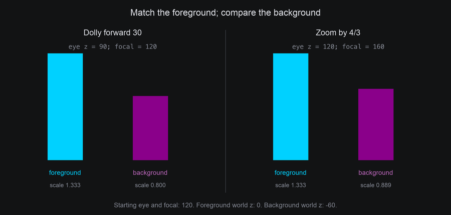
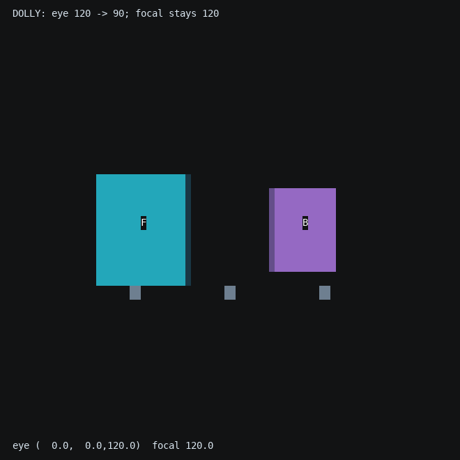
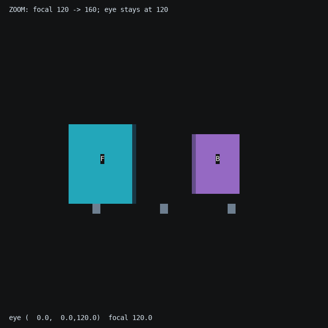
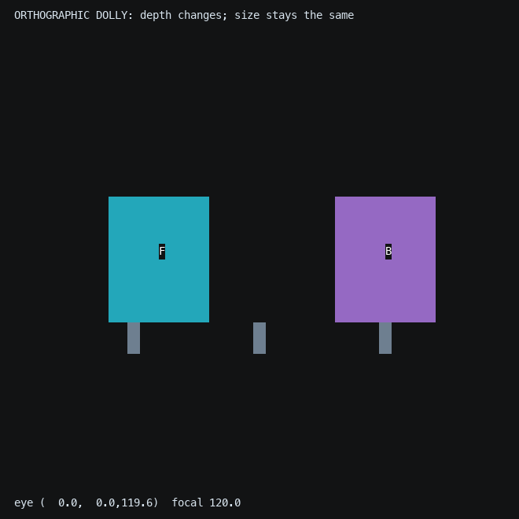
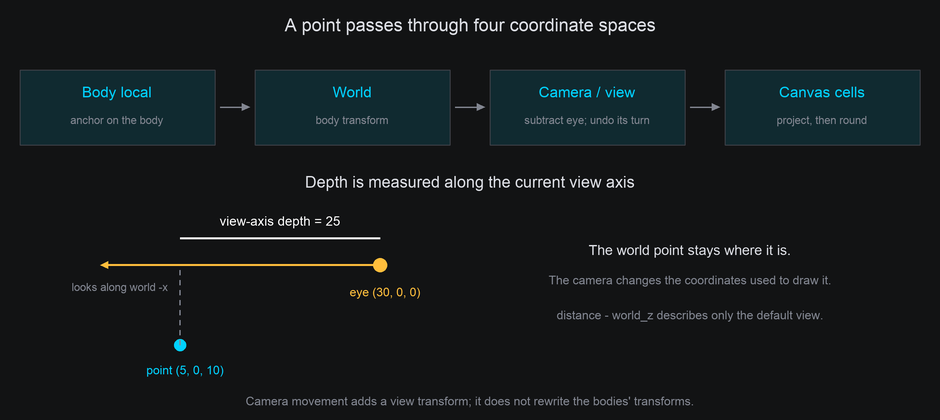

# Camera and Projection

A camera answers two questions: **where are we looking from?** and **how does that view become terminal cells?**
Its position and orientation answer the first. Projection and focal length answer the second. Start here for
framing and perspective, then read [Moving the camera](camera-movement.md) for travel, turning, aiming and orbiting.

## The default view

A new `Space3D` puts its eye at `(0, 0, 120)`, looking along world **-z**, with **+y** up. The canvas center is the
center of the image. This is the view used by the earlier chapters; moving the camera changes the view while the
world axes and body positions stay fixed.


- **Perspective** makes farther things smaller. A point's projected size is multiplied by `focal / depth`, where
  depth is distance along the camera's forward axis. Initially focal length is 120 too, so the world z=0 plane
  keeps its size and the input text meets its original cells.
- **Orthographic** projection skips that multiplication. Depth still exists for clipping and occlusion; it just
  does not change apparent size. The eye has a finite position and a near plane even though its rays are parallel.

Once the camera moves or turns, the world z=0 plane is no longer necessarily face-on, centered or at its initial
size. [Camera coordinates and depth](#camera-coordinates-and-depth) explains the extra transform.

## Setting up perspective

`Space3D(terminal, perspective=...)` chooses the initial projection:

| Setting | Initial eye z | Focal length when `focal=None` | Result |
| --- | --- | --- | --- |
| `0` | 120 | Ignored for size | Orthographic, with no depth magnification |
| `1` | 120 | 120 | Default perspective |
| `2` | 60 | 60 | Closer eye and stronger differences between near and far objects |


The Lens example keeps the bodies still and changes only that initial setup:

```python
self.space = Space3D(self.terminal, perspective=self.config.perspective)
for x, z in ((-26, 0), (0, -60), (26, -120)):
    self.space.body(Cube(14), at=(x, 0, z)).draw(Shaded())
```

??? example "lens.py"

    Save this module in your community effects directory as `lens.py`.

    ```python
    --8<-- "docs/effectguide/examples/3d/lens/lens.py"
    ```

=== "Orthographic"

    ```bash
    tte --input-file concept_input.txt --canvas-width 80 --canvas-height 24 --anchor-text c lens --perspective 0
    ```

    

=== "Default perspective"

    ```bash
    tte --input-file concept_input.txt --canvas-width 80 --canvas-height 24 --anchor-text c lens
    ```

    

=== "Closer initial camera"

    ```bash
    tte --input-file concept_input.txt --canvas-width 80 --canvas-height 24 --anchor-text c lens --perspective 2
    ```

    

`perspective` is a constructor setting. It establishes both eye distance and the default focal length. The controls
below let an effect change position and focal length independently afterward.

## Moving the camera

[Moving the camera](camera-movement.md) teaches eye position, camera-local travel, pan/tilt/roll, aiming and orbiting.
[Camera shots and timing](animating.md#camera-shots-and-timing) combines those controls into queued shots. Start with
the comparison below when deciding between changing position and changing focal length.

## Dolly or zoom?

A **dolly** moves the eye forward or backward. The foreground grows faster than the background as you approach,
and their relative positions can change: that is **parallax**. A **zoom** changes focal length while the eye stays
still. It magnifies the whole perspective image, keeping its perspective proportions.



The camera lab starts with eye z=120 and focal=120. Cyan **F** has its front face at world z=0; purple **B** has its
front face at z=-60. Both are the same physical size. These two moves give F the same final framing:

| Move | Final eye z | Final focal | F's front-face scale | B's front-face scale |
| --- | --- | --- | --- | --- |
| `dolly_by(30)` | 90 | 120 | 120 / 90 = 1.333 | 120 / 150 = 0.800 |
| `zoom_to(160)` | 120 | 160 | 160 / 120 = 1.333 | 160 / 180 = 0.889 |

=== "Move the eye"

    ```python
    camera.dolly_by(30, frames=120, ease=easing.in_out_sine)
    ```

    ```bash
    tte --input-file concept_input.txt --canvas-width 80 --canvas-height 32 --anchor-text c cameralab --lesson dolly
    ```

    

=== "Change focal length"

    ```python
    camera.zoom_to(160, frames=120, ease=easing.in_out_sine)
    ```

    ```bash
    tte --input-file concept_input.txt --canvas-width 80 --canvas-height 32 --anchor-text c cameralab --lesson zoom
    ```

    

`dolly(amount)` and `zoom(factor)` are immediate. `dolly_by(amount, frames=...)` is relative travel;
`zoom_to(focal, frames=...)` targets an **absolute** positive focal length. For example, `zoom(2)` doubles the current
focal length, while `zoom_to(2)` targets a focal length of two columns. Choose dolly to travel through a scene and
zoom to reframe the image from the same viewpoint.

### Orthographic camera movement

Orthographic travel and turns still work. Truck and pedestal move the image; pan, tilt and roll change which way
you see the scene. Dolly changes depth and can cross the near plane, but does not magnify. Focal length is ignored,
so zoom does not magnify either. Watch the readout change during the first two phases of this recording:

```bash
tte --input-file concept_input.txt --canvas-width 80 --canvas-height 32 --anchor-text c cameralab --lesson orthographic
```



The standalone camera lab and its lesson snippets are introduced in [Moving the camera](camera-movement.md#run-the-camera-lab).

## Camera coordinates and depth

Body coordinates describe points on a body. A body's transform places them in **world space**. The camera then
subtracts its eye position and undoes its orientation to express those world points in **view space**. In that
space, forward is always -z, right is +x and up is +y. Projection turns view x/y into canvas columns/rows.



For a world point `point`, the geometry is equivalent to:

```python
view = camera.rotation.inverse().apply(point - camera.position)
depth = -view.z
```

`camera.depth(point)`, `Projected.depth` and `Mount.depth` all use this view-axis depth. It is **not Euclidean range**
to the eye. With the default orientation and position it equals `camera.distance - point.z`; after camera movement,
use `depth(point)` instead of assuming that formula still describes the view.

Projection returns `None` before the near plane, including behind the eye:

```python
projected = self.space.camera.project(point)
if projected is not None:
    cell = projected.coord
    depth = projected.depth
```

The near plane is perpendicular to the current forward axis and moves with the eye. Faces and wireframe edges
crossing it retain their visible portions. [Depth and hidden surfaces](depth.md#moving-the-near-plane) shows this
with a stationary body and a moving side-view camera.

## Cells, rays and the text layout

`camera.cell_to_world(coord, z=...)` intersects the **active** viewing ray with a plane of constant **world z**.
For example, at the default view, `z=0` lifts a cell onto the input-text plane. A moved or rolled camera uses a
different ray, so the resulting world x/y may change. If that ray is parallel to the plane, there is no unique
intersection and the method raises `ValueError`.

For an arbitrary camera view, a ray is often a better building block:

```python
origin, direction = camera.ray(coord)
point_at_depth_30 = origin + direction * 30
```

Perspective rays begin at the eye; orthographic rays begin at the cell's position on the eye plane. The direction
is scaled so advancing by 30 gives a point at **camera depth 30**. It is not normalized to Euclidean length.

`body.text_plane(characters)` has a different job: it lays out text using the **initial camera configuration**,
undoing the body's pose at the time of the call. Moving or zooming the active camera does not rebuild those anchors.
To return text to its input cells, restore the body's construction pose **and** the initial camera view before
release. [Returning the view](animating.md#returning-the-view-before-release) demonstrates it.

## Settings and troubleshooting

| Symptom or task | Check |
| --- | --- |
| Everything disappears after moving the eye | Is the camera aimed at the scene? Movement alone does not turn it. Use `look_at` and check view-axis depth against `near`. |
| Objects enlarge when you wanted a flat view | Use `Space3D(..., perspective=0)`; a long focal length alone is still perspective. |
| Text doubles or loses letters as the camera approaches | Projected characters are colliding or the textured surface is magnified. Use gentler framing or more canvas space. |
| Zoom appears to do nothing | Is the view orthographic? Its size ignores focal length. |
| Input text does not land home | Restore both camera and body; resetting only one does not restore the other. |
| You need a new optical center | `center_column` and `center_row` are canvas coordinates for the image center, not world positions. |


`distance` remains the legacy setup value: the eye follows it until an explicit `set_position` or travel call.
Afterward, changing it does not move the eye. With `focal=None`, it still supplies the focal length. `zoom` makes
focal length explicit. `camera.reset()` restores the initial configuration, including the implicit position/focal
relationship. `position` and `rotation` are read-only properties; change them through the control methods.

Construction checks positive `distance`, `focal` when set, `near` and `row_scale`, and requires `near < distance` for
the initial view. Later field assignments do not revalidate. Keep projection values positive; a moved camera clips
using its current view depth rather than its distance from the world origin. `row_scale` remains the terminal's
tall-cell correction; see [Tall cells](tall-cells.md).
