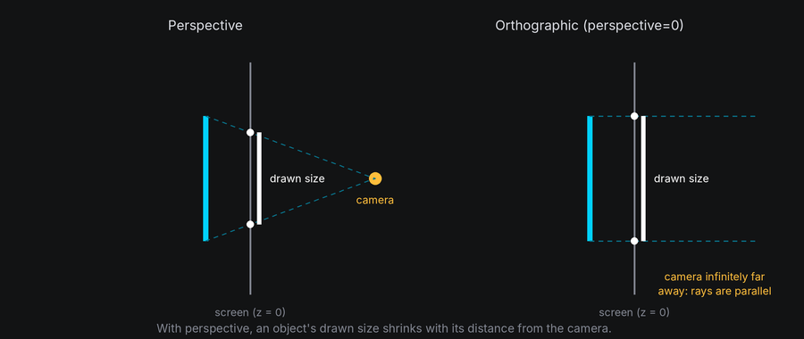
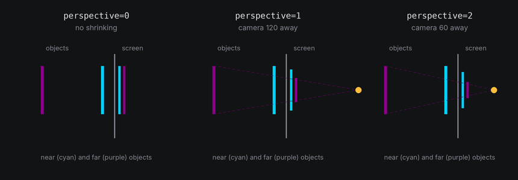
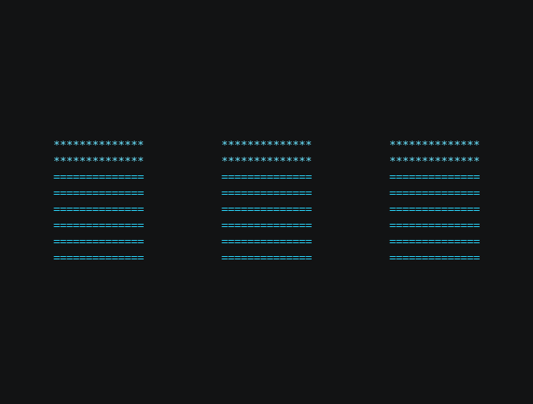
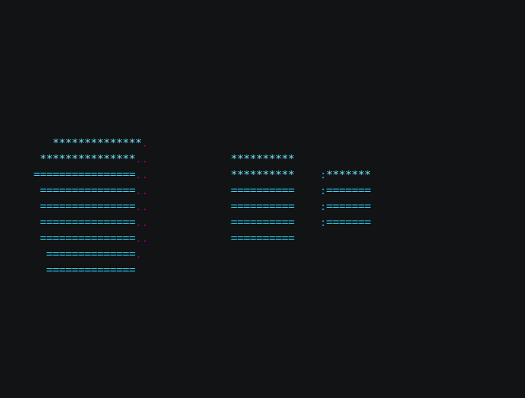
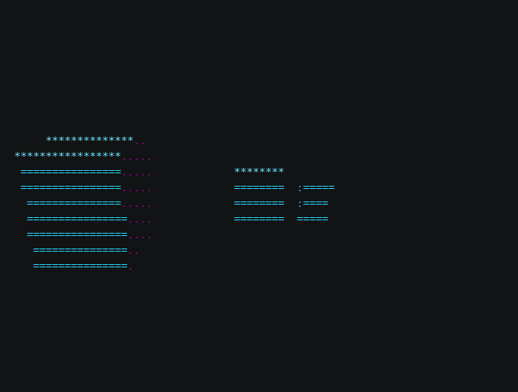
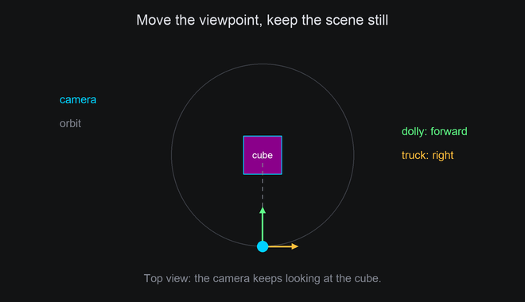
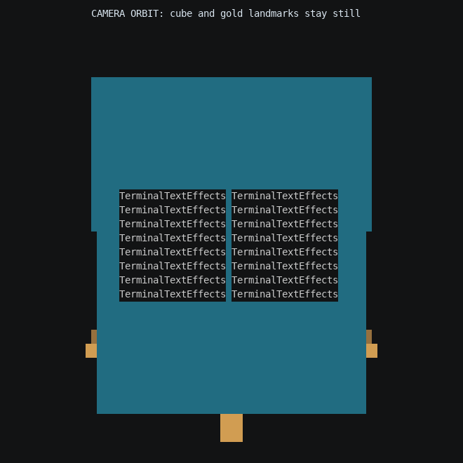
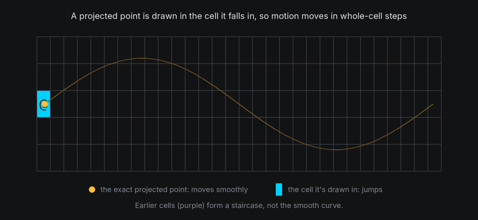

# Camera and Projection

The camera decides how 3D points become cells. Its one setting you'll change most is how strong the perspective is:
how much nearer things grow and farther things shrink.

## The idea

By default, the camera sits on the +z axis, looking back at the origin. To draw a point, it **projects** it: it finds where the
line from the point to the camera crosses the screen.

- With **perspective**, things farther away look smaller, and parallel lines running away from you converge. A point
  at depth `d` from the camera is scaled by `distance / d`, so the z = 0 plane keeps its size, nearer points grow
  and farther ones shrink.
- An **orthographic** view drops the scaling. Everything keeps its size whatever its depth, like a technical drawing.
  It's flat, but it's also stable: nothing swells as it turns toward you.



Perspective strength comes from the camera's distance. A camera close to the scene makes small changes in depth
look large. A distant camera barely changes sizes at all.



## In TTE

The Lens example places three cubes, each 26 columns to the right of and 60 columns farther away than the one
before:

```python
self.space = Space3D(self.terminal, perspective=self.config.perspective)
for x, z in ((-26, 0), (0, -60), (26, -120)):
    cube = self.space.body(Cube(14), at=(x, 0, z)).draw(Shaded())
```

??? example "lens.py"

    Save it in your community effects directory as `lens.py`.

    ```python
    --8<-- "docs/effectguide/examples/3d/lens/lens.py"
    ```

=== "perspective 0"

    ```bash
    tte --input-file concept_input.txt --canvas-width 80 --canvas-height 24 --anchor-text c lens --perspective 0
    ```

    

=== "perspective 1"

    ```bash
    tte --input-file concept_input.txt --canvas-width 80 --canvas-height 24 --anchor-text c lens
    ```

    

=== "perspective 2"

    ```bash
    tte --input-file concept_input.txt --canvas-width 80 --canvas-height 24 --anchor-text c lens --perspective 2
    ```

    

`Space3D(terminal, perspective=...)` sets the strength:

- `1`, the default, is a natural perspective. The camera is 120 columns from the origin.
- Larger values move the camera closer. `2` puts it 60 columns away, which exaggerates depth.
- `0` is orthographic.

## Moving the camera

Bodies can stay still while the camera moves around them. `space.camera` has immediate controls and a tween queue,
like a body. Its local axes are right (+x), up (+y) and backward (+z); it looks along local -z. World axes stay fixed
when the camera turns.



| Operation | Immediate call | Queued call |
| --- | --- | --- |
| World position | `set_position(x, y, z)`, `move_by(x, y, z)` | `move_to(x, y, z, frames=60)` |
| Forward / backward | `dolly(amount)` | `dolly_by(amount, frames=60)` |
| Right / left | `truck(amount)` | `truck(amount, frames=60)` |
| Up / down | `pedestal(amount)` | `pedestal(amount, frames=60)` |
| Yaw, pitch, roll | `pan(degrees)`, `tilt(degrees)`, `roll(degrees)` | The same calls with `frames=60` |
| World orientation | `set_rotation(rotation)` | `turn_to(rotation, frames=60)` |
| Aim at a point or body | `look_at(x, y, z)`, `look_at(body)` | The same calls with `frames=60` |
| Orbit a point or body | `orbit("y", degrees=30, around=body)` | `orbit("y", turns=1, around=body, frames=240)` |
| Focal length | `zoom(factor)` multiplies it | `zoom_to(focal, frames=60)` targets an absolute length |

Positive travel goes forward, right or up; use negative amounts for the reverse. Positive pan turns the view left,
positive tilt looks up, and positive roll rotates the camera counterclockwise about its backward axis. `up="y"`
is the default world-up direction for aiming and orbiting; an `(x, y, z)` direction also works. When looking along
that direction, the previous right axis supplies a stable roll. A target at the eye has no aiming direction and
raises `ValueError`.

A dolly changes position and perspective relationships. Zoom changes focal length without moving the eye;
it does not change sizes in orthographic mode. Moving the camera never changes focal length automatically.

### Queues and targets

Queued moves accept `ease` and `together=True`. All tweens starting together capture the same initial camera pose. `hold`, `on_complete`, `on_group_complete`, `cancel` and `reset`
work like their body counterparts. Callbacks receive the camera. `space.animating` includes camera tweens, and
`space.step()` advances them before body tweens, refreshes mount readings, runs camera callbacks followed by body
callbacks, refreshes again, then draws surfaces. Callbacks can read final mount positions and release text there.

```python
camera = self.space.camera
camera.dolly_by(25, frames=60, ease=easing.in_out_sine)
camera.look_at(cube, frames=60, together=True)
camera.orbit("y", turns=1, around=cube, frames=240)
camera.hold(30).zoom_to(160, frames=60)
```

`look_at` and `orbit` are immediate when `frames` is omitted. Supplying `frames=0` follows queue ordering: it
applies immediately only when no earlier work is queued. Negative frame counts raise `ValueError`.

Travel tweens capture their local direction when they start, so a simultaneous pan does not curve a dolly path.
Body targets are sampled when the action starts, after any preceding camera actions. They are not continuously
tracked. To follow a moving body, call `camera.look_at(body)` each frame after moving it. Orbit aims at its target when it starts and uses a world axis
through that sampled target. A nonzero orbit radius is required.

Tweens apply deltas: immediate nudges and turns survive later tween frames. Without concurrent edits, a move or
turn reaches its target and an orbit keeps its radius and ends aimed at its target. With concurrent edits, the
final pose includes those edits. Zoom deltas multiply, so an immediate `zoom(2)` doubles the rest of a zoom tween.

`cancel()` drops queued work and pending completion callbacks while keeping the current view. `reset()` also
restores all camera settings from space creation, including position, orientation and focal length.

### A stationary cube, seen from a moving camera

The CameraOrbit example mounts text on the front of a cube. The cube stays still while the camera makes one
complete orbit. Its mounted letters disappear behind the cube and return as the camera comes around.

```python
self.space = Space3D(self.terminal)
self.cube = self.space.body(Cube(48)).draw(Shaded())
anchors = [self.cube.anchor(a.point.x, a.point.y, 24, normal="z")
           for a in self.cube.text_plane(characters)]
self.cube.add_chars(characters, anchors, blend_frames=0,
                    hide_when_facing_away=True)
self.space.camera.set_position(0, 20, 170).look_at(self.cube).zoom(1.4)
self.space.camera.orbit("y", turns=1, around=self.cube, frames=360)
```

??? example "cameraorbit.py"

    Save it in your community effects directory as `cameraorbit.py`.

    ```python
    --8<-- "docs/effectguide/examples/3d/cameraorbit/cameraorbit.py"
    ```

```bash
tte --input-file concept_input.txt --canvas-width 80 --canvas-height 32 --anchor-text c cameraorbit
```



### Light and text layouts

`Space3D(..., light_space="world")` keeps the light fixed in the world, which is the default. With
`light_space="camera"`, the configured light direction rotates with the camera. Use `light="front"` for a headlight;
translation does not change a directional light. Mount light readings and shaded surfaces use the same mode.

`text_plane` and other at-rest layouts keep using the camera configuration from space creation, so camera
movement and zoom do not rearrange their anchors. `camera.cell_to_world(coord, z=...)` uses the active view and
intersects its ray with the requested **world-z** plane. It raises `ValueError` if the ray runs along that plane,
where there is no unique intersection. `camera.ray(coord)` returns the active world-space ray directly.

## Under the hood

[`geometry3d.Camera`](../../engine/utils/geometry3d.md) does the projection. `Space3D` makes one centered on the
canvas, and you can read it as `space.camera`:

```python
projected = self.space.camera.project(point)  # None if the point is nearer than camera.near.
if projected is not None:
    cell = projected.coord
    depth = projected.depth  # Distance from the camera. Smaller is nearer.
```

- `distance` sets the initial eye z and the focal length when `focal=None`. Assigning it moves the eye until
  explicit positioning, then only the fallback focal length changes. `focal` controls scaling independently.
- `near` clips points closer than that to the camera: `project` returns `None` when a point's depth is below `near`,
  which covers points behind the camera and points just in front of it. Clipping is per point and per face, not per
  body. Crossing faces and edges keep their visible portions; texture coordinates are interpolated at the clipped
  corners.

  
- `orthographic=True` turns the scaling off.
- `view_direction(point)` is the direction from a point toward the camera, which decides which faces turn toward it.

## At cell resolution

Each projected point is drawn in the cell it falls in, so a point that moves smoothly in 3D moves on screen in
whole-cell steps:



- Strong perspective makes near faces large and far faces tiny. Tiny faces become a few cells of noise, so keep
  perspective at 1 or below for small shapes.
- Perspective magnifies whatever comes toward you, including text on a surface. Letters on the near side of a large
  shape can double up (see [Texture mapping](textures.md)). Gentler perspective, such as 0.5, reduces it.
- Orthographic views are good for text: with no depth magnification, a text plane never swells as it turns toward
  you. A turn can still make it wider or taller on screen, as a long line of text turned about z stands on end.
- Nothing may come nearer than the camera's `near` distance. With `perspective=2` the camera is only 60 columns away,
  so a body moved to z = 60 has its origin right at the camera. What's clipped is each anchor and face that crosses
  `near`, not the body as a whole: an anchor on that body at local z = -5 is 5 columns in front of the camera and
  still projects.

## Coordinates and mutable settings

World **z** increases toward the default viewer. Camera **depth** is distance along the active view axis,
so smaller positive depth is nearer. In the default view it equals `camera.distance - world_z`. `cell_to_world(coord, z=...)` accepts world z; `Projected.depth`
and `Mount.depth` report camera depth. Both are measured in columns.

Camera settings are mutable. Construction checks positive `distance`, `focal` (when set), `near`
and `row_scale`, and requires `near < distance`. Assignments do not revalidate: preserve those
constraints when changing a field. With `focal=None`, focal length follows the current distance.
