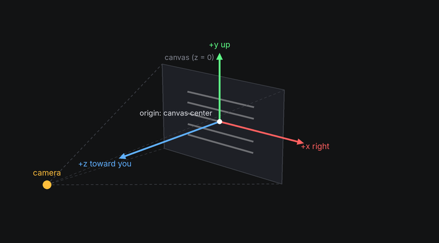
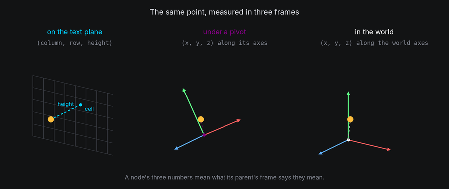
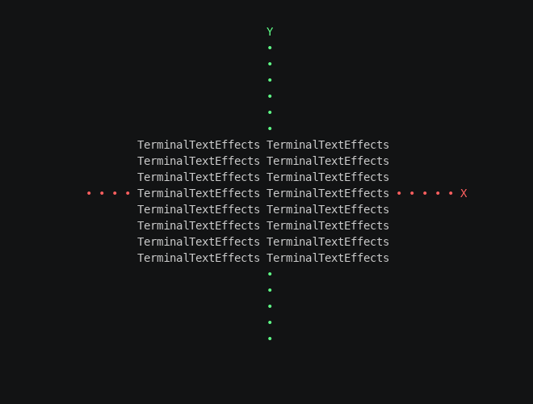

# Frames and Coordinates

Before you can place anything in 3D, you need to know where the axes point, what the units are, and what a node's
three numbers mean. TTE uses one convention everywhere, chosen so that the input text sits exactly where it does in
2D.

## The idea

- The **origin** is the center of the canvas.
- **x** points right, **y** points up and **z** points toward the **default** viewer. These world axes stay fixed when
  the camera turns.
- One **unit** is the width of one terminal column. Positions, sizes and distances are all in columns, including
  heights: a shape 10 units tall is 10 columns tall, which is about 5 rows (see [Tall cells](tall-cells.md)).
- **Angles** are in degrees, and **axes** can be named `"x"`, `"y"`, `"z"` or `"diagonal"`, or given as any
  `(x, y, z)` direction. The one exception is the low-level [`geometry3d`](../../engine/utils/geometry3d.md)
  module, whose `Rotation` takes radians; `rotation_about(axis, degrees)` builds one from degrees.



In the default view, you can think of the canvas as a window in the world z = 0 plane, with the camera on +z looking
straight through it. Negative z is farther away in that view. After the camera moves, distance and facing follow its
view direction instead. [Camera coordinates](camera.md#camera-coordinates-and-depth) distinguishes world axes from the
camera's axes.

## Frames

Every position is a `Vec3`, three numbers, and it is always measured in the node's **parent's frame**. What the three
numbers mean depends on the parent:

| Parent | A child's position is | Units | Example |
| --- | --- | --- | --- |
| A body with a surface: the text plane, the screen or a shaped body | `(column, row, height)`: a cell on the surface, and how far off it | Columns and rows in cells, height in units, outward along the surface | A character at `(12, 5, 0)` on the text plane is in canvas cell (12, 5) |
| A body with no surface: a pivot or `world.root` | `(x, y, z)` along the parent's own axes | Units | A character at `(20, 0, 0)` under a pivot is 20 units along the pivot's x axis |
| Any body, for a child body | `(x, y, z)` along the parent's own axes, even when the parent has a surface | Units | A body at `(0, 0, 10)` under the text plane floats 10 units in front of it |



So a character keeps the same three numbers while its parent moves, turns or scales: it is the parent that carries
it. Moving the character means changing those numbers, with a path or `motion.position`.

### The surface frame

On a surface, the first two numbers are a cell in the surface's grid, and the third is a **height**:

- On the text plane, the grid is the canvas. Column and row are exactly the canvas coordinates a 2D effect uses, so
  `Coord(12, 5)` and `Vec3(12, 5, 0)` name the same place, and anywhere a waypoint takes a `Coord` it means height 0.
- Height lifts a character off the surface, along the surface's outward normal. On the text plane at rest that is
  toward the camera, so a character at height 30 is nearer, and with perspective it drifts away from the center.
- On a shaped body, columns go around the shape and rows go from bottom to top. [Surfaces](surfaces.md) covers the
  grid of every shape.

### The local frame

A body's own axes turn with it. A point `(x, y, z)` in a body's frame is `x` units along the body's x axis, and so on,
scaled by the body's scale. A pivot's children use this frame, and so does every child body, even under a body with a
surface. The world frame is `world.root`'s local frame: the root never moves, so its axes are the world's.

## In TTE

The Axes example draws the three axes as lines of dots and turns them together with the text plane, to an angled view
and back. Each axis is a pivot with dots for children:

```python
body = self.world.body()  # No shape: a pivot, and a frame of reference.
for step in range(-length, length + 3, 2):
    dot = self.terminal.add_character("•", self.terminal.canvas.center)
    dot.attach(body, at=(step * x, step * y, step * z))  # Along the pivot's own axes, in units.
```

??? example "axes.py"

    Save it in your community effects directory as `axes.py`.

    ```python
    --8<-- "docs/effectguide/examples/3d/axes/axes.py"
    ```

```bash
tte --input-file concept_input.txt --canvas-width 80 --canvas-height 24 --anchor-text c axes
```



At rest, the Z axis points straight at you, so all its dots land on the center cell. Once the view turns, you can see
it come out of the screen.

- `world.body()` with no shape is a pivot: a position, orientation and scale to hang nodes from. Its children's
  positions are `(x, y, z)` along its axes.
- `attach(body, at=position)` places a character at that position in the new parent's frame. Without `at`, it keeps
  its place in the world instead (see [Attaching and detaching](attaching.md)).
- The text stays on the text plane. Its characters' positions never change: the plane's pose moves them all.

## Rest and pose

A body's **pose** is its whole transform: position, rotation and scale. **Rest** is only the rotation part: the
orientation a body is created in, with no turn applied. `turn_to_rest()` and `settle()` bring the rotation back to
rest, but leave position and scale alone. `body.reset()` cancels the body's tweens and puts all three back at once.

The text plane's characters are home in their input cells whenever the text plane is at its starting pose (rest, at
the origin, scale 1) and the camera is at its starting view. A character's own height and position on the plane still
apply: one you lifted to height 30 stays lifted.

## Position input forms

Positions and displacements accept a `Vec3` or an `(x, y, z)` three-tuple. On a surface the three numbers are
`(column, row, height)`; everywhere else they are right, up and toward the default viewer in the parent's axes.

```python
from terminaltexteffects.utils.geometry3d import Vec3

source = self.world.body(Cube(10), at=(10, 0, -20))
copy = self.world.body(Cube(10), at=source.position)
copy.position = (15, 0, -20)
character.motion.position = Vec3(12, 5, 10)  # On the text plane: cell (12, 5), lifted 10 units.
self.world.camera.move_to(source.world_position, frames=60)
```

Two-tuples elsewhere have their own meaning: a texture offset is `(column_offset, row_offset)` in text cells, for
example. They are not abbreviated 3D points. Argument docstrings specify their component order and units.

## Under the hood

A node turns its position into a world point through its parent:

```python
point = character.world_position  # parent.to_world(position, surface=True) for a character.
projected = self.world.camera.project(point)
if projected is not None:
    cell = projected.coord  # The cell it is drawn in.
```

`body.to_world(position, surface=...)` reads `position` as `(column, row, height)` on the body's surface when
`surface` is true and the body has one, or as `(x, y, z)` in its axes otherwise, then applies the body's pose and every
ancestor's. `body.from_world(point, surface=...)` runs the other way. On the text plane at rest, the surface frame maps
cell (column, row) to the world point under that cell on the z = 0 plane, so `project` brings it straight back.

`character.view.cell` reports the projected cell after each world step, along with its depth and facing (see
[Animating in 3D](animating.md#what-a-character-sees)).

## At cell resolution

- World y is measured in columns, but the canvas counts rows. A row is about two columns tall, so moving a body up by
  10 moves it up about 5 rows in the default view. On a surface, rows count rows: a surface row is 2 units tall.
- Points snap to the nearest cell. Two characters less than a cell apart land in the same cell, and only the nearer one
  shows.
- The canvas center can fall between two cells when the canvas has an even width or height, so a shape at the origin
  can look half a cell off center.
