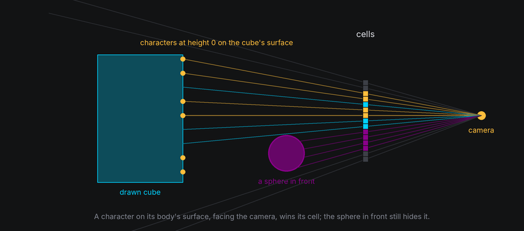

# Depth and Hidden Surfaces

In a 3D scene, nearer things hide farther ones. The world decides, cell by cell, what wins: drawn bodies through a
**depth buffer**, and everything that reaches a cell, drawn cells and characters alike, through one **depth order**.

## The idea

**Depth** is a point's distance along the camera's current viewing axis, not its straight-line range to the eye.
Smaller positive depth is nearer. Moving or turning the camera changes that measurement even when bodies stay still.

A **depth buffer** keeps, for every cell, the nearest surface found there so far. Each face is filled cell by cell, and
a cell only takes the new face if it's nearer than what the cell already holds. Every drawn body fills the same buffer,
so overlaps sort themselves out, even where two shapes pass through each other.


**Back-face culling** skips work before the buffer sees it. Each face of a closed shape has an outward **normal**, an
arrow pointing straight out of it. A face whose normal points away from the camera is on the far side of the shape,
hidden behind the near side, so it can be skipped without testing a single cell.


The buffer's winners become characters the world owns, one per cell. From there, they are ordered exactly like your
own characters: by **layer**, then by **depth**, nearest last. So a character in front of a drawn body hides it, and a
character behind it is hidden, with nothing for your effect to do.

## In TTE

The Depth example passes a sphere through a cube, or shows a cube's far side through its text. Two drawn bodies are all
it takes; the world sorts out which hides which:

```python
cube = self.world.body(Cube(20)).draw(Shaded())
sphere = self.world.body(Sphere(9), at=start).draw(Shaded())
path = sphere.motion.new_path(speed=(end - start).length() / 300, ease=easing.in_out_sine)
path.new_waypoint(end)  # Through the cube and out the far side.
sphere.motion.activate_path(path)
```

??? example "depth.py"

    Save it in your community effects directory as `depth.py`.

    ```python
    --8<-- "docs/effectguide/examples/3d/depth/depth.py"
    ```

=== "Overlap"

    ```bash
    tte --input-file concept_input.txt --canvas-width 80 --canvas-height 24 --anchor-text c depth
    ```

    

=== "See-through"

    ```bash
    tte --input-file concept_input.txt --canvas-width 80 --canvas-height 24 --anchor-text c depth --see-through
    ```

    

- Every drawn body in the world shares one depth buffer, so bodies hide each other correctly with no extra work.
- `Textured(back="dim")` draws a second pass of the faces turned away, in `back_color`, and lets them show through the
  spaces in the text. It's the one place the world draws back faces on purpose.

## Text on a drawn body

A character attached to a drawn body sits exactly on the body's surface, at the same depth as the drawn cell beneath
it. The **decal rule** settles that tie: a character on its body's surface draws over the body's own cell, like a
sticker on a box, when

- it is at height 0 on that body's surface,
- it faces the camera, and
- it is no more than a couple of units behind the drawn cell, which covers the gap between a curved surface and the
  flat facets it is drawn with.

Anything genuinely in front of the character still hides it: another body passing in front, the near edge of its own
body when it has wrapped round the side, or another character. A character lifted off the surface is ordered by its
true depth like anything else.



## Facing away

The Card example turns the text plane once, which shows what happens to text as it turns edge-on and then shows its
back:

```python
card = self.world.text_plane
card.hide_facing_away = self.config.hide_back
card.hold(20).spin("y", turns=1, frames=360, ease=easing.in_out_sine).hold(20)
```

??? example "card.py"

    Save it in your community effects directory as `card.py`.

    ```python
    --8<-- "docs/effectguide/examples/3d/card/card.py"
    ```

=== "Both sides"

    ```bash
    tte --input-file concept_input.txt --canvas-width 80 --canvas-height 24 --anchor-text c card
    ```

    

=== "Front only"

    ```bash
    tte --input-file concept_input.txt --canvas-width 80 --canvas-height 24 --anchor-text c card --hide-back
    ```

    

As the card turns edge-on, its columns crowd into fewer cells and only one character can show in each. Past edge-on you
see the back of the card, so the text reads mirrored. With `body.hide_facing_away = True`, the world hides each
character on the body's surface while its spot faces away from the camera, as a solid card would, and shows it again
once it turns back.

On a drawn body, `hide_facing_away` is rarely needed: the body's own near side hides the characters on its far side.
It matters for undrawn bodies, where nothing else would hide them.

## Behind the camera

A character can't be drawn while it is nearer than `camera.near`, or behind the camera. The world hides it and keeps
its last readings in `character.view`, with `view.projected` false. It shows the character again as soon as it can be
projected, unless the body still hides it for facing away.

Hiding by the view and hiding by your effect are kept apart. A character your effect hid stays hidden when the view
sees it again, and showing a character the view is hiding waits until the view can see it.

### Moving the near plane

In the default view, clipping is easy to picture as a body approaching a fixed camera:


The camera can move instead, with the same rule. The near plane belongs to the active view. It stays `camera.near`
columns **forward from the eye**, perpendicular to the viewing direction. A side-view camera looking along world -x
clips along that direction, rather than along world z. There is no separate rule for each body: projection, clipping,
hiding characters and depth order all follow the same camera.


The Clip lesson uses orthographic projection so the approach does not enlarge the shape. The stationary cube is cut by
the moving plane; its marker A is hidden once it is before the plane. This isolates **near clipping** from **viewport
cropping**, where an otherwise visible projection falls outside the terminal canvas.

```python
--8<-- "docs/effectguide/examples/3d/cameralab/cameralab.py:clip"
```

```bash
tte --input-file concept_input.txt --canvas-width 80 --canvas-height 32 --anchor-text c cameralab --lesson clip
```


## Hidden wireframe lines

By default, `Wireframe` calls an edge front-facing when an adjacent face points toward the camera. This is a fast
approximation for convex solids; concave and custom meshes can have front-facing edges behind another part of the mesh.
Use `Wireframe(depth_test=True, hidden_color=None)` for hidden-line removal against the same mesh's filled depth
buffer. A hidden color instead draws those occluded lines in that color. The low-level `geometry3d.wireframe` accepts
the same `depth_test=True` option. It adds a fill pass within the viewport and tests depth at terminal cell centers, so
cell rounding can affect silhouettes.

## Under the hood

[`geometry3d.rasterize`](../../engine/utils/geometry3d.md) fills a mesh into a buffer and returns it:

```python
from terminaltexteffects.utils import geometry3d as g3

buffer: dict = {}
g3.rasterize(cube_mesh, camera, rotation=turn, buffer=buffer)
g3.rasterize(sphere_mesh, camera, position=g3.Vec3(10, 0, 0), buffer=buffer)
for cell, fragment in buffer.items():
    ...  # fragment.depth, fragment.normal, fragment.facing, fragment.tag, fragment.uv
```

- `cull="back"`, the default, skips faces turned away. `"front"` keeps only those, and `"none"` keeps both.
- Each `Fragment` holds the nearest surface's depth, normal, face tag and texture coordinates.

Where several characters share a cell, drawn or yours, the terminal draws the one that sorts last by three keys, in
order:

1. **Layer**, the character's `layer`. Higher draws on top, whatever the depth. Drawn cells are on layer 0.
2. **Depth order**, a fraction between -0.5 and 0.5 from the character's depth: nearer than the text plane at rest is
   positive, farther is negative. It only decides between characters on the same layer.
3. **Character ID**, which follows creation order. The most recently created character draws on top.

A character on the text plane at rest, or on the screen, has depth order 0. Drawn cells are ordered a hair farther
than their depth, so a character exactly on the surface beats its own body's cell even before the decal rule.

So depth sorts everything on a layer, and layers still stack. Give the characters that should take part in the 3D scene
layer 0, like the drawn cells. Put a character on a higher layer when it must always draw on top, such as a label, or on
a lower one when it must always draw underneath, such as the dots in the Axes example.

## At cell resolution

- Text edge-on loses characters: a plane turned 60 degrees shows only half of its columns. Keep text near facing the
  viewer when it must be read, and move through edge-on quickly.
- Only cell centers are tested, so a part of a shape thinner than a cell, such as a narrow rim seen edge-on, can fall
  between centers and vanish for a frame.
- Two characters in the same cell at almost the same depth, such as two on one surface cell, are ordered by creation.
  On a turning body that can look random. Keep one character per surface cell.
