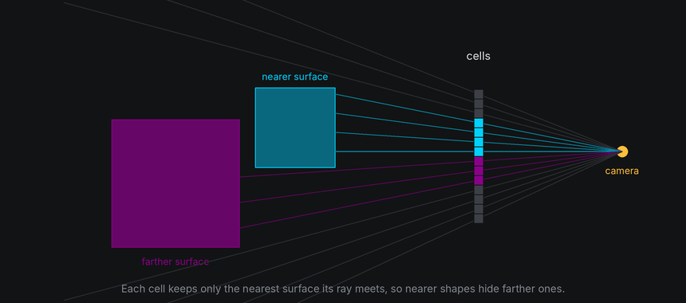
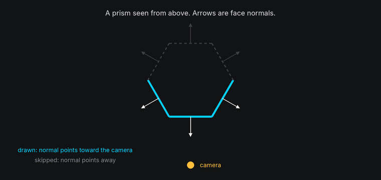
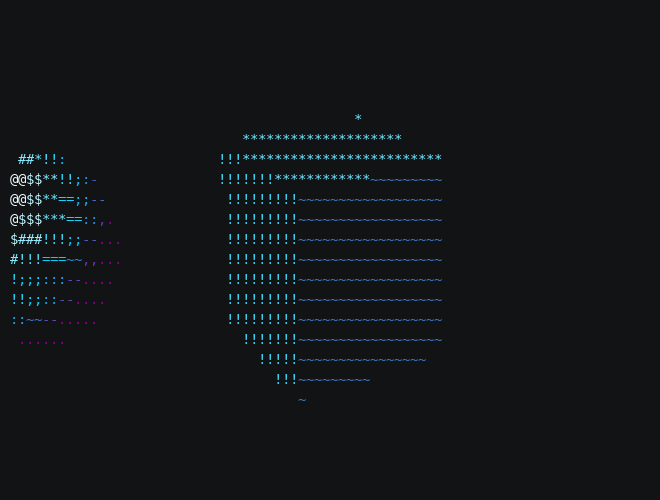
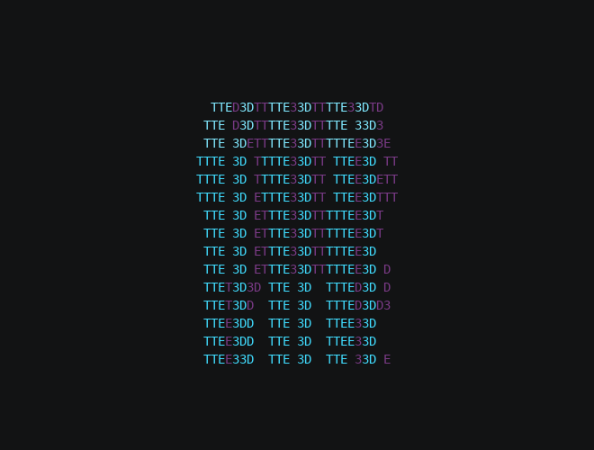
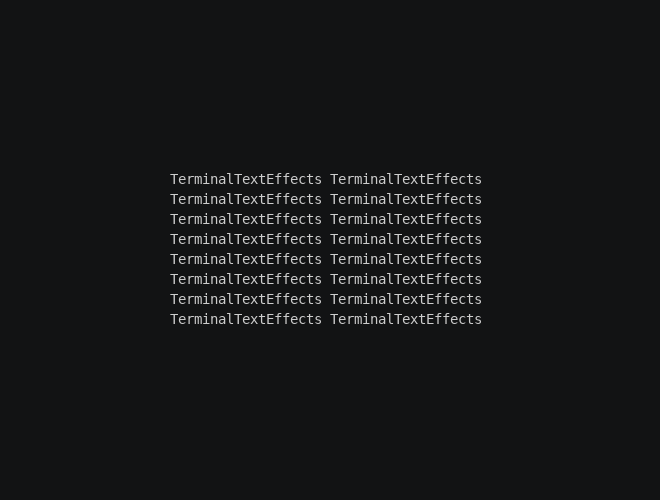
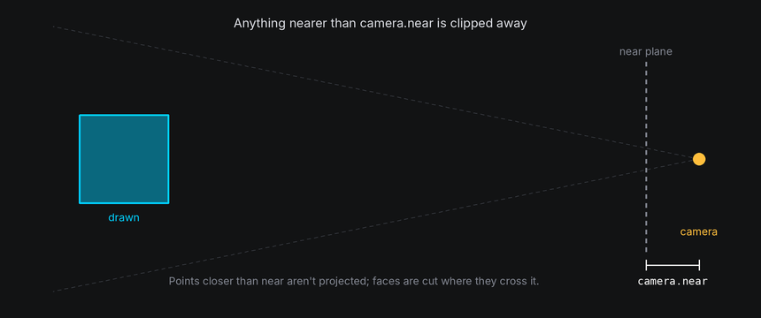
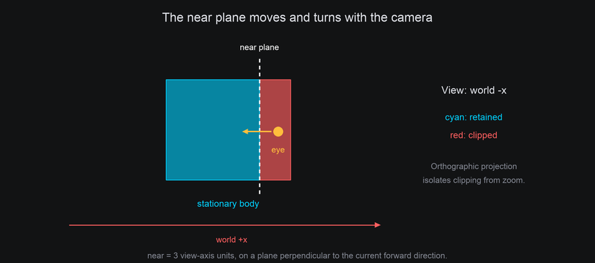
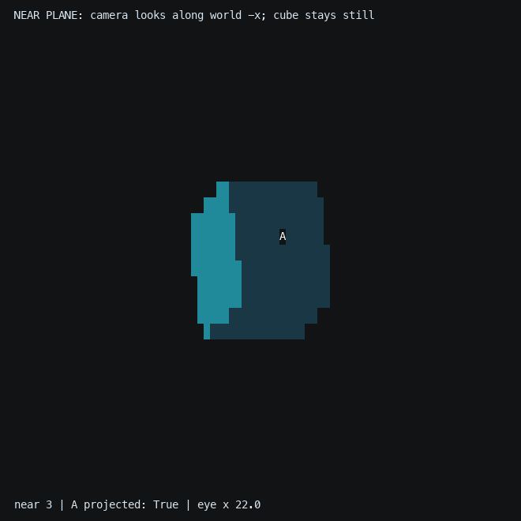

# Depth and Hidden Surfaces

In a 3D scene, nearer things hide farther ones. The space has to decide, cell by cell, which surface wins. It uses two
tools: a **depth buffer** for surfaces, and **layers** for characters.

## The idea

**Depth** is a point's distance along the camera's current viewing axis, not its Euclidean range to the eye.
Smaller positive depth is nearer. Moving or turning the camera changes that measurement even when bodies stay still.

A **depth buffer** keeps, for every cell, the nearest surface found there so far. Each face is filled cell by cell,
and a cell only takes the new face if it's nearer than what the cell already holds. Draw every shape into the same
buffer and overlaps sort themselves out, even where two shapes pass through each other.



**Back-face culling** skips work before the buffer sees it. Each face of a closed shape has an outward **normal**, an
arrow pointing straight out of it. A face whose normal points away from the camera is on the far side of the shape,
hidden behind the near side, so it can be skipped without testing a single cell.



Mounted characters aren't drawn into the buffer. Each one is a single character on one cell, so the space orders them
with **layers** instead: with `layer_by_depth` on, a mount adds a depth-derived offset to the character's own layer,
so among characters that started on the same layer, the nearer one draws on top. The full ordering is under
[Under the hood](#under-the-hood).

## In TTE

The Depth example passes a sphere through a cube, or shows a cube's far side through its text. Two drawn bodies are
all it takes; the space sorts out which hides which:

```python
cube = self.space.body(Cube(20)).draw(Shaded())
sphere = self.space.body(Sphere(9), at=(-34, 0, 6)).draw(Shaded())
sphere.move_to(34, 0, -6, frames=300, ease=easing.in_out_sine)  # Through the cube and out the far side.
```

??? example "depth.py"

    Save it in your community effects directory as `depth.py`.

    ```python
    --8<-- "docs/effectguide/examples/3d/depth/depth.py"
    ```

=== "Overlap"

    ```bash
    tte --input-file concept_input.txt --canvas-width 80 --canvas-height 24 --anchor-text c depth
    ```

    

=== "See-through"

    ```bash
    tte --input-file concept_input.txt --canvas-width 80 --canvas-height 24 --anchor-text c depth --see-through
    ```

    

- Every drawn body in a space shares one depth buffer, so bodies hide each other correctly with no extra work.
- `Textured(back="dim")` draws a second pass of the faces turned away, in `back_color`, and lets them show through the
  spaces in the text. It's the one place the space draws back faces on purpose.

The Card example mounts the input text on a plane and turns it once, which shows what happens to characters as they
turn edge-on. Its one 3D option is how the characters are mounted:

```python
self.card.add_chars(characters, self.card.text_plane(characters), hide_when_facing_away=self.config.hide_back)
```

??? example "card.py"

    Save it in your community effects directory as `card.py`.

    ```python
    --8<-- "docs/effectguide/examples/3d/card/card.py"
    ```

=== "Both sides"

    ```bash
    tte --input-file concept_input.txt --canvas-width 80 --canvas-height 24 --anchor-text c card
    ```

    

=== "Front only"

    ```bash
    tte --input-file concept_input.txt --canvas-width 80 --canvas-height 24 --anchor-text c card --hide-back
    ```

    

As the card turns edge-on, its columns crowd into fewer cells and only one character can show in each. Past edge-on
you see the back of the card, so the text reads mirrored. `hide_when_facing_away=True` hides each character while its
side faces away, as a solid card would. "Its side" is its anchor's [normal](coordinates.md#normals-for-anchors),
which `text_plane` provides; an anchor without a normal always counts as facing you, so it's never hidden.

## Hidden wireframe lines

By default, `Wireframe` calls an edge front-facing when an adjacent face points toward the
camera. This is a fast approximation for convex solids; concave and custom meshes can have
front-facing edges behind another part of the mesh. Use
`Wireframe(depth_test=True, hidden_color=None)` for hidden-line removal against the same mesh's
filled depth buffer. A hidden color instead draws those occluded lines in that color.
The low-level `geometry3d.wireframe` accepts the same `depth_test=True` option. It adds a fill
pass within the viewport and tests depth at terminal cell centers, so cell rounding can affect silhouettes.


## Moving the near plane

In the default view, clipping is easy to picture as a body approaching a fixed camera:



The camera can move instead, with the same rule. The near plane belongs to the active view. It stays `camera.near` columns **forward from the eye**, perpendicular to
the viewing direction. A side-view camera looking along world -x clips along that direction, rather than along world
z. There is no separate rule for each body: projection, face/edge clipping, mount visibility and depth ordering all
follow the same camera.



The Clip lesson deliberately uses orthographic projection so approach does not enlarge the shape. The stationary
cube is cut by the moving plane; its mounted A is hidden once its anchor is before the plane. This isolates **near
clipping** from **viewport cropping**, where an otherwise visible projection falls outside the terminal canvas.

```python
--8<-- "docs/effectguide/examples/3d/cameralab/cameralab.py:clip"
```

```bash
tte --input-file concept_input.txt --canvas-width 80 --canvas-height 32 --anchor-text c cameralab --lesson clip
```



A camera orbit also changes which faces point toward the viewer and which surfaces hide the mounted text. Compare
the [stationary-cube orbit](camera-movement.md#orbit-a-stationary-scene) with the moving-body examples above.
`Mount.facing` and `facing_amount` need a normal; they follow the active view. `Mount.nearness` measures depth relative
to the body's center and extent, so pure camera translation preserves it, while camera rotation can change it.

## Under the hood

[`geometry3d.rasterize`](../../engine/utils/geometry3d.md) fills a mesh into a buffer and returns it:

```python
from terminaltexteffects.utils import geometry3d as g3

buffer: dict = {}
g3.rasterize(cube_mesh, camera, rotation=turn, buffer=buffer)
g3.rasterize(sphere_mesh, camera, position=g3.Vec3(10, 0, 0), buffer=buffer)
for cell, fragment in buffer.items():
    ...  # fragment.depth, fragment.normal, fragment.facing, fragment.tag, fragment.uv
```

- `cull="back"`, the default, skips faces turned away. `"front"` keeps only those, and `"none"` keeps both.
- Each `Fragment` holds the nearest surface's depth, normal, face tag and texture coordinates.

Where several characters share a cell, the terminal draws the one that sorts last by three keys, in order:

1. **Layer**, the character's `layer`. Higher draws on top.
2. **Depth order**, a fraction from -0.5 to 0.5 that only 3D sets. Characters that never set it stay at 0.
3. **Character ID**, which follows creation order. The most recently created character draws on top.

A mount with `layer_by_depth` splits the character's nearness to the camera, `camera.distance - depth`, into a whole
number of columns and the rest. It adds the whole part to the layer the character had when it was mounted, uses the
rest as its depth order, and restores both on release. So between two characters mounted from the **same base
layer**, the nearer one draws on top, however small the difference. A different base layer shifts that comparison by
the difference in layers, in columns of depth. In the default camera view, a character on layer 10 at z = -2 sorts as `(8, 0)` and still draws
over a nearer one on layer 0 at z = 1, which sorts as `(1, 0)`, but it would lose to one more than 10 columns nearer.
Give characters the same base layer when depth should decide. When a character must always draw on top, turn
`layer_by_depth` off for it and give it a layer above every mounted character's range.

Surface cells are ordered the same way from layer 0, a hair farther than their depth, so text mounted on a drawn
body from base layer 0 or above reads on top of the face it sits on.

## At cell resolution

- Text edge-on loses characters: a plane turned 60 degrees shows only half of its columns. Keep text near facing the
  viewer when it must be read, and move through edge-on quickly.
- Where two characters land in the same cell, the higher layer wins. With `layer_by_depth` off, layers stay put and
  depth order stays 0, so among characters on the same layer the last-created one wins, which looks random on a
  turning body.
- Only cell centers are tested, so a part of a shape thinner than a cell, such as a narrow rim seen edge-on, can
  fall between centers and vanish for a frame.

## Mounted anchors at the near plane

`mount.projected` reports whether the anchor can be projected at its current pose. While the
anchor is closer than `camera.near` (including behind the camera), its character is automatically
hidden on its tick. The mount retains its last valid coordinate, depth, facing, and light readings;
check `projected` before using them. It restores visibility when the anchor returns, unless
backface hiding still applies. A character already hidden by the effect stays hidden. Releasing
a mount restores visibility only if the mount hid it.
