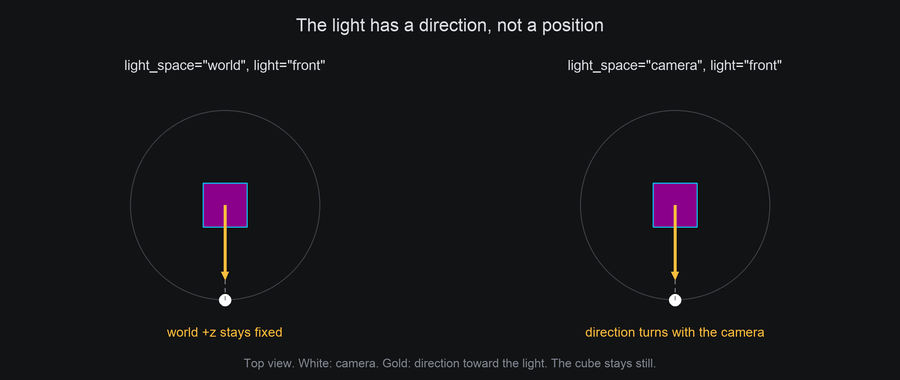
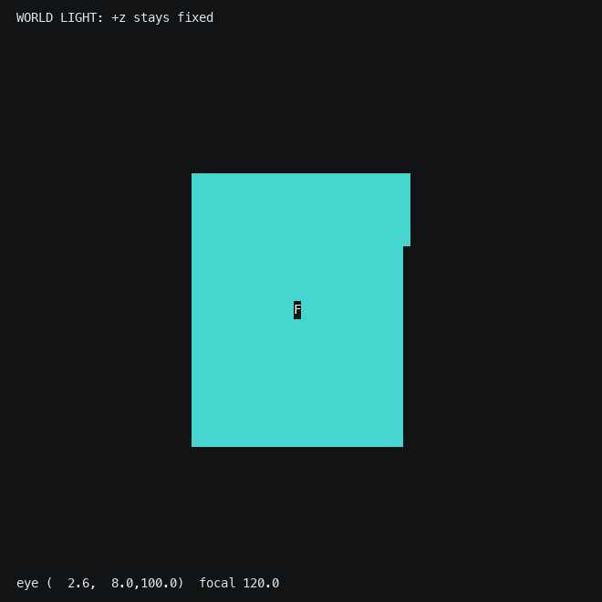
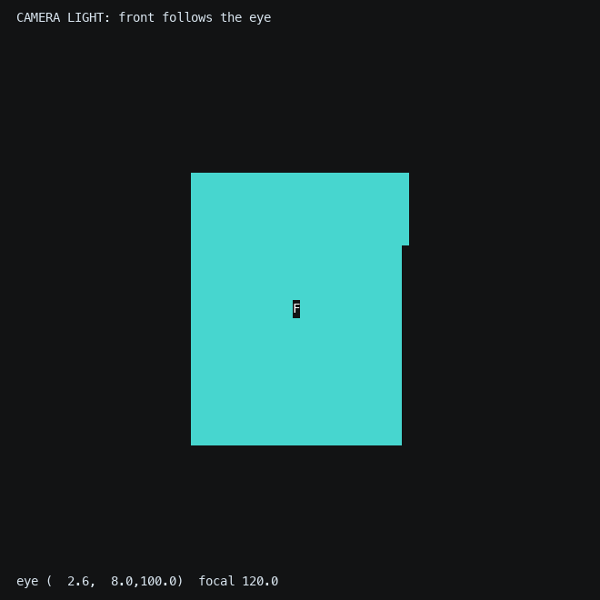

# Light and Shading

Shading is what makes a filled shape look solid. Without it, a cube is a flat blob of one symbol. With it, each face
gets a symbol and color from how directly it faces the light, and the shape's form reads at once.

## The idea

The world has one **directional** light: a single direction pointing toward it, the same everywhere in the scene,
like sunlight. It has no position, so nothing is nearer to it or farther from it. For each face, the world compares
two arrows: the face's normal and that direction.

- Facing the light squarely, the face is fully lit.
- Turned edge-on to the light, it's unlit.
- In between, brightness falls off smoothly with the angle. The measure is called **Lambert** shading: the cosine of
  the angle between the two arrows, from 1 (facing the light) to 0 (edge-on or facing away).

That number picks a symbol from a ramp and a color from a gradient, both ordered from unlit to fully lit. Unlit faces
still get the first symbol and color, so the shape's dark side stays visible.

Because only the angle counts, there's no falloff with distance and no cast shadows: a face turned toward the light
is lit even if another shape stands between them. Each face is shaded on its own.


## In TTE

The Light example moves the light in a circle around a slowly turning shape. A yellow `☼` and a dotted ray mark
the light's direction, and the shape hides them while the light is behind. The light is just a direction, changed
each frame:

```python
angle = 2 * math.pi * self.frame_number / self.frames
self.world.set_light((math.sin(angle), 0.5, math.cos(angle)))
```

??? example "light.py"

    Save it in your community effects directory as `light.py`.

    ```python
    --8<-- "docs/effectguide/examples/3d/light/light.py"
    ```

=== "Sphere"

    ```bash
    tte --input-file concept_input.txt --canvas-width 80 --canvas-height 24 --anchor-text c light
    ```

    

=== "Torus with blocks"

    ```bash
    tte --input-file concept_input.txt --canvas-width 80 --canvas-height 24 --anchor-text c light --shape torus --symbols "░▒▓█"
    ```

    

- `world.set_light(direction)` points the light, now: `"upper left"`, `"upper right"`, `"front"`, `"above"`,
  `"left"`, `"right"`, or any `(x, y, z)` direction toward the light. The default, upper left, gives most shapes a lit
  side, a shadowed side and a top.
- `set_light` can be called on any frame, as the example does. `world.light` reads the direction back, as a unit
  vector. The example's sun is only a marker
  placed along that direction so you can see it. Moving the marker wouldn't move the light, and the light doesn't
  shine from the marker's position.
- `Shaded(gradient, symbols)` fills faces from the ramp. The default symbols `.,-~:;=!*#$@` get denser as they get
  brighter. Block symbols such as `░▒▓█` read as solid and suit large shapes.
- `Solid(symbol, gradient)` uses one symbol and lets color alone show the light. It and `Textured` add a little
  **ambient** light, coloring by `0.15 + 0.85 x lambert`, so their unlit faces aren't the darkest color.
- Gradients default to the TTE brand colors, purple to cyan to white.
- `Solid(background=True)` paints the lit color as each cell's background instead of drawing a symbol, and
  `Textured(background=...)` lights a fill behind its text. See [Text over a solid fill](textures.md#text-over-a-solid-fill).

Characters can follow the light too. `character.view.light` is the Lambert value for the surface under the
character, and a scene created with `sync=Scene.SyncMetric.LIGHT` picks its frame from it. The
[logo recipe](recipes.md#spinning-logo) uses that to brighten text as it turns toward the light. Only a character on a
surface has a normal to compare (see [What a character sees](animating.md#what-a-character-sees)): one on a pivot,
on the screen or free in the world always reports `light=1`.

## World light or camera light?

The light direction can live in either of two coordinate spaces:

| Call | Meaning of `"front"` | When the camera turns |
| --- | --- | --- |
| `set_light("front")`, the default `space="world"` | Fixed world +z | The same world faces remain lit |
| `set_light("front", space="camera")` | Camera-local +z, back toward the eye | The light rotates with the view, like a headlight |



These recordings use the same stationary cube and camera orbit. Only the light's space changes. The light remains
**directional** in both: camera travel does not cause falloff or turn it into a point light at the eye.

=== "World light"

    ```python
    self.world.set_light("front")
    ```

    ```bash
    tte --input-file concept_input.txt --canvas-width 80 --canvas-height 32 --anchor-text c cameralab --lesson world-light
    ```

    

=== "Camera light"

    ```python
    self.world.set_light("front", space="camera")
    ```

    ```bash
    tte --input-file concept_input.txt --canvas-width 80 --canvas-height 32 --anchor-text c cameralab --lesson camera-light
    ```

    

`world.light` stores the direction in the selected space, and `world.light_space` names it. Surface shading and
`character.view.light` use the same mode. Body normals are in world space after the body's pose, so a manual Lambert
calculation needs the light in world space too: `world.world_light` gives it in either mode.

## Under the hood

[`geometry3d.lambert(normal, light)`](../../engine/utils/geometry3d.md) returns the Lambert value. With a face's
normal from the depth buffer, choosing a symbol is one line:

```python
from terminaltexteffects.utils import geometry3d as g3

shade = g3.lambert(fragment.normal, self.world.world_light)
symbol = ramp[min(len(ramp) - 1, int(shade * len(ramp)))]
color = gradient.get_color_at_fraction(shade)
```

Each face is flat, so all of its cells share one normal and one symbol. That's why a sphere shows bands rather than a
smooth fade, and why more segments make the shading smoother.

## At cell resolution

- Pick ramps where each symbol is clearly denser than the last. Ten or twelve steps is plenty, and fewer can look
  bolder.
- Color carries most of the shading in a dark terminal. A gradient from a dark color to a bright one works with
  almost any symbols.
- A camera-relative `"front"` light points back along the current view axis, so visible faces come out bright and
  the shape can look flat. In an orthographic view, facing that light and facing the viewer agree. In perspective,
  off-axis viewing rays differ a little. A light from one side often shows form better. In world mode, `"front"`
  means fixed world +z and is viewer-facing only while the camera has its default orientation.
