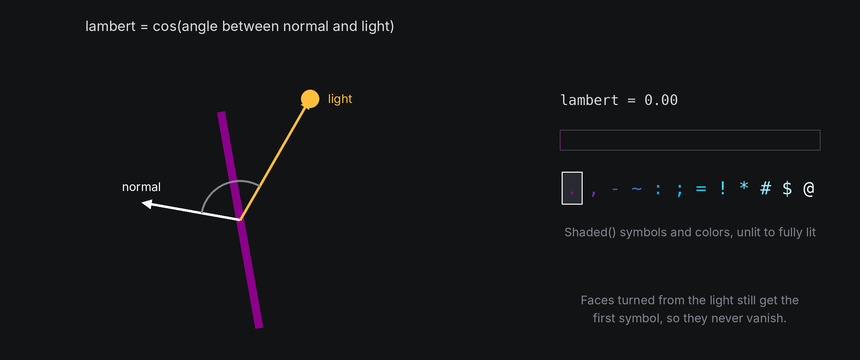
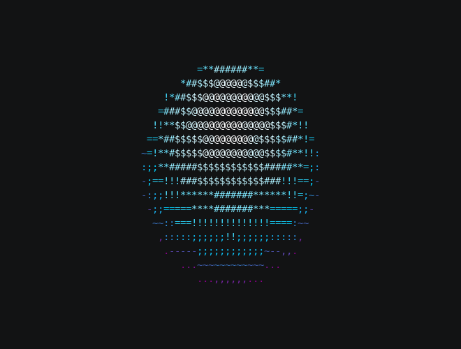
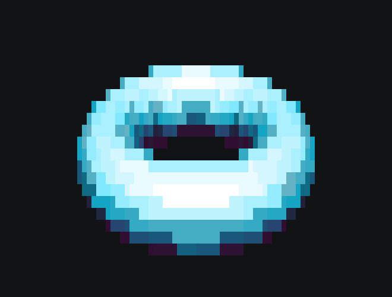

# Light and Shading

Shading is what makes a filled shape look solid. Without it, a cube is a flat blob of one symbol. With it, each face
gets a symbol and color from how directly it faces the light, and the shape's form reads at once.

## The idea

The space has one light, a direction pointing toward it. For each face, it compares two arrows: the face's normal
and the direction to the light.

- Facing the light squarely, the face is fully lit.
- Turned edge-on to the light, it's unlit.
- In between, brightness falls off smoothly with the angle. The measure is called **Lambert** shading: the cosine of
  the angle between the two arrows, from 1 (facing the light) to 0 (edge-on or facing away).

That number picks a symbol from a ramp and a color from a gradient, both ordered from unlit to fully lit. Unlit faces
still get the first symbol and color, so the shape's dark side stays visible.



## In TTE

The Light example moves the light in a circle around a slowly turning shape. A yellow `☼` and a dotted ray mark
where the light is, and the shape hides them while the light is behind. Save it as `light.py`:

```python title="light.py"
--8<-- "docs/effectguide/examples/3d/light/light.py"
```

=== "Sphere"

    ```bash
    tte --input-file concept_input.txt --canvas-width 80 --canvas-height 24 --anchor-text c light
    ```

    

=== "Torus with blocks"

    ```bash
    tte --input-file concept_input.txt --canvas-width 80 --canvas-height 24 --anchor-text c light --shape torus --symbols "░▒▓█"
    ```

    

- `Space3D(terminal, light="upper left")` sets the light at creation: `"upper left"`, `"upper right"`, `"front"`,
  `"above"`, `"left"`, `"right"`, or any `(x, y, z)` direction. The default, upper left, gives most shapes a lit
  side, a shadowed side and a top.
- `space.light` is a unit vector you can change each frame, as the example does.
- `Shaded(gradient, symbols)` fills faces from the ramp. The default symbols `.,-~:;=!*#$@` get denser as they get
  brighter. Block symbols such as `░▒▓█` read as solid and suit large shapes.
- `Solid(symbol, gradient)` uses one symbol and lets color alone show the light. It and `Textured` add a little
  **ambient** light, coloring by `0.15 + 0.85 x lambert`, so their unlit faces aren't the darkest color.
- Gradients default to the TTE brand colors, purple to cyan to white.

Mounted characters can follow the light too. Each mount reports `light`, the Lambert value for its point, and a scene
created with `sync=Scene.SyncMetric.LIGHT` picks its frame from it. The [logo recipe](recipes.md#spinning-logo) uses
that to brighten text as it turns toward the light.

## Under the hood

[`geometry3d.lambert(normal, light)`](../../engine/utils/geometry3d.md) returns the Lambert value. With a face's
normal from the depth buffer, choosing a symbol is one line:

```python
from terminaltexteffects.utils import geometry3d as g3

shade = g3.lambert(fragment.normal, self.space.light)
symbol = ramp[min(len(ramp) - 1, int(shade * len(ramp)))]
color = gradient.get_color_at_fraction(shade)
```

Each face is flat, so all of its cells share one normal and one symbol. That's why a sphere shows bands rather than a
smooth fade, and why more segments make the shading smoother.

## At cell resolution

- Pick ramps where each symbol is clearly denser than the last. Ten or twelve steps is plenty, and fewer can look
  bolder.
- Color carries most of the shading in a dark terminal. A gradient from a dark color to a bright one works with
  almost any symbols.
- A light straight from the front (`"front"`) makes every face that faces you bright and flattens the shape. A light
  from one side shows form best.
