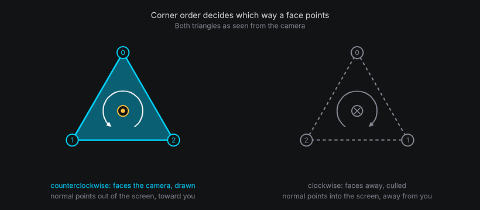
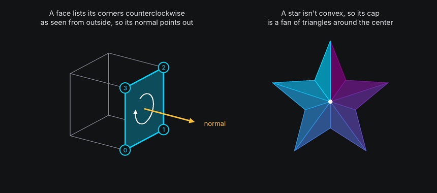
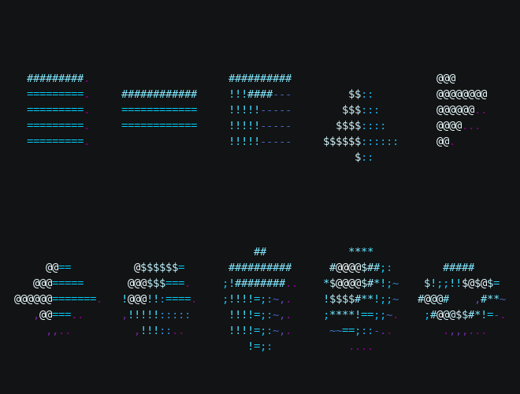
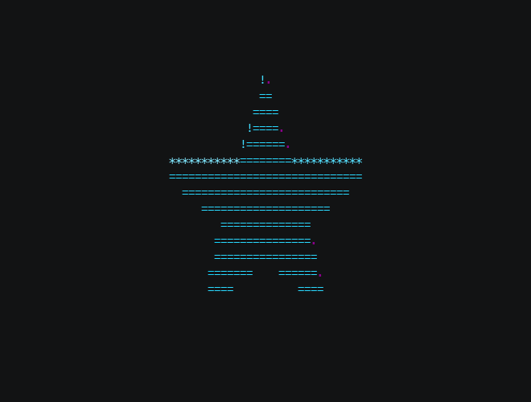
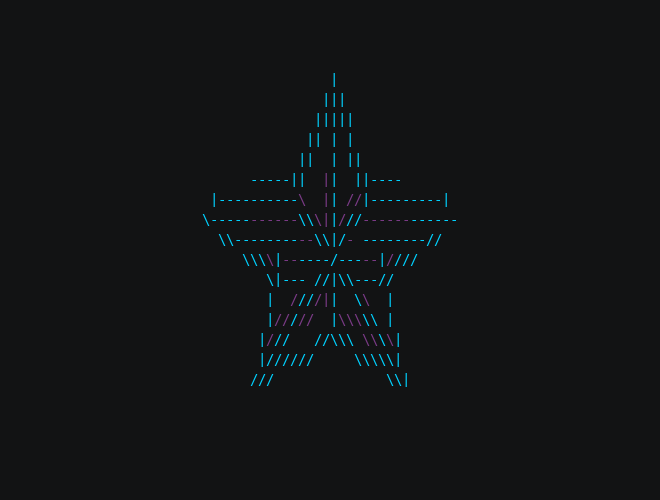

# Meshes

Every shape is a **mesh**: a list of corner points and the flat faces between them. The built-in shapes build their
meshes for you. Knowing what's inside one lets you pick shapes that read well, and build your own when none fits.

## The idea

- **Vertices** are the corner points, in the shape's own coordinates, centered on its origin.
- **Faces** are flat polygons, each listing the vertices at its corners.
- **Edges** are where two faces meet. A wireframe draws them.
- Each face has a **normal**: an arrow pointing straight out of it. Normals decide which faces turn toward the
  camera and how brightly each face is lit.

The order a face lists its corners in sets which way its normal points. Listed **counterclockwise as seen from
outside**, the normal points out of the shape. List them the other way and the face is inside out: it's culled when
it should show, and shows when it should be hidden.



Faces must be **convex**: no corner may point inward. A shape with inward corners, such as a star, splits each such
face into triangles, which are always convex.



Curved shapes are meshes too. A sphere is a band of flat faces, and more `segments` and `rings` make its outline
rounder at a higher cost per frame.

## Shape ownership

A body's `shape` is read-only: its mesh and texture layouts are built from that shape when
`space.body(shape)` is called. Create another body to use a different shape. Anchors belong to
the body that created them and keep their original local coordinates.


## In TTE

The Gallery example shows every built-in shape, a few at a time so each is large enough to read. Save it as `gallery.py`:

```python title="gallery.py"
--8<-- "docs/effectguide/examples/3d/gallery/gallery.py"
```

```bash
tte --input-file concept_input.txt --canvas-width 80 --canvas-height 24 --anchor-text c gallery
```



| Shape | Sizes | Faces tagged |
| --- | --- | --- |
| `Cube(size)`, `Box(width, height, depth)` | Edge lengths | 0 front, 1 right, 2 back, 3 left, 4 top, 5 bottom |
| `Prism(sides, radius, height)` | `radius` is center to corner | Sides 0 to `sides - 1`, then top and bottom |
| `Pyramid(sides, radius, height)` | Base radius and height | Sides 0 to `sides - 1`, then the base |
| `Tetrahedron`, `Octahedron`, `Icosahedron` | `radius` to each corner | |
| `Cylinder(radius, height, segments)` | `segments` around | |
| `Sphere(radius, segments, rings)` | `segments` around, `rings` top to bottom | |
| `Torus(major_radius, minor_radius, segments, sides)` | Ring radius and tube radius | |

Tags let you treat faces differently: `body.draw(Shaded(), faces={0: Textured("1")})` gives the front of a cube its
own look (see the [die recipe](recipes.md#die)).

The Star example builds its own shape. A custom shape subclasses `Shape`, like the built-in ones a frozen dataclass, and returns
a mesh from `build_mesh`. Save it as `star.py`:

```python title="star.py"
--8<-- "docs/effectguide/examples/3d/star/star.py"
```

=== "Shaded"

    ```bash
    tte --input-file concept_input.txt --canvas-width 80 --canvas-height 24 --anchor-text c star
    ```

    

=== "Wireframe"

    ```bash
    tte --input-file concept_input.txt --canvas-width 80 --canvas-height 24 --anchor-text c star --wireframe
    ```

    

`StarPrism.build_mesh` places a ring of corners at each end, alternating between the points and the notches. Each
side is a rectangle between the rings. Each cap is a fan of triangles around a center vertex, because the star's
outline isn't convex.

## Under the hood

[`geometry3d.Mesh`](../../engine/utils/geometry3d.md) holds `vertices` (`Vec3`s) and `faces` (`Face`s). A `Face`
has `indices` into the vertices, optional `uvs` for [texture mapping](textures.md), and a `tag`. The mesh works out
each face's normal from its corner order when it's created, and `edges()` lists each edge once.

The builders, such as `g3.box`, `g3.prism` and `g3.uv_sphere`, return meshes, and `mesh.scaled(x, y, z)` stretches
one. A `Shape` adds what a body needs on top of its mesh: `surface_points` for spreading anchors over it and
`texture_cell` for `Textured` looks.

## At cell resolution

- More faces cost more time but don't always look better. Past the point where each face covers only a few cells,
  extra detail is lost at cell resolution.
- Thin parts, like a torus's tube seen edge-on, can fall between cell centers. Keep every part a few cells thick.
- Flat faces show as flat patches of one symbol. That's what makes a cube read as a cube, and why a low-detail
  sphere looks faceted.

## Dimension contracts

Use positive dimensions for built-in shapes and mesh factories. They intentionally do not check
dimension signs: zero can collapse faces, and negative sizes can reverse winding and normals.
Shading and texture layouts for those sizes are not guaranteed. Body scale is a separate transform
and explicitly rejects non-positive values. Custom mesh faces should be flat, convex, and wound outward.
