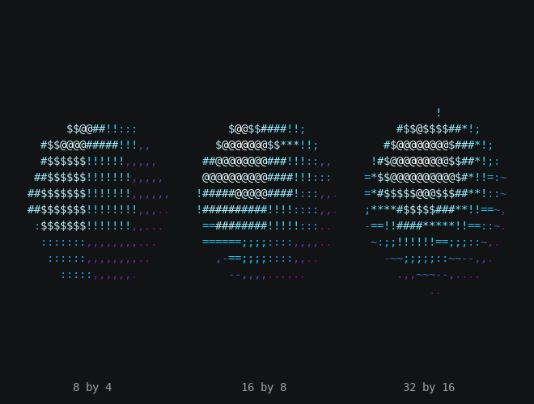
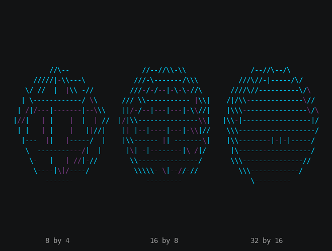

# Performance

A frame has about 16 milliseconds at 60 frames per second (see the Engine chapter on
[Performance](../engine/performance.md)). In a 3D effect, the world's part of `update()` is usually the most
expensive thing in the frame: stepping the world, projecting characters and painting drawn bodies. This chapter shows what it costs and how to keep it inside the budget.

## The idea

The world does two kinds of work, and they grow with different things:

| Work | Grows with |
| --- | --- |
| Drawing bodies | The number of **triangles** in drawn bodies, and the number of **cells** they cover. Each triangle is projected and filled cell by cell into the depth buffer. |
| Placing characters | The number of **characters**. Whenever the camera or any body moves, turns or scales, every character is projected to a cell again. |

Bodies that are neither drawn nor carrying characters cost almost nothing, and on a frame where nothing in the world
moves, placing characters costs nothing. A drawn body that has finished its tweens and hasn't moved is still drawn every frame, because
the world doesn't know whether anything else in the scene changed.

## Camera movement and frame cost

An unchanged default camera uses the default projection path. A moved or turned camera also transforms world points
into its view coordinates. The renderer prepares those coordinates once per vertex for a mesh and reuses them for
near-plane clipping, two-sided fills and depth-tested wireframe work. Characters are projected one at a time.

Camera movement can change the **number of covered cells** far more than the arithmetic cost of that view transform.
A dolly close to a large face or a strong zoom may fill the canvas. Keep wide shots and close shots in the same
benchmark scenario, and compare frame counts and output before making timing claims. The measurements below don't
include the camera lessons.

## Measured costs

These are the guide's own examples on the concept input, on an 80 by 24 canvas with the frame-rate limit off. Each
time is the median of five runs, divided by the frames the example produces. They were measured at revision 5d10d89
with Python 3.14 on an Intel Xeon. Your times will differ with the processor and Python version. Treat them as a rough
guide to which examples cost more, and measure your own effect on the machines you care about.

| Example | What it draws | Time per frame |
| --- | --- | --- |
| [Card](depth.md#facing-away) | The text plane turning | 0.8 ms |
| [Wireframe solids](recipes.md#wireframe-solids) | Four solids as edges | 1.5 ms |
| [Cubes](terminal.md) | Three shaded cubes | 2.0 ms |
| [Depth](depth.md) | A cube and a sphere | 2.5 ms |
| [Depth](depth.md) `--see-through` | One textured cube, its far side shown with `back="dim"` | 2.6 ms |
| [Gallery](meshes.md) | Ten shapes, two or three at a time | 2.8 ms |
| [Light](light.md) | A shaded sphere | 3.3 ms |
| [Spinning logo](recipes.md#spinning-logo) | The text plane turning, with lighting scenes | 3.8 ms |
| [Light](light.md) `--shape torus` | A shaded torus | 4.4 ms |
| [Texture](textures.md) `--text` | A textured cube and a textured sphere | 4.8 ms |
| [Globe](recipes.md#globe) | A textured sphere, 48 by 24, back faces shown | 12.4 ms |

Every example fits in the budget, and the globe costs the most by far. Here's the same sphere drawn different ways,
timing the world's part of a frame alone, on the same revision and machine:

| Sphere, radius 20 | Time per step |
| --- | --- |
| 8 by 4, `Shaded()` | 1.6 ms |
| 16 by 8, `Shaded()` | 2.2 ms |
| 24 by 12, `Shaded()` | 3.3 ms |
| 32 by 16, `Shaded()` | 4.0 ms |
| 48 by 24, `Shaded()` | 6.1 ms |
| 24 by 12, `Textured(back="dim")` | 5.8 ms |
| 48 by 24, `Textured()` | 7.2 ms |
| 48 by 24, `Textured(back="dim")` | 11.6 ms |

The Detail example draws three of those spheres side by side, smaller, so you can see what the extra faces buy:

```bash
tte --input-file concept_input.txt --canvas-width 80 --canvas-height 24 --anchor-text c detail
```



With `--wireframe`, the 32 by 16 sphere's edges crowd into a tangle of cells, so more detail reads worse:



The script that produced these tables is `tools/perf/guide_3d_costs.py` in a TTE checkout. Run it with
`python -m tools.perf.guide_3d_costs` from the repository root to measure your own machine.

Two things stand out:

- **Doubling the segments and rings costs about half as much again**, even though the sphere covers the same cells.
  Four times the triangles, but each one covers fewer cells.
- **Showing back faces nearly doubles it.** `back="dim"` fills the far side too, so the world rasterizes the shape
  twice.

Characters on a turning text plane cost about 3 microseconds each per frame to place. The concept input's 304
characters take about 0.8 ms. A full 200 by 50 screen of text, 10,000 characters, takes about 29 ms, before their own
ticks.

## Geometry preparation

A two-sided `Textured(back="dim")` body transforms and projects its vertices once per frame,
then reuses that geometry for the front and back fills. The fills keep independent depth buffers.
Wireframes reuse edge-to-face adjacency stored on the immutable mesh instead of rebuilding it
every frame. Adjacency is built on first use, so filled meshes pay no topology cost; wireframe
meshes retain topology proportional to their edges.

These optimizations do not cache a rendered scene. Camera, light, gradients and body transforms
are still read each step. Static-scene caching would need to track all of those mutable inputs;
it remains deferred rather than risking stale output.

## In TTE

- **Use as few triangles as read well.** At terminal resolution, a sphere with 24 segments and 12 rings looks as
  round as one with 48 and 24 unless it's very large. Raise the counts only when you see facets.
- **Show back faces only when they add something.** `Textured(back=...)` and `Wireframe(hidden_color=...)` draw the
  far side. Leave them off when the front hides it anyway.
- **Erase what's off screen or finished.** `body.erase()` stops drawing a body, and the world hides its drawn cells
  when it next paints. The world only fills cells on the canvas, so a body out of view costs little, but it is still
  moved and projected every frame until you erase it. Erasing only stops the drawing: queued tweens keep playing and
  attached characters keep riding. Use `body.cancel()` to drop the tweens, or `world.remove(body)` to do all of it:
  detach its children where they are and stop stepping the body.
- **Attach only the characters you need.** Attach the visible text, not the spaces between it, as the guide's
  examples do by skipping blank input cells.
- **Bring finished characters home.** A character on the text plane at rest costs only its own tick, so send
  characters home once their 3D part is over (see [Attaching and detaching](attaching.md#coming-home)).
- **Watch the count of drawn bodies.** All ten gallery shapes at once took about 9 ms a frame. Two or three larger
  ones at a time take under 5 ms and read better. Many small shapes cost more than a few large ones and read worse
  (see [3D in a terminal](terminal.md)).

## Measuring

Time your effect with the frame-rate limit off, as in the Engine chapter:

```bash
time tte --input-file concept_input.txt --canvas-width 80 --canvas-height 24 --anchor-text c --frame-rate 0 globe > /dev/null
```

Divide the time by the number of frames to get the cost per frame. To find where the time goes, run the effect under
Python's profiler, sorted by the time spent inside each function. The table prints after the last frame, at the end
of the file:

```bash
python -m cProfile -s tottime -m terminaltexteffects --input-file concept_input.txt --frame-rate 0 globe > profile.txt
```

In a 3D effect, `rasterize` near the top means surfaces dominate, so cut triangles or back
faces. `project` and `to_world` near the top, without `rasterize`, mean placing characters dominates, so show fewer
characters, or keep the world still once its part is over. In a TTE checkout,
the harness in `tools/perf/` measures and profiles effects too (see [Performance Testing](../../performance.md)).

## At cell resolution

- The terminal shows at most a few thousand cells, so detail past that is wasted work. If two meshes look the same
  on screen, use the smaller one.
- A large shape fills more cells, so it costs more to draw than a small one with the same triangles. That's still
  usually the right trade, since large shapes read better.
- Test on a full-size terminal with `--canvas-width 0 --canvas-height 0`, since attached text and drawn bodies both grow
  with the canvas.
