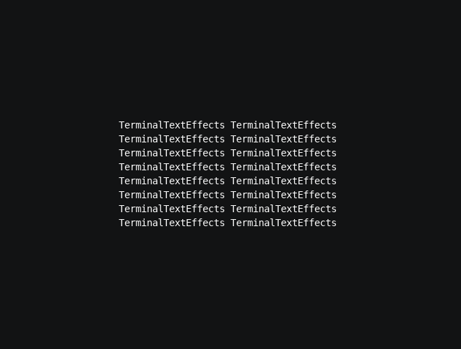
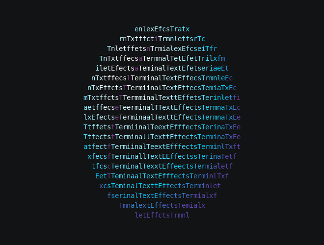
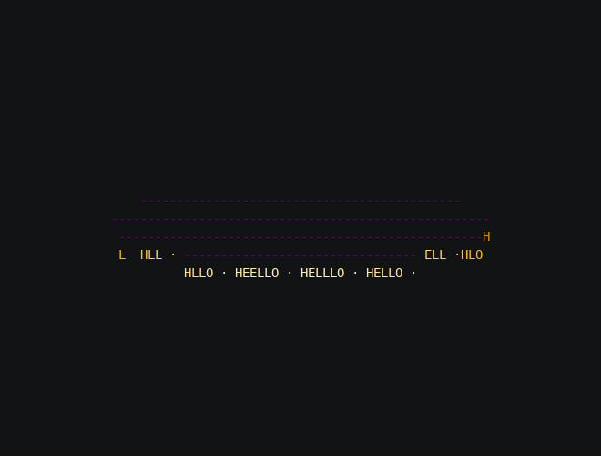
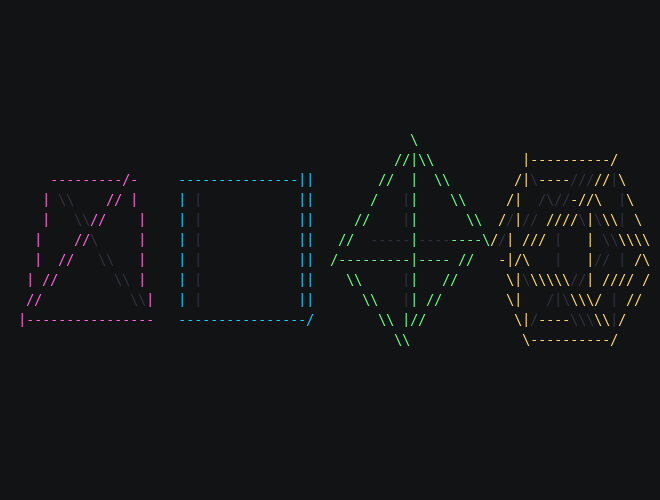

# Recipes

Each recipe is a complete effect that combines ideas from several chapters. They're short enough to read in one
sitting, and each one is a good starting point for an effect of your own. Run them like the concept examples:

```bash
tte --input-file concept_input.txt --canvas-width 80 --canvas-height 24 --anchor-text c logo
```

## A queued camera shot

Keep bodies in world space and give the camera a short script: hold, truck and pan together, then zoom. The
[camera lab](camera-movement.md#run-the-camera-lab) includes a complete standalone iterator with this setup:

```python
--8<-- "docs/effectguide/examples/3d/cameralab/cameralab.py:sequence"
```

The subject's turn uses its own body queue. The camera's individual and group callbacks label the timing without
changing the body's animation. See [Camera shots and timing](animating.md#camera-shots-and-timing) for the recording,
the frame loop and callback definitions. The `restore` lesson then demonstrates a return shot that restores the
camera before releasing mounted text to 2D.

## Spinning logo

The input text spins like a sign on a post, brightening as it faces the light, then settles back into place and
hands the characters back to 2D.

```python title="logo.py"
--8<-- "docs/effectguide/examples/3d/logo/logo.py"
```



- **Mounting**: the characters are yours, mounted on a shapeless body with `text_plane`, so they land exactly on
  their input cells at rest ([Transforms](transforms.md)).
- **Light**: `light="front"` and scenes built with `sync=Scene.SyncMetric.LIGHT` pick each character's frame from how
  squarely it faces the light ([Light and shading](light.md)).
- **Back faces**: `hide_when_facing_away=True` hides the text while its back is to you, so it never reads mirrored
  ([Depth and hidden surfaces](depth.md)).
- **Timing**: `spin` then `settle` with `ease=easing.out_back` gives a fast spin that overshoots and springs back to
  rest. `on_complete(self.finish)` releases the characters and restores their input colors when it lands
  ([Animating in 3D](animating.md)).

To make it your own, change the gradient, the number of turns, or spin about `"x"` for a flip.

## Die

A die rolls in from the left, tumbling, and lands with the five facing you.

```python title="die.py"
--8<-- "docs/effectguide/examples/3d/die/die.py"
```


- **Per-face looks**: `draw(faces=looks)` gives each of the cube's tagged faces its own `Textured` look
  ([Meshes](meshes.md)). Opposite faces add up to seven, as on a real die.
- **Textures as pictures**: each face's text is a solid block of `█` with blank pips cut out. Each pip is two cells
  wide and one tall, which looks round on tall cells ([Tall cells](tall-cells.md), [Texture mapping](textures.md)).
- **Combining tweens**: `move_to` and `spin(..., together=True)` roll it across the screen, then `turn_to` lands it
  on an exact pose ([Rotation](rotation.md)).
- **Starting pose**: `set_rotation(rotation_about("diagonal", 120))` starts it at an angle so no face is square to
  the camera while it rolls.

## Globe

The input text wraps around a sphere that turns once. You see the far side through the gaps in the text.

```python title="globe.py"
--8<-- "docs/effectguide/examples/3d/globe/globe.py"
```



- **Wrapping**: `Textured()` with no text uses the input text, wrapped around the sphere by its UV layout, and
  repeated to fill it ([Texture mapping](textures.md)).
- **See-through**: `back="dim"` draws the far side's text in dim color wherever the near side has a space
  ([Depth and hidden surfaces](depth.md)).
- **Tilt**: `rotate("z", -15)` then `rotate("x", 15)` leans the axis like a desk globe, and
  `spin("y", ..., local=True)` turns the globe about that leaning axis, which stays put
  ([Rotation](rotation.md)).

The globe is the most expensive example in the guide, because a round sphere has many triangles and `back="dim"`
draws it twice. [Performance](performance.md) shows the numbers and what to cut.

## Ticker on a cylinder

A message runs around a short, wide drum, like a news ticker on a building.

```python title="ticker.py"
--8<-- "docs/effectguide/examples/3d/ticker/ticker.py"
```

```bash
tte --input-file concept_input.txt --canvas-width 80 --canvas-height 24 --anchor-text c ticker --message " HELLO ·"
```



- **Shape as a band**: a `Cylinder` only 2 units tall holds one row of text around its side
  ([Tall cells](tall-cells.md), [Texture mapping](textures.md)).
- **Turning about a tilted axis**: the drum is tipped toward you, so turning it with `rotate("y", ...)` would turn it
  about the world's vertical and make it wobble. Instead, it sets its rotation each frame to the tilt times a turn
  about its own axis ([Rotation](rotation.md)).
- **Perspective**: `perspective=0.5` keeps the near side from magnifying the letters too much
  ([Camera and projection](camera.md)).
- **Driving it yourself**: there's no tween. `__next__` counts frames and sets the angle, which is how to make
  motion that never ends or follows your own rules.

## Wireframe solids

Four solids tumble in a row, each in its own color, with hidden edges dimmed.

```python title="wireframes.py"
--8<-- "docs/effectguide/examples/3d/wireframes/wireframes.py"
```



- **Wireframe look**: `Wireframe(color=..., hidden_color=...)` draws edges only, with the edges behind the shape in
  a dark color ([3D in a terminal](terminal.md), [Depth and hidden surfaces](depth.md)).
- **Tumbling**: two spins about different axes, run `together`, at different rates for each solid
  ([Rotation](rotation.md)).
- **Spacing**: each solid sits 20 columns from the next, so their edges never cross on screen. Edges that touch
  blur into one tangle of line symbols.

## Where to go next

- The [`Space3D` reference](../../engine/space3d.md) lists every call used here.
- The [Effect Tutorial](../tutorial/01-scaffold.md) covers configuration, testing and packaging, which apply to 3D
  effects unchanged.
