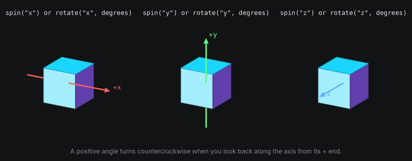
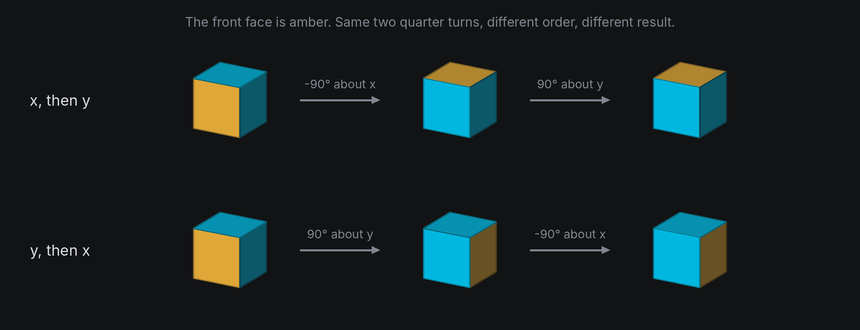
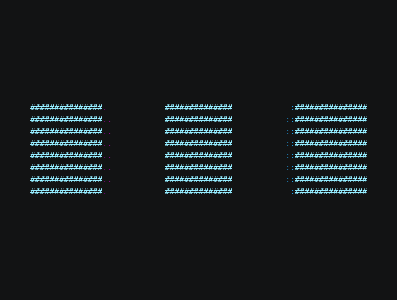
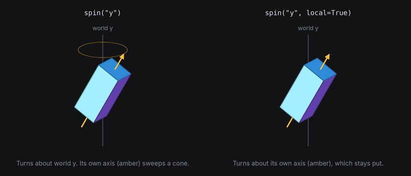
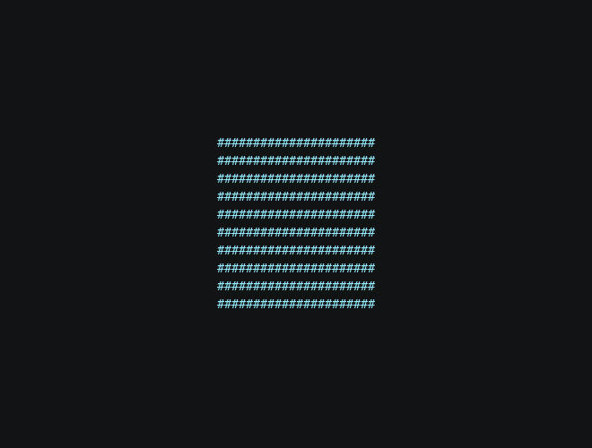
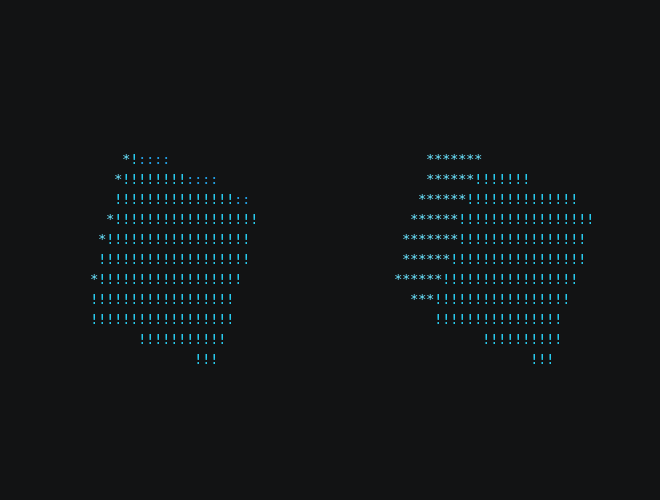

# Rotation

Turning is what makes 3D look like 3D, and it's the part with the most surprises. This chapter covers turning about
one axis, combining turns into a tumble, and the two ways to bring a body back to rest.

## The idea

A turn has an **axis** and an **angle**. The axis is a line through the body's origin. A positive angle turns
counterclockwise when you look down the axis toward the origin:

- About **y** (up), the body turns like a revolving door.
- About **x** (right), it tips forward or back. A positive angle tips the top toward the default viewer, so you see it from above in that view.
- About **z** (toward the default viewer), it turns like a clock hand, counterclockwise.



Turns don't add up like numbers. Turning a cube -90 degrees about x, which carries its front face up onto the top,
and then 90 degrees about y leaves it facing a different way than making the same two turns in the other order.



So TTE never stores an orientation as three angles, which would depend on the order you applied them in. It stores
a **quaternion**: four numbers that describe the whole orientation as one turn about one axis. You never need to read them. What matters is what they make
easy: combining turns, turning by part of a turn, and finding the shortest way from one orientation to another.

## In TTE

The Turns example has three modes. In the first, each cube spins about one axis:

```python
for axis, x in (("x", -26), ("y", 0), ("z", 26)):
    cube = self.space.body(Cube(14), at=(x, 0, 0)).draw(Shaded())
    cube.hold(30).spin(axis, turns=1, frames=240, ease=easing.in_out_sine).hold(30)
```

??? example "turns.py"

    Save it in your community effects directory as `turns.py`.

    ```python
    --8<-- "docs/effectguide/examples/3d/turns/turns.py"
    ```

### One axis at a time

```bash
tte --input-file concept_input.txt --canvas-width 80 --canvas-height 24 --anchor-text c turns
```



`spin(axis, turns, frames, ease)` queues whole or partial turns about an axis. It's a **tween**: the space plays it
one frame at a time in `step()`. `rotate(axis, degrees)` turns the body by that much right away instead, which is
useful when your own code decides the angle each frame.

Both turn about the **world's** axes by default. `rotate("y", 5)` on a body you've already tipped forward
turns it about the screen's vertical. Use `rotate("y", 5, local=True)` or
`spin("y", local=True)` to turn about the body's own tipped axis. The local axis follows the body
when other turns run alongside it.



`settle` still spins about a world axis while returning to rest. `turn_to` and `turn_to_rest`
target an absolute orientation, so they have no local-axis option.

### Tumbling

```bash
tte --input-file concept_input.txt --canvas-width 80 --canvas-height 24 --anchor-text c turns --mode tumble
```



`together=True` runs a tween alongside the one queued before it. Two spins about different axes running together
combine every frame into a tumble.

### Back to rest

```bash
tte --input-file concept_input.txt --canvas-width 80 --canvas-height 24 --anchor-text c turns --mode rest
```



**Rest** is the orientation a body was created in, with no turn applied. It matters because `text_plane` places each
character on its input cell at the pose the body has when you call it. The usual pattern, used by these examples and
the Spin tutorial, is to build the text plane on an unmoved body and only then turn it away, so returning to rest
brings the text home. Rest is only an orientation: if you also moved or scaled the body, bring its position and scale
back too, with `move_to` and `scale_to` (see [Space and coordinates](coordinates.md#rest-and-pose)).

There are two ways back to rest:

- `turn_to_rest(frames, ease)` takes the shortest path. It looks like a body being straightened.
- `settle(axis, turns, frames, ease)` spins about an axis while it unwinds any other tilt, landing exactly at rest.
  It looks like a coin or a sign coming to a stop.

`turn_to(rotation)` turns along the shortest path to any orientation, and `random_pose()` turns to a random one,
drawn from the space's `rng`.

## Under the hood

[`geometry3d.Rotation`](../../engine/utils/geometry3d.md) is the quaternion. Its angles are in radians:

```python
import math

from terminaltexteffects.engine.space3d import rotation_about
from terminaltexteffects.utils.geometry3d import Rotation, Vec3

tip = Rotation.about_x(math.radians(20))
turn = rotation_about("y", 45)  # The same, but in degrees and with axis names.
both = tip * turn  # Turn first, then tip.
halfway = Rotation().slerp(both, 0.5)  # Halfway from rest to `both`, along the shortest path.
point = both.apply(Vec3(10, 0, 0))
```

- `a * b` is the rotation that applies `b` first, then `a`.
- `inverse()` undoes a rotation.
- `slerp(other, t)` blends along the shortest path. `turn_to` and `settle` are built on it.
- `matrix()` gives the 3 by 3 matrix that `apply` and `transform_points` use.

## At cell resolution

- A fast turn skips cells. At more than a few degrees per frame, a large shape's edges jump visibly. Ease spins in and
  out, or slow them down.
- In the default view, turns about world z look flat because they move points parallel to the image. Once the
  camera turns, world z need not be the view axis. A [camera roll](camera-movement.md#turn-the-view-without-moving-the-eye)
  always turns about the camera's own backward axis; it is distinct from turning a body about world z.
- Text turned edge-on loses characters (see [Depth and hidden surfaces](depth.md)), so don't leave a text plane
  turned past about 60 degrees for long.
