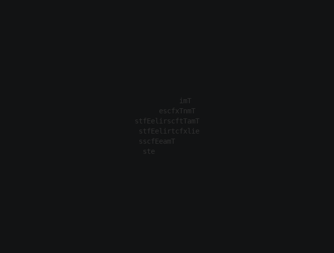
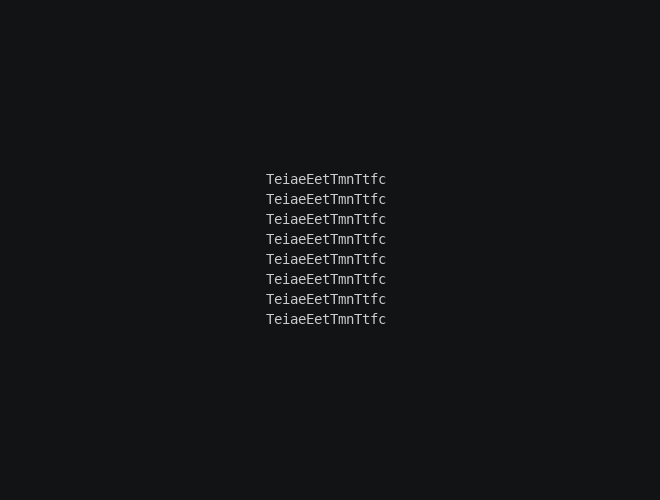

# Spin, step 1: A sheet of text

This tutorial builds a 3D effect from scratch: Spin. The text starts far behind the canvas as a flat sheet, turned at
a random angle. It comes forward while spinning, unwinds its tilt as it goes, and lands exactly on the input text.
Each character brightens as it turns to face you. This is what you'll have at the end:



Your copy is called **MySpin** and runs as `tte myspin`. It uses the same input and canvas as the
[3D Effects](../index.md#running-the-examples) chapters. If you haven't written an effect before, the
[MySpray tutorial](../../tutorial/01-scaffold.md) covers the parts every effect has, which this one skips over.

In this step you mount the text on a sheet, turn the sheet away, and turn it back.

**3D chapters used:** [Space and coordinates](../coordinates.md), [Transforms](../transforms.md),
[Rotation](../rotation.md).

## Create the module

Save this as `myspin.py` in your community effects directory:

```python title="myspin.py"
--8<-- "docs/effectguide/examples/3d/myspin_step1/myspin.py"
```

## How it works

### The space and the sheet

`Space3D(self.terminal, perspective=0)` sets up a camera looking at the canvas. Perspective 0 is a flat view, so
nothing grows or shrinks with distance yet. Step 3 turns it on.

`self.space.body()` makes a body with no shape. A body is a position, a rotation and a scale. It owns no characters
and draws nothing; it only carries the characters you mount on it.

### Mounting the text

`text_plane(characters)` returns one **anchor** per character: a point on the body, placed so that it lands on the
character's input cell at the body's pose right now. The sheet hasn't moved yet, so that's its rest pose. `add_chars`
mounts each character on its anchor. From then on, `space.step()` works out where each anchor is on screen, and each
character's tick in `update()` moves it there.

Mounting doesn't show or tick anything by itself, so `build` also makes each character visible and adds it to
`active_characters`. A mounted character is never finished while its mount is active, so `update()` keeps ticking it
until it's released.

Spaces are left out. They're invisible, so mounting them would only cost time.

### Turning away and back

`set_rotation(rotation_about("y", 70))` turns the sheet 70 degrees about the vertical axis, right away. The order
matters: the anchors were placed first, at rest, so they turn with the sheet, and the text is home again whenever the
sheet is back at rest. Built after the turn, the anchors would put the text on its input cells at 70 degrees instead.
`turn_to_rest(frames=120, ease=easing.out_cubic)` queues a **tween** that turns it back to rest along the shortest
path, slowing as it arrives.

### Handing the text back

`on_complete(self.finish)` calls `finish` when the sheet's last tween ends. `release_all()` gives the characters back,
on their input cells, as ordinary 2D characters. Once they have nothing left to do, `update()` drops them from
`active_characters` and the effect ends.

`__next__` keeps going while `self.space.animating` or `self.active_characters` is true. `animating` only tracks the
sheet's tween queue, so it can't tell whether the characters are done; `active_characters` can. Without the release,
the mounted characters would stay active and the effect would never end.

## Run it

```bash
tte --input-file concept_input.txt --canvas-width 80 --canvas-height 24 --anchor-text c myspin
```



With no perspective, turning the sheet only squeezes the text from the sides. Characters that land on the same
cell hide each other, which is why letters go missing while it's turned.

## Next step

Step 2 replaces the single turn with a spin.
