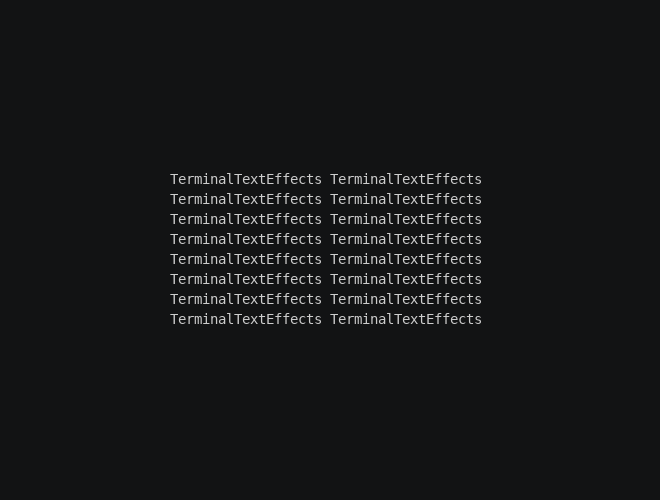

# Spin, step 2: Spinning

In step 1 the sheet turned once, back to rest. In this step it spins twice about the vertical axis and lands facing
you again.

**3D chapters used:** [Rotation](../rotation.md), [Animating in 3D](../animating.md).

## Update the module

Replace `myspin.py` with this version:

```python title="myspin.py"
--8<-- "docs/effectguide/examples/3d/myspin_step2/myspin.py"
```

## What changed

The `set_rotation` and `turn_to_rest` calls are replaced with one call:

```python
self.sheet.spin("y", turns=2, frames=240, ease=easing.in_out_sine)
```

`spin` turns the body about an axis by whole or partial turns, spread over `frames`. Two whole turns end where they
started, so the text lands at rest. `in_out_sine` starts slowly, speeds up and slows down again.

A spin turns about the **world's** axis, not the body's own. That doesn't matter yet, because the sheet isn't tilted.
It will in step 5.

## Run it

```bash
tte --input-file concept_input.txt --canvas-width 80 --canvas-height 24 --anchor-text c myspin
```



Halfway through each turn the sheet faces away, and you read the text mirrored. Step 4 deals with the back side.

## Next step

Step 3 adds perspective, and starts the sheet far behind the canvas.
