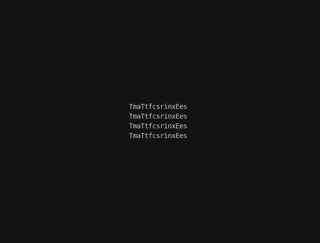

# Spin, step 3: Perspective

The flat view from steps 1 and 2 only squeezes the text as it turns. In this step the camera gets perspective, so
near things look bigger, and the sheet comes from far behind the canvas.

**3D chapters used:** [Camera and projection](../camera.md), [Animating in 3D](../animating.md).

## Update the module

Replace `myspin.py` with this version:

```python title="myspin.py"
--8<-- "docs/effectguide/examples/3d/myspin_step3/myspin.py"
```

## What changed

### Two constants

`START_DISTANCE` and `SPIN_FRAMES` name the numbers the new code shares. Step 6 turns them into options.

### Perspective

`world.camera.set_perspective(1)` gives the camera its default perspective. With perspective, a point's view-axis depth
controls its scale on screen: far points crowd toward the center, and near points spread out. The edge of the sheet that
turns toward you now grows, and the far edge shrinks.

### Starting far away

`self.sheet.position = Vec3(0, 0, -START_DISTANCE)` moves the sheet 200 columns away from the viewer, along z.
It's still centered, so it appears as a small block in the middle of the canvas.

The sheet comes back with a **path**, exactly as a character would travel. A body's path is in its parent's frame,
which for the text plane is the world, so the waypoint is the world origin:

```python
self.sheet.spin("y", turns=2, frames=SPIN_FRAMES, ease=easing.out_cubic)
approach = self.sheet.motion.new_path(speed=START_DISTANCE / SPIN_FRAMES, ease=easing.out_cubic)
approach.new_waypoint(Vec3(0, 0, 0))
self.sheet.motion.activate_path(approach)
```

A path's speed is units per frame, so a speed of `START_DISTANCE / SPIN_FRAMES` takes exactly `SPIN_FRAMES` frames,
and the approach and the spin finish on the same frame. Both also use `out_cubic`, so the sheet arrives fast and slows
as it lands, and the spin and the approach stay in step all the way: halfway through the turn, it's also halfway
home. `world.animating` covers body paths as well as tweens, so the effect runs until both are done.

## Run it

```bash
tte --input-file concept_input.txt --canvas-width 80 --canvas-height 24 --anchor-text c myspin
```



While the sheet is far away, many characters land on the same cells, so the text reads as a jumble until it nears.

This tutorial animates the sheet while keeping the camera at its default pose. For the complementary approach,
leave the sheet in place and try [moving the camera](../camera-movement.md).

## Next step

Step 4 colors each character by how directly it faces the light, and decides what to show when the back faces you.
