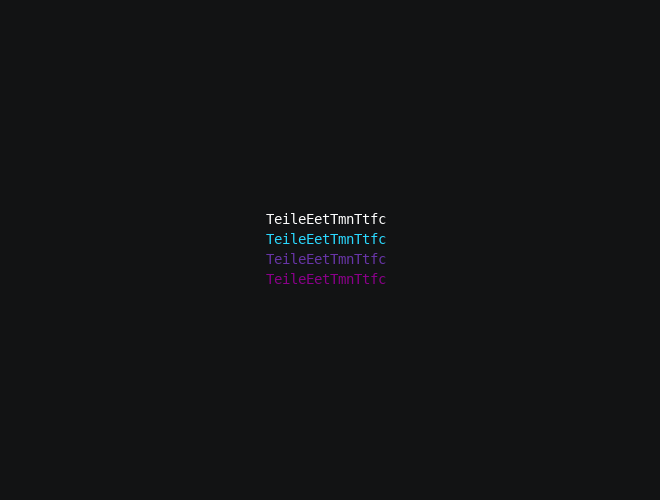

# Spin, step 4: Shading and the back side

Every character has been the same color so far. In this step each one is colored by how squarely it faces you: dark
when edge-on or turned away, its gradient color facing forward. The turning sheet now reads as a lit surface.

**3D chapters used:** [Light and shading](../light.md), [Depth and hidden surfaces](../depth.md).

## Update the module

Replace `myspin.py` with this version:

```python title="myspin.py"
--8<-- "docs/effectguide/examples/3d/myspin_step4/myspin.py"
```

## What changed

### A light in front

`Space3D(..., light="front")` puts the light behind the viewer, shining at the canvas. A surface facing you faces the
light too, so how lit it is and how squarely it faces you are the same thing here.

### Scenes synced to the light

Every mount measures its anchor's light each frame: 1 when its surface faces the light squarely, 0 when edge-on or
facing away. A scene created with `sync=Scene.SyncMetric.LIGHT` picks its frame from that reading instead of playing
in order.

Each character gets a scene with one frame per color of a gradient, from `SHADOW_COLOR` to its final color. Its final
color comes from `FINAL_GRADIENT` mapped over the text from top to bottom, as in most built-in effects.

### The back side

When the sheet faces away, its light reading is 0, so the mirrored text shows in the shadow color. That reads as the
back of the sheet. `HIDE_BACK = True` would pass `hide_when_facing_away=True` to `add_chars` instead, which hides each
character while its back faces you.

### Final colors

`finish` now also stops each scene and sets the character to its final color. Without this, a released character
would keep whichever frame its scene showed last.

## Run it

```bash
tte --input-file concept_input.txt --canvas-width 80 --canvas-height 24 --anchor-text c myspin
```



## Next step

Step 5 starts the sheet at a random tilt and lets it settle.
