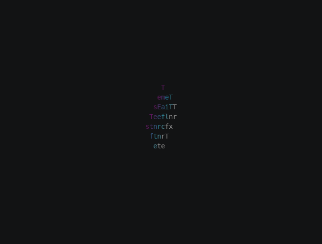

# Spin, step 5: Tumbling in and settling

The sheet has always started upright. In this step it starts at a random orientation and unwinds the tilt while it
spins, so it tumbles in and still lands exactly on the text.

**3D chapters used:** [Rotation](../rotation.md#back-to-rest).

## Update the module

Replace `myspin.py` with this version:

```python title="myspin.py"
--8<-- "docs/effectguide/examples/3d/myspin_step5/myspin.py"
```

## What changed

Two lines replace the `spin` call:

```python
self.sheet.random_pose()
self.sheet.settle("y", turns=2, frames=SPIN_FRAMES, ease=easing.out_cubic)
```

`random_pose()` turns the sheet to a random orientation right away, drawn from the space's random number generator.

`settle` spins about an axis while it unwinds every other part of the rotation, and lands exactly at rest. A plain
`spin` from a tilted pose would keep the tilt: it turns about the world's vertical axis, so the sheet would wobble
around it and finish tilted.

## Run it

```bash
tte --input-file concept_input.txt --canvas-width 80 --canvas-height 24 --anchor-text c myspin
```



The starting pose is random, so each run tumbles in differently.

## Next step

Step 6 turns the constants into options and handles colored input.
