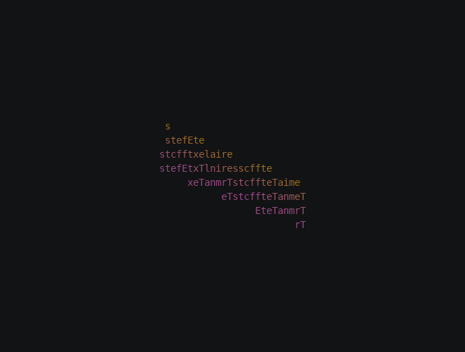

# Spin, step 6: Options

In this step the constants become options, and the effect respects the colors of colored input. The result is the
Spin effect, under your command name.

**Chapters used:** [Configuration](../../engine/configuration.md), [Color](../../engine/color.md).

## Update the module

Replace `myspin.py` with this version:

```python title="myspin.py"
--8<-- "docs/effectguide/examples/3d/myspin_step6/myspin.py"
```

## What changed

### Options

Each constant is now a field of `MySpinConfig`, with an `ArgSpec` that names its command-line option, type, default
and help:

| Option | Default | Replaces |
| --- | --- | --- |
| `--spin-turns` | `2` | The `turns=2` passed to `settle` |
| `--spin-frames` | `240` | `SPIN_FRAMES` |
| `--spin-easing` | `OUT_CUBIC` | `easing.out_cubic` |
| `--start-distance` | `200` | `START_DISTANCE` |
| `--perspective` | `1` | `perspective=1` |
| `--shadow-color` | `303030` | `SHADOW_COLOR` |
| `--hide-back` | off | `HIDE_BACK` |
| `--final-gradient-stops`, `--final-gradient-steps`, `--final-gradient-direction` | `8A008A 00D1FF ffffff`, `12`, `vertical` | `FINAL_GRADIENT` |

The final gradient options use the shared `FinalGradientStopsArg`, `FinalGradientStepsArg` and
`FinalGradientDirectionArg` from `base_config`, so they behave like every built-in effect's.

### Colored input

With `--existing-color-handling dynamic`, each character keeps its input colors. `build` reads them into
`final_colors` instead of the gradient color. A character with an input foreground still shades from the shadow color
to that foreground, over its input background. One with no foreground keeps its input colors in a single frame
throughout. Spaces with an input background are mounted too, since their color shows.

## Run it

```bash
tte --input-file concept_input.txt --canvas-width 80 --canvas-height 24 --anchor-text c myspin --spin-turns 1 \
    --start-distance 60 --hide-back --final-gradient-stops ffb000 ff5fd7
```



With the defaults, MySpin now plays the same as Spin:


## Where to go next

- The [Recipes](../recipes.md) show other effects built on `Space3D`.
- The MySpray tutorial's [Step 7: Harden](../../tutorial/07-harden.md) covers testing an effect, which applies here
  unchanged.
