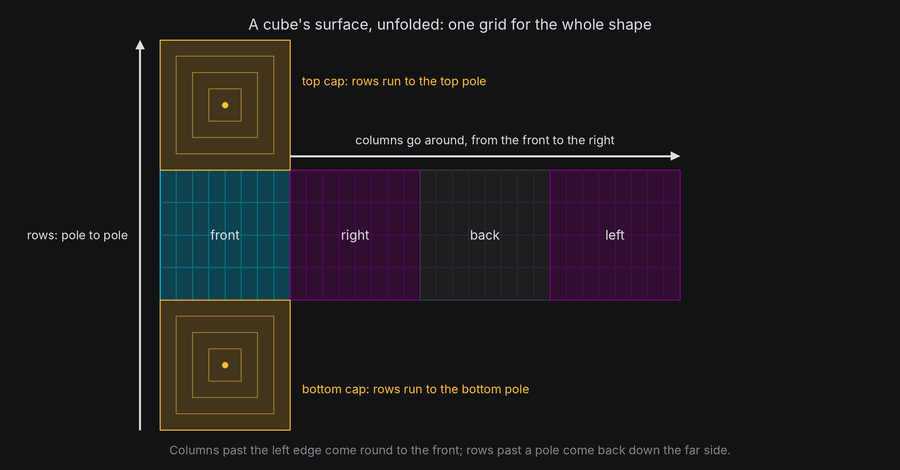
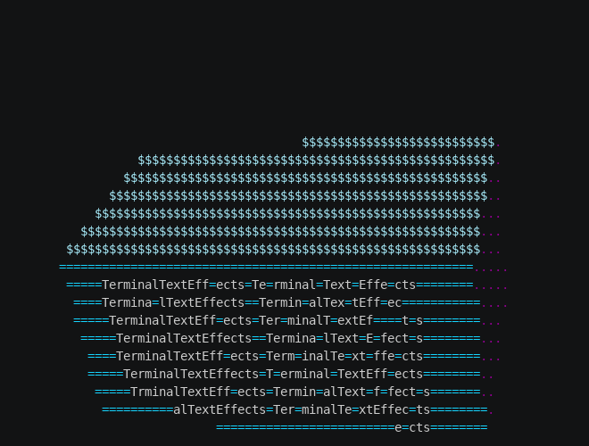
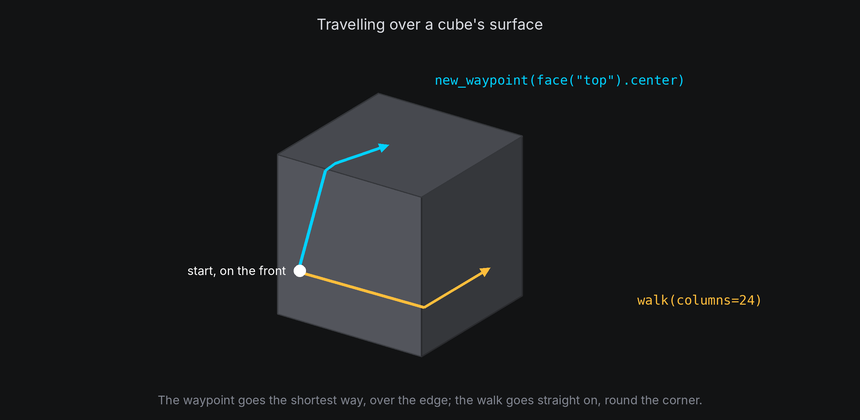

# Surfaces

A shaped body has a **surface**: a grid of cells laid over the shape, like the canvas laid over the text plane.
Characters attached to the body sit on that grid at `(column, row, height)`, and their paths travel over it, round the
sides and over the edges, without your effect ever working out which face a character is on.

## The idea

Every closed shape except the torus uses the same layout, like a map of a globe:

- **Columns** go around the shape, starting at the front and increasing to the right as seen from outside. A column
  is one unit wide, as on the canvas.
- **Rows** go from the bottom pole to the top pole: across the bottom cap from its center out to its edge, up the
  sides, then across the top cap from its edge in to its center. A row is two units tall, as on the canvas, and cells
  squeeze together toward the poles.
- **Height** is in units, outward from the surface. On a sphere that is straight out from the center. On flat faces it
  leans outward toward the edges, the same direction it has across the fold, so a character lifted off one face never
  jumps when it walks onto the next.
- Positions are **normalized**: column 70 on a surface 64 columns around is column 6, and a row past a pole comes back
  down the far side.



| Shape | Grid | Faces |
| --- | --- | --- |
| `Cube`, `Box`, `Prism`, `Cylinder` | Columns around the sides, rows bottom cap to top cap | `"front"`, `"right"`, `"back"`, `"left"`, `"top"`, `"bottom"` for boxes; `0` to `n - 1`, `"top"`, `"bottom"` for prisms; `"side"`, `"top"`, `"bottom"` for cylinders |
| `Pyramid` | Columns around the sides, rows from the base's center to the apex | `0` to `n - 1` for the sides, `"bottom"` |
| `Sphere` | Longitude and latitude | None |
| `Torus` | Columns around the ring, rows around the tube from the outside equator up over the top. Both wrap | None |
| `Plane` | An open grid, like the text plane: cells carry on past its edges | `"front"` |

`Icosahedron`, `Octahedron` and `Tetrahedron` have no surface yet. They can be drawn, and characters can be attached
to them with positions in their axes, as on a pivot.

## In TTE

The Routes example lays the text out on the front of a box, walks it round the side, back again and up onto the lid,
then sends every character the shortest way back to its place on the front. At the end, the text flies home to the
text plane:

```python
self.box.surface.face("front").layout_text(characters)
home = character.motion.position  # (column, row, height) on the box's surface.
around = character.motion.new_path(speed=0.5, ease=easing.in_out_sine, path_id="around")
around.walk(columns=50)
return_path = character.motion.new_path(speed=0.3, ease=easing.in_out_sine, path_id="return")
return_path.new_waypoint(home)
```

??? example "routes.py"

    Save it in your community effects directory as `routes.py`.

    ```python
    --8<-- "docs/effectguide/examples/3d/routes/routes.py"
    ```

```bash
tte --input-file concept_input.txt --canvas-width 80 --canvas-height 24 --anchor-text c routes
```



- `face("front").layout_text(characters)` attaches the characters to the box and lays them out flat on the front face,
  as the input reads, centered.
- `walk(columns=50)` moves 50 columns to the right, straight ahead, over every edge on the way. The box's front is 50
  columns wide, so each character ends up 50 columns along, round the corner on the right side or the back.
- `walk(rows=12)` climbs 12 rows. Past the top of the front face, the characters carry straight on over the edge
  and across the lid.
- `new_waypoint(home)` on a closed surface is reached by the **shortest straight route**: over the lid's edge and down
  the front, the way a string pulled tight across the box would lie.
- All four paths are chained with `PATH_COMPLETE` events. Each `walk` starts from wherever the previous path ended,
  because a route is worked out when its path is activated.

## Faces

Faces let an effect place things without knowing the body's size. `surface.face(name)` returns a flat grid of its own,
seen from outside with text the right way up:

```python
lid = cube.surface.face("top")
lid.width, lid.height  # Columns and rows in the face's grid.
lid.center  # The surface position of its middle cell.
lid.at(1, lid.top)  # Its top-left cell, as a surface position.
lid.random_coord()  # A random cell on it.
```

Cells on a face are numbered from 1, like the canvas: columns from `left` to `right`, rows from `bottom` to `top`. A
face that isn't a rectangle, such as a prism's lid or a pyramid's side, gets the smallest grid that covers it, and
`contains(column, row)` and `row_extent(row)` say which cells are on it.

### Laying out text

| Call | Lays the characters out |
| --- | --- |
| `face.layout_text(characters)` | Flat on the face, as the input reads, centered |
| `surface.layout_text(characters)` | Around the surface, as the input reads, centered on `surface.center`: wrapped around a cylinder or sphere |

Both attach the characters and keep the input's rows and columns: the text is never scaled or reflowed. Text wider or
taller than the face carries on across the surface beyond it with `overflow="extend"`, the default, the way `walk()`
goes. With `overflow="clip"`, the characters that would go past the edge aren't attached; they are returned, so the
effect can hide them or send them elsewhere.

## Travelling over a surface

On a surface, a waypoint and a walk mean different things:

| Call | Goes to | Route |
| --- | --- | --- |
| `path.new_waypoint(position)` | A place: a surface position, a face cell or a target | The shortest straight route there, over any folds between |
| `path.walk(columns, rows)` | An amount, from wherever the path starts | Straight ahead by that much, over every fold and round as many laps as it takes |



- On a box, the shortest route to the lid's center goes over the nearest edge. A walk of 64 columns on a 64-column
  cube goes once around and ends where it started.
- On a cylinder, a walk goes up the side as a helix and straight across a lid as a chord. On a sphere, it heads off
  along the grid and crosses the pole when the rows take it there.
- Where two routes are the same length, the tie goes up, then right, then down, then left.
- Routes are worked out once, when the path is activated, and cached by cell, so a thousand characters taking the same
  trip cost one route.

A plane's grid is open, so on a plane, or on the text plane, a waypoint is simply a straight line.

## Positions and points

```python
surface = cube.surface
position = surface.locate((0, 0, 8))  # The surface position at a point in the cube's own axes.
point, normal = surface.point(position)  # The point in the cube's axes, and the outward normal there.
where = surface.world_point(position)  # Where that position is in the world right now.
spot = surface.target(position)  # A live target that follows it (see Attaching and detaching).
```

`surface.point`, `world_point` and `target` take a column, row and height, or one position such as `face.center`.
`surface.random_coord()` is a random position spread evenly by area, not by cell, so the poles don't get more than
their share. `surface.columns` and `surface.rows` give the grid's size, and `surface.closed` is false only for a plane.

`body.surface` raises `ValueError` for a body without a surface. Check `body.has_surface` first when a body might be a
pivot.

## At cell resolution

- A surface cell is a unit wide and two tall, like a terminal cell, but only when the face is square to the camera. A
  turned face squeezes its cells together, and two characters can land in the same screen cell.
- Near a pole, cells squeeze together on the surface itself. Text reads best on the sides, between the caps.
- Characters on the far side of a drawn body are hidden by its cells. On an undrawn body, they show through unless the
  body has `hide_facing_away` set (see [Depth](depth.md)).
