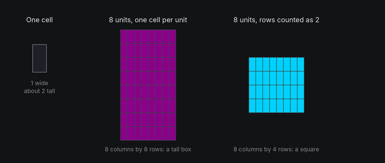
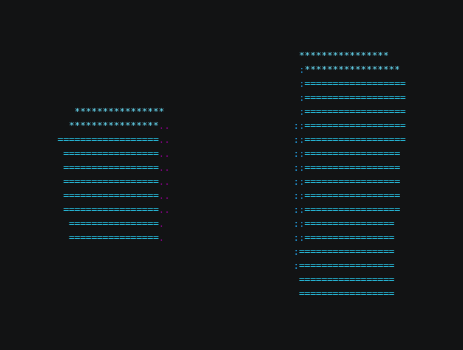

# Tall Cells

Terminal cells are not square. A typical cell is about twice as tall as it is wide, so a shape drawn with one cell per
unit in both directions comes out twice as tall as it should. TTE corrects for this in the camera, so you can work in
plain columns and still get round spheres and square cubes.

## The idea

Measured in pixels, a row is roughly two columns tall. If a 16 unit cube were drawn 16 columns wide and 16 rows tall,
it would look like a tower. To look like a cube on screen, it must be 16 columns wide and about 8 rows tall.



The camera does this by counting each row as `row_scale` units of height, 2 by default
(`geometry.TERMINAL_ROW_SCALE`). Everything above the camera works in columns, as if cells were square. Only the
final step, from world space to canvas rows, divides heights by 2.

## In TTE

The Cells example turns the same cube twice: on the left with the usual camera, and on the right in a second space
whose camera treats rows as one unit tall. The only difference is the second camera's `row_scale`:

```python
corrected = Space3D(self.terminal)
square = Space3D(self.terminal)
square.camera = Camera.for_canvas(self.terminal.canvas, distance=square.camera.distance, row_scale=1.0)
```

??? example "cells.py"

    Save it in your community effects directory as `cells.py`.

    ```python
    --8<-- "docs/effectguide/examples/3d/cells/cells.py"
    ```

```bash
tte --input-file concept_input.txt --canvas-width 80 --canvas-height 24 --anchor-text c cells
```



You never need the right-hand camera in a real effect. It's here to show what the correction does. Notice that it
also changes how the cube turns: the uncorrected cube stretches as its faces turn, because a turn that keeps
distances the same in 3D no longer keeps them the same on screen.

## Under the hood

[`Camera`](../../engine/utils/geometry3d.md) has a `row_scale` field. `project` divides the y offset by it, and
`cell_to_world` multiplies by it, so the two stay exact inverses:

```python
row = center_row + point.y * scale / row_scale
```

Line symbols for wireframes use the same scale. `geometry3d.line_symbol` multiplies the row change by `row_scale`
before measuring an edge's angle, so a 45 degree edge on screen is drawn with `/` and not `|`.

## At cell resolution

- Vertical detail is half as fine as horizontal detail. A sphere 16 columns wide is only 8 rows tall, so its top
  and bottom edges are coarse. Wider shapes hide this best.
- In the default orthographic view, moving a body by 1 unit in y moves it half a row, so slow vertical motion steps
  once every two units. A turned camera or perspective changes screen displacement. Horizontal
  motion steps every unit and looks smoother.
- Turning doesn't favor either axis. Text on a face turning about x and text turning about y both shrink by the
  cosine of the angle, so at 60 degrees each shows half its rows or half its columns. The row correction already
  allowed for tall cells when the text was lifted into 3D.
- Fonts vary, so the real ratio is somewhere around 1.8 to 2.2. TTE uses 2 because it's close for common fonts.
