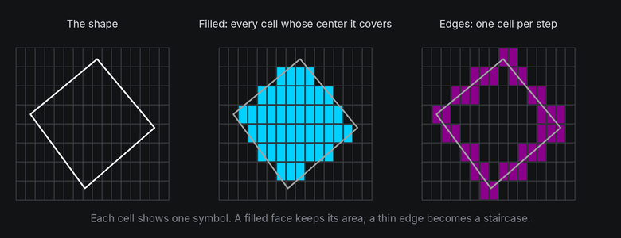
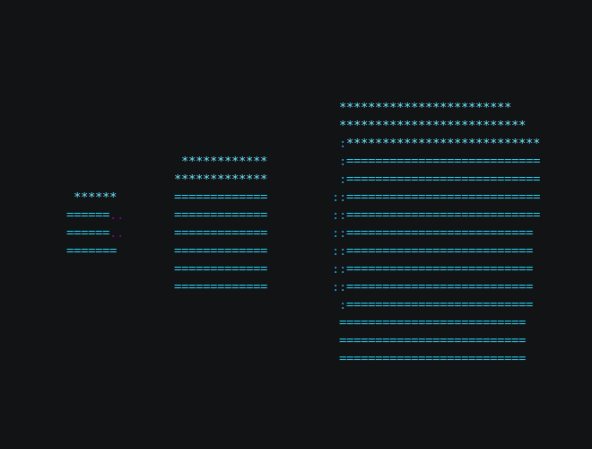
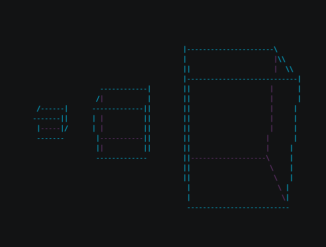

# 3D in a Terminal

A terminal is a very coarse screen. An 80 by 24 terminal has fewer than 2,000 cells, each showing one symbol in one
foreground color. A 3D scene has to read at that resolution, so it helps to know what survives and what doesn't
before you design an effect.

## The idea

Every frame, the space works out which cells each shape covers and draws one symbol in each. Two things decide how
well a shape reads:

- **Area beats outline.** A filled face covers many cells, and its symbol and color say which way it faces. A thin
  edge covers one cell per step, and at a slant it becomes a staircase of `/` and `\`. Filled, shaded shapes read
  as solid at almost any size. Wireframes need room.
- **Size matters more than detail.** A cube 6 columns wide has faces only a few cells across, so its corners and
  edges blur into a blob as it turns. At 12 columns it reads as a cube. At 24 it looks solid and turns smoothly.



A cell is either covered or not. The space tests one point per cell, its center, so a face fills a solid patch of
cells while a line that's thinner than a cell leaves a trail of single cells that steps sideways as it slants.

## In TTE

The Cubes example turns three cubes of different sizes side by side:

```python
for size, x in ((6, -28), (12, -10), (24, 18)):
    cube = self.space.body(Cube(size), at=(x, 0, 0)).draw(look)  # look is Shaded() or Wireframe().
    cube.rotate("x", 20)
    cube.spin("y", turns=1, frames=240, ease=easing.in_out_sine)
```

??? example "cubes.py"

    Save it in your community effects directory as `cubes.py`.

    ```python
    --8<-- "docs/effectguide/examples/3d/cubes/cubes.py"
    ```

=== "Filled"

    ```bash
    tte --input-file concept_input.txt --canvas-width 80 --canvas-height 24 --anchor-text c cubes
    ```

    

=== "Wireframe"

    ```bash
    tte --input-file concept_input.txt --canvas-width 80 --canvas-height 24 --anchor-text c cubes --wireframe
    ```

    

- `space.body(Cube(size), at=(x, 0, 0))` makes a body with a cube shape, `x` columns from the center.
- `.draw(look)` tells the space to fill the cells the body covers. `Shaded()` picks a symbol and color for each face
  from its angle to the light. `Wireframe()` draws only the edges, with hidden edges dimmed.
- `rotate("x", 20)` tips the top toward you so you can see it, and `spin` queues a full turn.

The small cube is a smudge in both looks. The middle one reads as a cube when filled, but its wireframe edges crowd
together. Only the large one works as a wireframe.

## Under the hood

`draw()` asks [`geometry3d.rasterize`](../../engine/utils/geometry3d.md) to fill the shape's faces into a
**depth buffer**, one entry per cell, keeping the nearest surface in each cell. A wireframe uses
`geometry3d.wireframe` instead, which walks each edge cell by cell and picks a line symbol from its slope. The
[Depth and hidden surfaces](depth.md) chapter explains the buffer.

## At cell resolution

- Aim for shapes at least 12 columns across, and 20 or more for wireframes and textured faces.
- Keep a few cells between shapes. Two shapes that touch on screen merge into one blob of symbols.
- Prefer a few large shapes to many small ones. They read better and cost less (see [Performance](performance.md)).
- Text mounted on a shape needs even more room than a surface: a character is one cell, so a 12 column face holds
  12 characters across at most, and fewer as it turns away.
