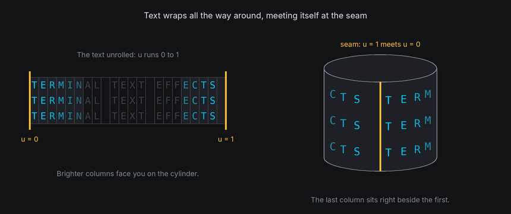
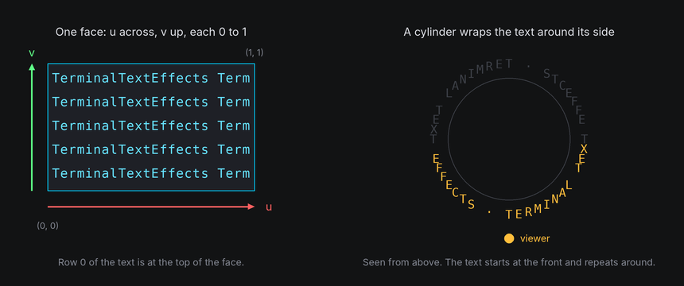
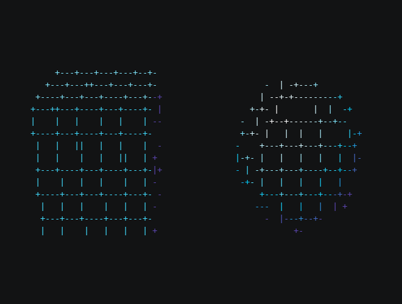
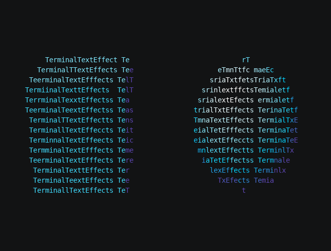
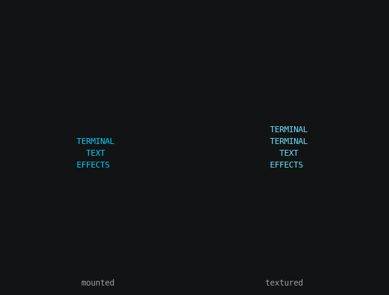

# Texture Mapping

A `Textured` look wraps text over a shape's faces, so the surface itself is made of letters. To do that, every point
on a face needs to know which character of the text belongs there. That lookup is called **texture mapping**.

## The idea

Each face carries **texture coordinates**, usually called **u** and **v**: u runs across the face from 0 to 1, and v
runs up it from 0 to 1. Any point on the face has a (u, v) position, however the face is turned or stretched on
screen.

The shape turns (u, v) into a position in the text: a column and a row. TTE keeps the text at its natural size, about
one character per column across and one per row down, and repeats it when the face is bigger than the text. Wrapped
shapes, such as cylinders and spheres, run u all the way around, so the text continues across the seam.





When a cell is filled, the world finds the (u, v) at the cell's center, looks up the character there, and draws it in
a color from the light. So the text turns, tilts and foreshortens with the surface, while each cell still shows one
upright character.

## In TTE

The Texture example wraps a grid pattern, or the input text, over a cube and a sphere:

```python
look = Textured() if self.config.text else Textured(GRID)  # Textured() wraps the input text.
cube = self.world.body(Cube(22), at=(-20, 0, 0)).draw(look)
sphere = self.world.body(Sphere(13, segments=32, rings=16), at=(20, 0, 0)).draw(look)
```

??? example "texture.py"

    Save it in your community effects directory as `texture.py`.

    ```python
    --8<-- "docs/effectguide/examples/3d/texture/texture.py"
    ```

=== "Grid"

    ```bash
    tte --input-file concept_input.txt --canvas-width 80 --canvas-height 24 --anchor-text c texture
    ```

    

=== "Text"

    ```bash
    tte --input-file concept_input.txt --canvas-width 80 --canvas-height 24 --anchor-text c texture --text
    ```

    

- `Textured()` wraps the effect's input text. `Textured("...")` wraps any string, with lines separated by `\n`.
- A grid shows the mapping clearly: watch the squares compress toward the sphere's edges, where the surface turns away.
- Each face of a `Box` or `Cube` starts the text at its own top left corner. `Prism` and `Pyramid` run the text
  around their sides. `Cylinder` and `Sphere` wrap it all the way around, starting at the front.
- Faces without texture coordinates, such as prism and cylinder caps, are drawn in `back_color`.
- `back="dim"` shows the far side through the spaces in the text (see [Depth](depth.md)).
- Each cell shows one character, so wide characters such as CJK can't be split across cells and are left blank.

### Attached text or textured surface

Text can be part of a 3D scene in two ways. Attaching puts each character on a body, as in
[Attaching and detaching](attaching.md): the character keeps its own symbol and moves as a whole. A `Textured` look draws the
surface out of text: each cell samples the text where it lands. The Surfaces example shows the same words both ways.

??? example "surfaces.py"

    ```python
    --8<-- "docs/effectguide/examples/3d/surfaces/surfaces.py"
    ```

```bash
tte --input-file concept_input.txt --canvas-width 80 --canvas-height 24 --anchor-text c surfaces
```



- Attached characters keep their colors, scenes and symbols, and can fly home to their input cells afterward. Turned
  away, the letters still read upright, in reverse order.
- A textured surface is lit and hides what's behind it, but it can't hand its letters back: they belong to the world.
- Attach text that has to land somewhere. Texture text that decorates a shape.
- `surface.layout_text(characters)` and `Textured(text)` both put text around a cylinder or sphere, but differently.
  `layout_text` attaches each of your characters to one cell of the surface's grid, and the characters ride the
  surface as wholes. `Textured` resamples the text into the drawn cells, so the letters stretch, repeat and shade with
  the surface. See [Laying out text](surfaces.md#laying-out-text).

## Under the hood

A mesh face's `uvs` give a (u, v) for each corner. [`rasterize`](../../engine/utils/geometry3d.md) blends them across
the face, correcting for perspective, and stores the result in each cell's `Fragment.uv`. The shape's
`texture_cell(fragment)` turns that into a fractional (column, row) in the text:

```python
column, row = body.shape.texture_cell(fragment)  # For example (12.4, 3.9): column 12, row 3.
```

A custom shape can override `texture_cell` to lay its text out differently. Return `None` for faces that shouldn't be
textured.

## At cell resolution

- Text is sampled once per cell. Where a surface faces you squarely at its natural size, each character lands in its
  own cell. Where the surface is magnified, by perspective or by scaling up, neighboring cells sample the same
  character, and letters double up. Where it's shrunk or turned away, cells skip characters.
- Doubling is worst on the near side of a large shape. A gentler `perspective` or a smaller shape helps. `back="dim"`
  doesn't: it only shows the far side through the near side's spaces.
- Text needs space to read. A face 20 columns wide holds about 20 characters, and fewer as it turns.
- Bold, dense text such as capitals reads better on a surface than lowercase or punctuation.

## Scrolling, repetition and text size

`Textured(offset=(column, row))` adds an offset in text cells before sampling. Positive columns
scroll left; positive rows scroll up. `repeat=True` wraps the text in both directions.
`repeat=False` clamps samples outside the text to the nearest edge cell. `scale=2` doubles each
character's footprint in both dimensions; scale must be finite and positive. Row density follows
`world.camera.row_scale`, including when it differs from the usual tall-cell ratio.

Looks are immutable. Animate an offset by replacing the look each frame, without turning the body:

```python
from dataclasses import replace
from terminaltexteffects.looks import Textured

look = Textured("A scrolling message")
# In the iterator's __next__, with elapsed_frames advanced by the effect, before update():
body.draw(replace(look, offset=(elapsed_frames / 4, 0)))
```

For custom shapes, `texture_cell` continues to return rows in the default terminal cell ratio;
the renderer converts those rows to the camera's ratio before applying scale and offset.
