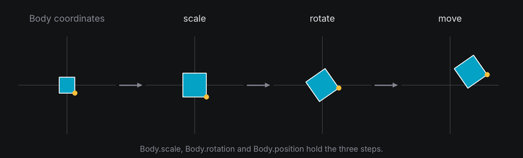
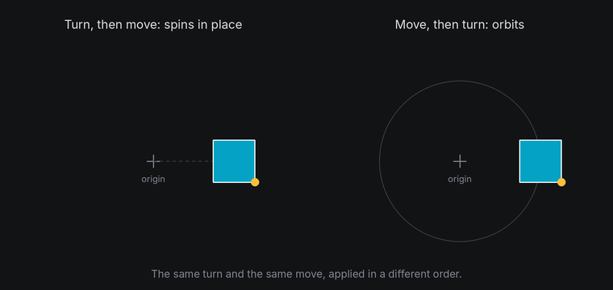
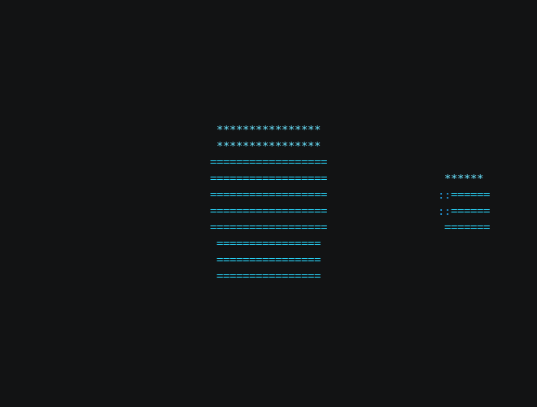

# Transforms

A body's **transform** is where it is, which way it faces and how big it is. Every point of its shape and every
anchor on it is placed by applying that transform. Three operations make it up, and the order you apply them in
changes the result.

## The idea

- **Scale** grows or shrinks the body about its own origin.
- **Rotate** turns it about an axis through its own origin.
- **Move** shifts it to a position in the world.



A body applies them in that order: scale, then rotate, then move. Because the turn happens before the move, the body
always turns about its own center, wherever it is. That's **spinning in place**.

Do it the other way around, moving first and turning second, and the turn swings the body around the world's origin.
That's an **orbit**. A spinning planet and a moon going around it are the same turn applied in different orders.



## In TTE

The Orbit example turns a planet and a moon by the same angle each frame. The planet stays at the origin and only
its orientation changes. The moon's starting position is turned too, so it travels around the planet. Each frame:

```python
turn = rotation_about("y", 360 * self.frame_number / self.config.frames)
self.planet.set_rotation(self.tilt * turn)  # Spin in place.
self.moon.set_rotation(self.tilt * turn)
point = (self.tilt * turn).apply(self.moon_start)  # Orbit: turn the moon's offset yourself...
self.moon.set_position(point.x, point.y, point.z)  # ...then move the moon there.
```

??? example "orbit.py"

    Save it in your community effects directory as `orbit.py`.

    ```python
    --8<-- "docs/effectguide/examples/3d/orbit/orbit.py"
    ```

```bash
tte --input-file concept_input.txt --canvas-width 80 --canvas-height 24 --anchor-text c orbit
```



`Body` has a method for each operation. Some change the transform relative to where it is now, and some set it
outright:

| Change by | Set to | Effect |
| --- | --- | --- |
| `rotate(axis, degrees)` | `set_rotation(rotation)` | Turn about the body's own origin. |
| `move_by(x, y, z)` | `set_position(x, y, z)` | Move the body's origin. |
| `scale_by(factor)` | `set_scale(scale)` | Grow or shrink about the origin. |

`reset()` puts all three back to how the body was created and clears its queued tweens. `rotation`, `position` and `scale` read the current
values. Each method returns the body, so calls chain: `cube.set_position(10, 0, 0).rotate("y", 45)`.

The order you call these methods in doesn't change that pipeline. A body always scales, then turns about its own
origin, then moves, so `move_by(30, 0, 0)` followed by `rotate("y", 45)` still spins the body in place at x = 30;
it doesn't swing it around the world's origin. To orbit with these methods, compute the moon's position yourself by
turning its starting offset, as the example does, then `set_position` there.

The [camera orbit](camera-movement.md#orbit-a-stationary-scene) is a different operation: it leaves these body
transforms fixed and moves the viewpoint around the scene.

## Under the hood

[`geometry3d.transform_points`](../../engine/utils/geometry3d.md) applies a transform to many points at once:

```python
from terminaltexteffects.utils.geometry3d import Rotation, Vec3, transform_points

world = transform_points(points, Rotation.about_y(angle), scale=2.0, position=Vec3(10, 0, 0))
```

It scales each point, rotates it with the rotation's matrix and adds the position. `Body.world_point(local)` does the
same for one point with the body's own transform.

## At cell resolution

- Moving a body by less than a cell often changes nothing on screen. Slow drifts look stepped, so ease them or
  combine them with a turn.
- Scaling changes how many cells a shape covers. A shape scaled below about 6 columns stops reading as a shape at
  all (see [3D in a terminal](terminal.md)).
- Anchors scale with the body, but characters don't. A text plane scaled to half size crowds two characters into
  each cell, and only one of them can show.
