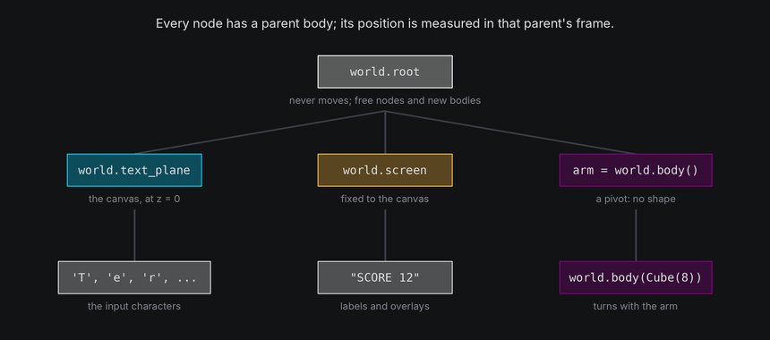
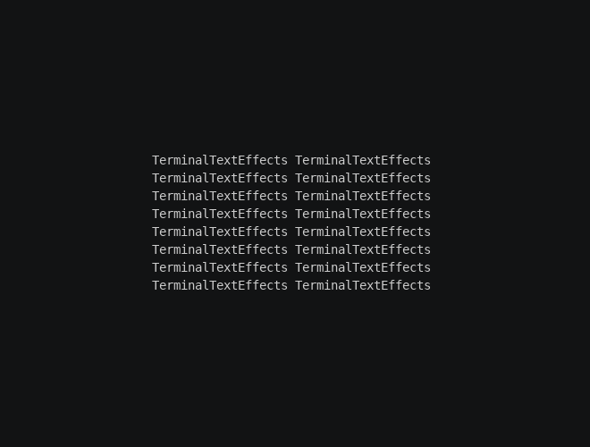

# The World

Every terminal has a world, `terminal.world`, and everything an effect shows lives in it. Characters and bodies are
both **nodes** in one tree: each has a parent, a position measured against that parent, and moves, turns and scales
along with it. This chapter introduces the tree and the three bodies every world starts with.

## The idea

- A **node** is anything with a place in the world. Characters and bodies are both nodes (`SpatialNode`).
- A **body** is a node that other nodes can belong to. It has a position, a rotation and a scale, and optionally a
  **shape**, which gives it a surface to sit on and a mesh to draw.
- Every node has a **parent** body. A node's `position` is measured in its parent's frame, so when the parent moves,
  turns or scales, its children go with it. [Frames and coordinates](coordinates.md) covers what the numbers mean.
- A character is always a leaf: it can belong to a body, but nothing can belong to it.

Three bodies come with every world:

| Body | What it is | Who belongs to it |
| --- | --- | --- |
| `world.root` | A shapeless body at the world origin that never moves. | Free nodes. `node.detach()` makes a node its child, and new bodies belong to it by default. |
| `world.text_plane` | A flat body at z = 0, the size of the canvas, facing the camera. Its surface positions are canvas coordinates. | Every input character, at first. |
| `world.screen` | A flat body fixed to the canvas, for labels and overlays. | Characters that must stay on their cells whatever the camera does. |



A 2D effect only ever uses the text plane, and never notices: with the text plane and the camera as the world made
them, a character on it is drawn in exactly the cell its position names.

## In TTE

The Nodes example tips the text plane back into a floor and swings a cube over it on an invisible arm. The arm is a
shapeless body, and the cube is the arm's child, so turning the arm carries the cube round:

```python
floor = self.world.text_plane
floor.turn_to(rotation_about("x", -70), frames=60, ease=easing.in_out_sine)

self.arm = self.world.body(at=(0, 6, 0))
self.cube = self.world.body(Cube(8), at=(26, 0, 0), parent=self.arm).draw(Shaded())
self.arm.spin("y", turns=1, frames=240, ease=easing.in_out_sine)
```

??? example "nodes.py"

    Save it in your community effects directory as `nodes.py`.

    ```python
    --8<-- "docs/effectguide/examples/3d/nodes/nodes.py"
    ```

```bash
tte --input-file concept_input.txt --canvas-width 80 --canvas-height 24 --anchor-text c nodes
```



- The text plane is an ordinary body. Its tweens are the same ones any body has, and every character on it goes along.
  None of the characters is active: the world places each one every frame, whether it ticks or not.
- `world.body(shape, at=, parent=)` makes a body. With no shape, it is a **pivot**: a position, rotation and scale for
  other nodes to hang from. With a shape, it can also be drawn and carry characters on its surface.
- `at` is measured in the parent's frame. The cube sits 26 units along the arm's x axis, wherever the arm happens to
  point.
- The cube spins on its own while the arm turns it round. A child's pose adds to its parent's: rotations, positions
  and scales all compose down the tree.
- At the end, `world.remove(body)` takes each body out. `world.bodies` lists the bodies made with `world.body()` that
  are still in the world.

## Bodies

A body's pose is three properties, each measured in its parent's frame:

| Property | Set it now | Animate it |
| --- | --- | --- |
| `position` | `body.position = (x, y, z)` | A path: `body.motion.new_path(...)`, the same `Motion` characters use |
| `rotation` | `body.rotation = rotation_about("y", 30)`, or `body.rotate("y", 30)` to add a turn | `spin`, `settle`, `turn_to`, `turn_to_rest`, `random_pose` |
| `scale` | `body.scale = 2.0` | `scale_to` |

[Transforms](transforms.md) explains how the three combine, and [Animating in 3D](animating.md) covers the tweens.
Bodies move along paths for the same reason characters do: a path can have easing, bezier curves, holds, events and
live targets, so anything you know about moving a character works for a body.

```python
pivot = self.world.body(at=(0, 0, -20))
trip = pivot.motion.new_path(speed=0.5, ease=easing.in_out_sine)
trip.new_waypoint(Vec3(30, 0, -20))  # In the pivot's parent's frame: here, the world's.
pivot.motion.activate_path(trip)
```

Body paths play inside `update()` along with the tweens, and `world.animating` stays true until they finish.

### Parents and children

- `parent=` on `world.body()` sets a body's parent when it is made. Later, `body.attach(other)` moves it under another
  body, and `body.detach()` makes it free again. [Attaching and detaching](attaching.md) covers both for characters
  and bodies alike.
- `body.children` lists the nodes that belong to a body, and `body.descendants()` walks every node below it.
- A body can't become its own ancestor; attaching it under one of its own descendants raises `ValueError`.

### Removing bodies

`world.remove(body)` takes a body out of the world and stops drawing it. Its children don't vanish with it: each one is
detached and stays exactly where it was, free in the world. Characters that should go back to the text plane need
attaching there (see [Coming home](attaching.md#coming-home)). The root, the text plane and the screen can't be removed.

## The screen

The screen is a flat body like the text plane, but it is fixed to the canvas. A character on the screen sits on the
cell its position names whatever the camera does, and reads as facing the viewer in full light. Use it for captions,
scores and labels next to a moving scene:

```python
for column, letter in enumerate("ORBIT", start=4):
    label = self.terminal.add_character(letter, Coord(column, 2))
    label.attach(self.world.screen, at=Coord(column, 2))
    self.terminal.set_character_visibility(label, is_visible=True)
```

The screen never moves, turns or scales, and heights on it are ignored. Its characters still take part in the depth
order: they paint at the camera's distance, like the text plane at rest.

## Under the hood

Every body can convert between its frame and the world's:

```python
point = cube.to_world((4, 0, 0), surface=False)  # A point in the cube's own axes, in world coordinates.
local = cube.from_world(point, surface=False)  # And back.
where = character.world_position  # Wherever its parent puts it, in world coordinates.
```

`world_position`, `world_rotation` and `world_scale` give a body's pose composed all the way up the tree.
`surface=True` (the default) reads positions as `(column, row, height)` on the body's surface instead, which is what
characters on it use; [Frames and coordinates](coordinates.md) explains both.

## At cell resolution

- A pivot is invisible. Only its children show where it is, which makes pivots the cheapest way to group things.
- Removing a body detaches its children where they are. A character left free in the world after its body goes keeps
  its last place, which may be off the canvas or behind the camera.
- A body's children move with it in the same frame. Characters and drawn cells never lag a frame behind the body
  they belong to.
