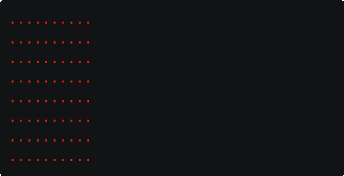
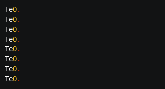
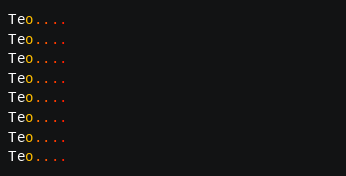

# Animation

Motion decides where a character is. Animation decides what it looks like: its symbol, its colors, and text styles
such as bold. Each character has its own [`Animation`](../../engine/animation/animation.md) object,
`character.animation`, which plays **scenes**. A scene is a list of **frames**, and each frame shows one appearance for
a number of ticks.

## A character's appearance

At any moment a character has one appearance, a [`CharacterVisual`](../../engine/animation/charactervisual.md): a
symbol, a foreground and background color, and style flags. A character that has never played a scene shows its input
symbol with no colors, so the terminal's default colors apply.

There are two ways to change the appearance:

- Play a scene, which changes the appearance frame by frame.
- Call `character.animation.set_appearance(symbol, colors)` to change it once. With no arguments, it restores the input
  symbol with no colors.

A playing scene replaces the appearance on every tick, so `set_appearance()` only lasts while no scene is active.

## A first scene

```python
from terminaltexteffects import Color, ColorPair

scene = character.animation.new_scene()
scene.add_frame(".", duration=5, colors=ColorPair(fg=Color("#ff2000")))
scene.add_frame("o", duration=5, colors=ColorPair(fg=Color("#ffc000")))
scene.add_frame(character.input_symbol, duration=5, colors=ColorPair(fg=Color("#ffffff")))
character.animation.activate_scene(scene)
```

- `new_scene()` creates an empty [`Scene`](../../engine/animation/scene.md) owned by this character.
- `add_frame()` adds a frame: a symbol, how many ticks to show it, and optional colors and styles.
- `activate_scene()` makes the scene the character's active scene and shows its first frame straight away.

Like a path, the scene plays once the character is in your iterator's `active_characters`. Each tick shows the current
frame and counts down its duration. When the last frame finishes, the scene completes and the character keeps the
last frame's appearance. A character stays active while it has an unfinished scene, even after its path is complete.

A frame's symbol must be a single printable character. Wide characters, such as most emoji, are allowed.

### Frame styles

`add_frame()` takes these keyword arguments besides the symbol and duration:

| Argument | Effect |
| --- | --- |
| `colors` | A `ColorPair(fg=..., bg=...)`. Either color can be `None` to use the terminal's default. |
| `bold`, `dim`, `italic`, `underline`, `blink`, `reverse`, `hidden`, `strike` | Text styles. All default to `False`. Terminals differ in which styles they support. |

Colors are covered in detail in the [Color](color.md) chapter.

## Gradients across symbols

Many effects show a short sequence of symbols while the color changes smoothly. `apply_gradient_to_symbols()` builds
those frames for you:

```python
heat = Gradient(Color("#ff2000"), Color("#ffc000"), Color("#ffffff"), steps=6)
scene.apply_gradient_to_symbols((".", "o", "O", character.input_symbol), 3, fg_gradient=heat)
```

It adds one frame for each color in the gradient, each lasting the given duration, and spreads the symbols evenly
across those frames. The `heat` gradient has 13 colors, so this scene has 13 frames of 3 ticks each: about three frames
of each symbol, from a red `.` to the white input symbol. When there are more symbols than colors, it adds one frame per
symbol and spreads the colors instead. Pass `bg_gradient` to change the background as well.

## The Glow example

The examples in this chapter use the Glow effect. Every character slides home from the canvas's left edge, as in the
Travel example from the Motion chapter, while a scene heats it from a red spark to its white input symbol. Save it as
`glow.py` in your community effects directory:

```python title="glow.py"
--8<-- "docs/effectguide/examples/glow/glow.py"
```

```bash
tte --input-file concept_input.txt glow
```



Every scene starts during setup and plays at the same rate, so all the characters change together, wherever they are.
The scene lasts 39 ticks. Characters near the left edge are home before then and stay active until their scene
finishes; characters from the right of the text are still moving when their scene ends, and arrive already showing
their white input symbol.

## Frame duration

A frame's duration is a number of ticks, so it controls how fast a scene plays. With `--frame-duration 10`, each of
Glow's 13 frames lasts 10 ticks, and the scene takes 130 ticks, longer than any character's path:

```bash
tte --input-file concept_input.txt glow --frame-duration 10
```


At 60 frames per second, 10 ticks is a sixth of a second. Durations must be at least 1.

## Syncing a scene to a path

Often a scene should play exactly as long as a path, so a character finishes changing as it arrives. Pass
`sync` to `new_scene()` and the scene follows the progress of the character's active path instead of counting ticks:

| `sync` | Frame shown |
| --- | --- |
| `None` | The default. Frames play for their durations, independent of motion. |
| `Scene.SyncMetric.DISTANCE` | The frame matching how far along the path the character has traveled. |
| `Scene.SyncMetric.STEP` | The frame matching how many of the path's ticks have passed. |

Frame durations are ignored in a synced scene. When the path completes, or if no path is active, the scene shows its
last frame and completes.

The two metrics differ when the path has an easing function. Glow's paths use `out_expo`, which covers most of the
distance in the first few ticks:

=== "distance"

    ```bash
    tte --input-file concept_input.txt glow --sync distance
    ```

    

    The scene follows the eased distance, so it races through the early frames with the character, and each character
    shows nearly white for most of its trip.

=== "step"

    ```bash
    tte --input-file concept_input.txt glow --sync step
    ```

    

    The scene follows elapsed ticks, so it plays at an even rate however the character moves, and the trailing
    characters glow orange and yellow as they settle.

Without easing, distance and step progress at the same rate. Use `DISTANCE` to tie an appearance to position, such as
a trail that changes as a character travels, and `STEP` to tie it to time.

A 3D body's turn and scale tweens take the same `sync`, so a body can spin in step with its path. See
[Syncing to a path](../3d/rotation.md#syncing-to-a-path).

## More scene options

`new_scene()` takes these keyword arguments:

| Argument | Effect |
| --- | --- |
| `is_looping` | Start again from the first frame after the last one, forever. |
| `sync` | Follow the active path's progress, as above. |
| `ease` | An easing function for the scene's progress through its frames, as with paths. The total duration doesn't change. |
| `scene_id` | A name for the scene, so you can find it with `animation.query_scene(scene_id)`. One is generated if you don't give one. |

A looping scene never completes, so a character playing one never becomes inactive. Give a looping scene an end, for
example by activating another scene from an event, or remove the character from `active_characters` yourself.

A character has at most one active scene. Activating another scene replaces the current one;
`animation.deactivate_scene()` stops the active scene and leaves the character showing its current appearance.
Activating a scene doesn't reset it, so a scene that was stopped part way resumes where it stopped. Call
`scene.reset_scene()` first to start it from the beginning.

## Scenes and events

Scenes fire `SCENE_ACTIVATED` and `SCENE_COMPLETE` events, and event actions can activate and deactivate scenes (see
[Events](events.md)). A common pattern is to start a scene when a path completes:

```python
character.event_handler.register_event(Event.PATH_COMPLETE, path, Action.ACTIVATE_SCENE, landing_scene)
```

## Where to go next

- [Tutorial step 5: Color](../tutorial/05-color.md) gives MySpray's characters a scene and a color in a gradient across the text.
- [Color](color.md) explains `Color`, `ColorPair`, and gradients.
