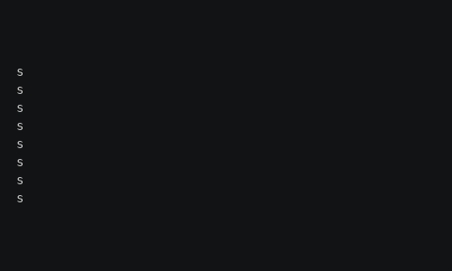

# Canvas and coordinates

Characters live on a **canvas**: a grid of cells with the input text placed somewhere inside it. This chapter explains
how positions are written, how the canvas and the text area relate, and how to pick positions for your effect.

## Coordinates

A position is a [`Coord`](../../engine/utils/geometry.md) with a `column` and a `row`:

```python
from terminaltexteffects import Coord

home = Coord(column=10, row=3)
column, row = home  # A Coord unpacks to (column, row).
```

Coordinates start at 1, and the origin is the **bottom left** cell:

- `column` increases to the right.
- `row` increases **upward**. Row 1 is the bottom row of the canvas, which is the last line of the input.

Upward rows are the opposite of how a terminal numbers lines, so check this first when characters end up upside
down. `Coord` is immutable and hashable, so you can use it as a dictionary key.

## Canvas and text bounds

The [`Canvas`](../../engine/terminal/canvas.md), available as `self.terminal.canvas`, has two sets of bounds:

| | Canvas | Text |
| --- | --- | --- |
| Edges | `left`, `right`, `bottom`, `top` | `text_left`, `text_right`, `text_bottom`, `text_top` |
| Size | `width`, `height` | `text_width`, `text_height` |
| Center | `center`, `center_column`, `center_row` | `text_center`, `text_center_column`, `text_center_row` |

All edges are inclusive. `left` and `bottom` are always 1. When a dimension is even, the center is the lower of the two
middle cells.

By default the canvas is exactly the size of the text, so both sets of bounds are the same. Users can make the canvas
larger with the terminal options `--canvas-width` and `--canvas-height`: a positive number sets the size, `0` matches
the terminal, and `-1` (the default) matches the text. `--anchor-text` then places the text inside the canvas, and
`--anchor-canvas` places the canvas inside the terminal.

Your effect should work with any canvas size. Use canvas bounds for where things come from or go to, such as a spray
origin, and text bounds for anything about the text itself, such as a gradient across it.

### Seeing the canvas

The Travel example effect starts every character at the canvas's left edge, on its own row, and moves it home. Its
code is shown in the [Motion](motion.md) chapter. Here it runs on a canvas larger than the text, with the text
centered:

```bash
tte --input-file concept_input.txt --canvas-width 60 --canvas-height 14 --anchor-text c travel
```



The characters start at column 1, the canvas's left edge, and cross the empty part of the canvas to reach the text.

## Picking positions

| Method | Returns |
| --- | --- |
| `canvas.random_coord()` | A random cell on the canvas. |
| `canvas.random_coord(within_text_boundary=True)` | A random cell inside the text bounds. |
| `canvas.random_coord(outside_scope=True)` | A random cell one step outside one of the four canvas edges. |
| `canvas.random_column()`, `canvas.random_row()` | A random column or row, with the same `within_text_boundary` option. |
| `canvas.coord_is_in_canvas(coord)` | Whether `coord` is on the canvas. |
| `canvas.coord_is_in_text(coord)` | Whether `coord` is inside the text bounds. |

Characters can move outside the canvas. They aren't drawn while they are outside it, which lets an effect bring
characters in from beyond the edge. `outside_scope=True` is a convenient starting point for that.

The [geometry utilities](../../engine/utils/geometry.md) find coordinates on circles, rectangles, lines, and bezier
curves, for effects that arrange characters in shapes.

## Distances are measured on screen

A terminal cell is about twice as tall as it is wide. TTE accounts for this when it measures how far apart two
coordinates are: one row counts as two columns. A character moving one row up travels as far, on screen, as one moving
two columns sideways. Speeds and the circular character orders use this screen distance, so motion looks even in
every direction.

## Where to go next

- [Motion](motion.md) moves characters between coordinates.
- [Tutorial step 3: Move](../tutorial/03-move.md) starts each character at a canvas edge.
