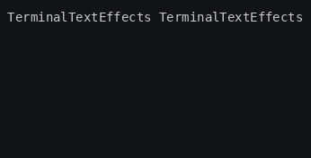
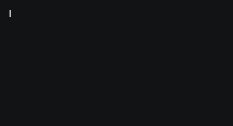
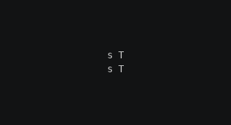

# Characters

Everything you see in an effect is an [`EffectCharacter`](../../engine/basecharacter.md): one symbol, at one position,
with its own motion and animation. This chapter covers what a character knows about itself, how to get the
characters you need, and the state that decides how each one is drawn.

## What a character knows

The terminal creates one character for every non-space symbol of the input. Spaces don't become characters; the empty
cells they leave are covered under [Fill characters](#fill-characters) below.

| Attribute | Meaning |
| --- | --- |
| `input_symbol` | The symbol from the input, such as `"T"`. |
| `input_coord` | The character's home position in the text, as a `Coord(column, row)`. |
| `character_id` | A unique number, assigned in creation order. |
| `motion` | Moves the character along paths. See [Motion](motion.md). |
| `animation` | Changes the character's symbol and colors. See [Animation](animation.md). |
| `event_handler` | Runs actions when paths and scenes start or finish. See [Events](events.md). |
| `is_visible` | Whether the terminal draws the character. Read-only; change it through the terminal. |
| `is_active` | Whether the character still has an unfinished path or scene. |
| `layer` | Drawing order when characters overlap. |

`input_coord` never changes. The character's current position is `character.motion.current_coord`, which starts at
`input_coord` and changes as the character moves.

## Getting characters

Ask the terminal for characters; never build `EffectCharacter` objects yourself.

| Method | Returns |
| --- | --- |
| `terminal.get_characters()` | A flat list of characters, top to bottom and left to right unless you pass `order`. |
| `terminal.get_characters_grouped(order=...)` | A list of groups, such as one list per row. |
| `terminal.get_character_by_input_coord(coord)` | The character whose home is `coord`, or `None`. |
| `terminal.add_character(symbol, coord)` | A new character that isn't part of the input. See [Added characters](#added-characters). |

Both `get_characters()` and `get_characters_grouped()` accept the same ordering options:

- `order`: a [`CharacterOrder`](../../engine/utils/argutils.md), or its lowercase name such as `"row_top_to_bottom"`.
- `reverse`: reverse the whole traversal.
- `serpentine`: reverse every other group, so rows alternate left-to-right and right-to-left.
- `input_chars`, `inner_fill_chars`, `outer_fill_chars`, `added_chars`: which kinds of character to include. By
  default, only input characters are returned.

Some orders are **spatial**: they form groups of several characters, such as rows, diagonals, or rings around the
center. Others, such as spirals and `random`, are **individual**: each group holds one character. Flattening the
groups gives the same order as `get_characters()` with the same options.

### Seeing the orders

The Reveal example effect shows one group per frame, so you can watch how an order traverses the text. Save it as
`reveal.py` in your community effects directory:

```python title="reveal.py"
--8<-- "docs/effectguide/examples/reveal/reveal.py"
```

Then save this text as `concept_input.txt`, the input used by every example in the engine chapters:

```text title="concept_input.txt"
--8<-- "docs/effectguide/examples/concept_input.txt"
```

Each command below sets a frame rate so the reveal is slow enough to follow; the animation beside it is what the
command shows.

=== "Rows"

    ```bash
    tte --input-file concept_input.txt --frame-rate 8 reveal --order row_top_to_bottom
    ```

    

=== "Diagonals"

    ```bash
    tte --input-file concept_input.txt --frame-rate 30 reveal --order diagonal_top_left_to_bottom_right
    ```

    

=== "Rings"

    ```bash
    tte --input-file concept_input.txt --frame-rate 15 reveal --order circle_center_to_outside
    ```

    

=== "Spiral"

    ```bash
    tte --input-file concept_input.txt --frame-rate 60 reveal --order spiral_clockwise
    ```

    

`tte reveal -h` lists every order.

## Visibility, activity, and layers

Three pieces of state decide how the terminal treats a character each frame:

- **Visible**: `terminal.set_character_visibility(character, is_visible=True)` makes the terminal draw the character.
  Every character starts hidden.
- **Active**: characters in your iterator's `active_characters` set are ticked every frame until they finish. See
  [Active and visible are separate](frame-loop.md#active-and-visible-are-separate).
- **Layer**: when two visible characters occupy the same cell, the one on the higher layer is drawn on top. On the
  same layer, the character with the higher `character_id` wins. Every character starts on layer 0; set
  `character.layer` to change it.

Layers matter as soon as characters move: a character flying across the text overlaps characters that have already
settled. Spray puts moving characters on layer 1 and settled ones back on layer 0, so the flying ones pass in front.

## Fill characters

Cells without a character, such as spaces between words and the area around the text, can be filled with **fill
characters** when an effect needs to animate them. Fill characters have a space as their symbol.

- **Inner fill** characters cover empty cells inside the text's bounding box.
- **Outer fill** characters cover the rest of the canvas.

Pass `inner_fill_chars=True` or `outer_fill_chars=True` to `get_characters()` to include them. They are created only
when first requested, so effects that don't use them pay nothing.

## Added characters

`terminal.add_character(symbol, coord)` creates a character that isn't part of the input, such as a spark or a
falling drop. It starts hidden and inactive like any other character, and `coord` becomes its `input_coord`. Added
characters aren't returned by `get_character_by_input_coord()` and don't appear in `get_characters()` unless you pass
`added_chars=True`.

When an effect creates and recycles many short-lived characters, use a
[`ParticlePool`](../../engine/particles.md) instead of adding new ones every frame.

## Neighbors

`character.neighbors` maps `"north"`, `"east"`, `"south"`, and `"west"` to the adjacent character, or `None` at the
edge of the canvas. Reading it makes the terminal create the fill characters it needs to complete the grid, so empty
cells have neighbors too. Spanning-tree effects use neighbors to grow paths through the text.

## Where to go next

- [Tutorial step 2: Release](../tutorial/02-release.md) reveals characters a few at a time with visibility and
  `active_characters`.
- [Canvas and coordinates](canvas.md) explains `Coord` and the canvas the characters live on.
