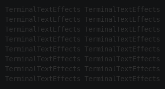
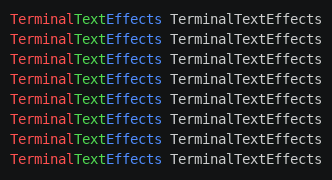
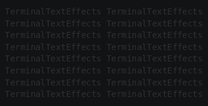

# Color

Frames, appearances, and gradients all take colors. This chapter covers the color classes, gradients, coloring the
text by position, and colors that come with the input.

## Colors and color pairs

A [`Color`](../../engine/utils/color.md) is either an RGB hex string or an XTerm-256 color number:

```python
from terminaltexteffects import Color, ColorPair

orange = Color("#ff8000")  # The leading # is optional.
gray = Color(245)          # XTerm-256 color 245.
```

`Color` objects are immutable and can be compared and used as dictionary keys. Invalid values raise `ValueError`.

A character has a foreground and a background color, so frames and appearances take a
[`ColorPair`](../../engine/utils/colorpair.md):

```python
ColorPair(fg=orange)            # Orange text on the terminal's background.
ColorPair(fg=gray, bg="#000080")  # Plain values are converted to Color.
```

`None` for either color means the terminal's default color.

You don't need to handle how colors reach the terminal. If the user passes `--xterm-colors`, TTE converts RGB colors to
the nearest XTerm-256 color, and with `--no-color` it leaves out colors entirely. Effects write the same code either
way.

## Gradients

A [`Gradient`](../../engine/utils/gradient.md) is a list of colors that blends from one **stop** to the next:

```python
from terminaltexteffects import Gradient

gradient = Gradient(Color("#ff0080"), Color("#ffd000"), Color("#00d0ff"), steps=12)
```

`steps` is the number of transitions between each pair of neighboring stops. This gradient has 12 between magenta and
yellow and 12 more between yellow and cyan, so its `spectrum`, the list of colors, has 25 colors: 12 + 12, plus the
final stop. Pass a tuple, such as `steps=(4, 12)`, to give each pair its own count, and `loop=True` to blend from the
last stop back to the first.

A gradient works like a list: iterate over it, index it, or take `len(gradient)`. To pick a color by position instead
of index, `gradient.get_color_at_fraction(0.5)` returns the color halfway along.

Gradients have two main uses in effects:

- **Over time**, as the colors of a scene's frames. `scene.apply_gradient_to_symbols()` turns a gradient into frames;
  see [Gradients across symbols](animation.md#gradients-across-symbols).
- **Over space**, as a color for each position in the text, described next.

## Coloring the text by position

Most effects end with the text in a gradient that runs across it. `build_coordinate_color_mapping()` assigns a
color from the gradient to every coordinate in an area:

```python
canvas = self.terminal.canvas
color_mapping = gradient.build_coordinate_color_mapping(
    canvas.text_bottom,
    canvas.text_top,
    canvas.text_left,
    canvas.text_right,
    Gradient.Direction.VERTICAL,
)
color = color_mapping[character.input_coord]
```

The arguments are the bottom and top rows, then the left and right columns, of the area to color, followed by a
direction. Use the text bounds, so the gradient spans the text whatever the canvas size, and look up each character by
its `input_coord`.

### The Paint example

Paint shows the four directions. Every character fades from dark gray to its color in the gradient above. Save it as
`paint.py` in your community effects directory:

```python title="paint.py"
--8<-- "docs/effectguide/examples/paint/paint.py"
```

Each character's scene is built from a second, two-stop gradient, from dark gray to the character's color. A string
works as the symbol sequence for `apply_gradient_to_symbols()`, so `character.input_symbol` gives every frame the
input symbol.

=== "vertical"

    ```bash
    tte --input-file concept_input.txt paint --direction vertical
    ```

    

    The first stop is at the bottom row and the last at the top, since rows count upward.

=== "horizontal"

    ```bash
    tte --input-file concept_input.txt paint --direction horizontal
    ```

    

    The first stop is at the left column and the last at the right.

=== "radial"

    ```bash
    tte --input-file concept_input.txt paint --direction radial
    ```

    

    The first stop is at the center and the last at the corners.

=== "diagonal"

    ```bash
    tte --input-file concept_input.txt paint --direction diagonal
    ```

    

    The first stop is at the bottom left corner and the last at the top right.

## Colors in the input

The input can contain its own colors, as ANSI escape sequences, for example when another program's colored output is
piped into `tte`. Each input character records them in `character.animation.input_fg_color` and
`character.animation.input_bg_color`, which are `None` when the character had no color.

The user decides what happens to input colors with the terminal option `--existing-color-handling`:

| Value | What happens |
| --- | --- |
| `ignore` | The default. Input colors are dropped, and the effect's colors are used. |
| `always` | Input colors replace the effect's colors on every frame and appearance. Characters without input colors are shown with no color. |
| `dynamic` | The effect decides. Input colors are available, but the engine applies none of them. |

With `ignore` and `always`, your effect needs no code: the engine handles both. With `dynamic`, check the setting
and use the input colors where they make sense. Paint uses a character's input color as the color to fade to,
when it has one:

```python
dynamic = self.terminal.config.existing_color_handling == "dynamic"
...
if dynamic and character.animation.input_fg_color:
    color = character.animation.input_fg_color
```

To see the difference, create an input file whose first word on each line is red, green, and blue, and whose second
word has no color:

```bash
--8<-- "docs/effectguide/examples/color_input.sh"
```

Then run Paint with each setting:

=== "ignore"

    ```bash
    tte --input-file color_input.txt --existing-color-handling ignore paint
    ```

    

    The input colors are dropped, so the output matches the vertical demo above.

=== "always"

    ```bash
    tte --input-file color_input.txt --existing-color-handling always paint
    ```

    

    Every frame of the fade is replaced with the input colors, so nothing changes from one frame to the next: the
    text appears in its input colors, and the second word, which has none, has no color.

=== "dynamic"

    ```bash
    tte --input-file color_input.txt --existing-color-handling dynamic paint
    ```

    

    Paint fades the first word in to its input colors, and the second word, which has none, to the gradient.

Built-in effects differ in what they do with uncolored characters in `dynamic` mode; Paint falls back to its gradient.
Whatever you choose, say so in your effect's documentation.

## Where to go next

- [Tutorial step 5: Color](../tutorial/05-color.md) gives MySpray a final gradient and a scene that fades each character into it.
- [Animation](animation.md) covers the scenes that colors are shown in.
