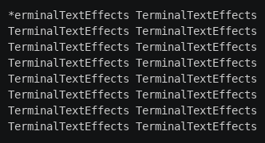

# Events

Paths and scenes run on their own once activated, but effects often need something to happen at a particular moment:
when a character lands, start a scene; when a scene ends, start the next path. Each character's
[`EventHandler`](../../engine/eventhandler.md), `character.event_handler`, runs **actions** when **events** happen to
that character's paths, waypoints, and scenes.

## Registering an event

```python
from terminaltexteffects import EventHandler

character.event_handler.register_event(
    EventHandler.Event.PATH_COMPLETE,  # when this happens...
    fall,                              # ...to this path, waypoint, or scene...
    EventHandler.Action.SET_LAYER,     # ...do this...
    0,                                 # ...with this target.
)
```

`terminaltexteffects` also exports the enums as `Event` and `Action`, so you can write `Event.PATH_COMPLETE`.

You register events once, during setup. They then fire every time their event happens, for the rest of the effect.
Several actions can be registered for the same event; they run in the order you registered them.

## Events

| Event | Fires when | Caller |
| --- | --- | --- |
| `PATH_ACTIVATED` | A path is activated. | `Path` |
| `SEGMENT_ENTERED` | The character starts the segment that ends at a waypoint. | `Waypoint` |
| `SEGMENT_EXITED` | The character reaches a waypoint. | `Waypoint` |
| `PATH_HOLDING` | The character reaches the end of a path with `hold_time`, before holding. | `Path` |
| `PATH_COMPLETE` | A path finishes, after any hold. | `Path` |
| `SCENE_ACTIVATED` | A scene is activated. | `Scene` |
| `SCENE_COMPLETE` | A scene finishes. | `Scene` |
| `ATTACHED` | The character is attached to a body other than the world root. | The new parent `Body` |
| `DETACHED` | The character leaves a body other than the world root. | The old parent `Body` |

The caller is the object the event is about. For path and scene activation and completion, you can pass the path or
scene's ID string instead of the object.

Activation events fire **immediately** when the path or scene is activated, even during setup and even if the
character isn't active yet. Register events for a path or scene before you activate it, or the activation event is
already over.

Segment events fire once per traversal of the segment. A looping path fires them again on each loop.

## Actions

| Action | Target | Does |
| --- | --- | --- |
| `ACTIVATE_PATH` | `Path` or path ID | Starts that path from the character's current position. |
| `DEACTIVATE_PATH` | `Path`, path ID, or `None` | Stops that path, or whichever path is active. |
| `ACTIVATE_SCENE` | `Scene` or scene ID | Starts that scene. |
| `DEACTIVATE_SCENE` | `Scene`, scene ID, or `None` | Stops that scene, or whichever scene is active. |
| `SET_LAYER` | `int` | Moves the character to that layer. |
| `SET_COORDINATE` | `Coord` or `Vec3` | Moves the character there instantly: a `Coord` is a cell that keeps its height, a `Vec3` a whole [position](../3d/coordinates.md#frames). |
| `RESET_APPEARANCE` | none | Restores the input symbol and its input colors. |
| `CALLBACK` | `EventHandler.Callback` | Calls your function. |
| `ATTACH` | `Body` | Attaches the character to that body, keeping its place in the world. |
| `DETACH` | none | Detaches the character into the world, keeping its place. |

The attach events and actions belong to 3D effects, where characters move between bodies; see
[Attaching and detaching](../3d/attaching.md). Bodies have event handlers too, with the path and attach events and
the actions that apply to any node: `ACTIVATE_PATH`, `DEACTIVATE_PATH`, `SET_COORDINATE`, `ATTACH`, `DETACH` and
`CALLBACK`. Registering a scene, layer or appearance action on a body raises `EventRegistrationNodeError`.

### Callbacks

When no built-in action fits, use a callback. `EventHandler.Callback(function, *args)` calls
`function(character, *args)` when the event fires:

```python
def hide(character, terminal):
    terminal.set_character_visibility(character, is_visible=False)

character.event_handler.register_event(
    Event.PATH_COMPLETE, fall, Action.CALLBACK, EventHandler.Callback(hide, self.terminal)
)
```

Callbacks can do anything, including activating other paths. Keep them short: they run inside the character's tick.

## The Hop example

Hop makes each column of text hop to the top of the canvas and fall back, one column after another. Events do all the
sequencing:

- `PATH_ACTIVATED` on the rise sets layer 1, so rising characters pass in front.
- `PATH_HOLDING` on the rise calls a callback that changes the symbol to `*` while the character waits at the top.
- `PATH_COMPLETE` on the rise activates the fall path.
- `PATH_COMPLETE` on the fall restores the input symbol and sets layer 0.

The iterator only activates each column's rise. Save it as `hop.py` in your community effects directory:

```python title="hop.py"
--8<-- "docs/effectguide/examples/hop/hop.py"
```

```bash
tte --input-file concept_input.txt hop
```



## When events fire in a tick

During a character's tick, motion moves first and animation steps second (see
[Ticking a character](frame-loop.md#ticking-a-character)), and each fires its own events as it goes, so path events
for a tick run before scene events for that tick.

An action that activates a path or scene changes what the character is doing straight away. The engine stops
processing the old path for the rest of that tick, so the new path starts moving on the next tick.

## Where to go next

- [Tutorial step 4: Layer](../tutorial/04-layer.md) uses `PATH_ACTIVATED` and `PATH_COMPLETE` to change layers.
- [Motion](motion.md#sequences-of-paths) shows `chain_paths()`, a shortcut for `PATH_COMPLETE` and `ACTIVATE_PATH`.
