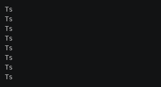
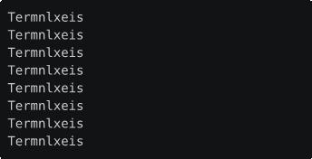
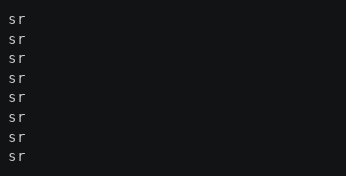
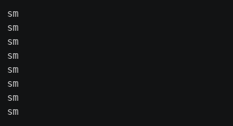
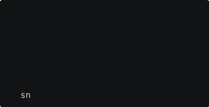

# Motion

Each character moves with its own [`Motion`](../../engine/motion/motion.md) object, `character.motion`. You give it
**paths**, each a list of **waypoints**, and activate one; the character then moves a little along it every tick until
it reaches the end. This chapter covers building paths and controlling how characters travel along them.

## A first path

```python
path = character.motion.new_path(speed=0.5)
path.new_waypoint(character.input_coord)
character.motion.activate_path(path)
```

- `new_path()` creates an empty [`Path`](../../engine/motion/path.md) owned by this character.
- `new_waypoint()` adds a [`Waypoint`](../../engine/motion/waypoint.md), a coordinate to travel to. A path can have
  any number of waypoints; the character visits them in order.
- `activate_path()` starts the path **from wherever the character is now**. The engine adds a segment from the
  character's current position to the first waypoint, so a path doesn't need a starting waypoint.

To start somewhere other than the character's home, move it first with
`character.motion.set_coordinate(coord)`. The character's position is `character.motion.current_coord`.

The path runs once the character is in your iterator's `active_characters`. When the character reaches the last
waypoint, the path completes and the character becomes inactive, unless it also has a scene playing.

## The Travel example

The examples in this chapter use the Travel effect. It moves every character from the canvas's left edge to its home,
with options for speed, easing, and a curved path. Save it as `travel.py` in your community effects directory:

```python title="travel.py"
--8<-- "docs/effectguide/examples/travel/travel.py"
```

With the default options, every character moves at a constant speed, so characters that start farther from home
arrive later:

```bash
tte --input-file concept_input.txt travel
```



## Speed and duration

`speed` is the distance a character covers per tick. The number of ticks a path takes is its length divided by its
speed, rounded: a path 20 cells long at speed 0.5 takes 40 frames, or two-thirds of a second at 60 frames per second.

Lengths are measured on screen, so one row counts as two columns (see
[Distances are measured on screen](canvas.md#distances-are-measured-on-screen)). Because the length includes the
segment from the character's starting position, characters with different distances to travel take different times
at the same speed. To make characters arrive together, give each a speed proportional to its distance.

## Easing

An easing function changes how progress along the path is spread over its duration. With `ease=None`, the default,
the character moves the same distance every tick. With an easing function, it can start slowly, finish slowly, or
overshoot and settle. The path's duration doesn't change.

```python
from terminaltexteffects import easing

path = character.motion.new_path(speed=0.5, ease=easing.out_expo)
```

=== "out_expo"

    ```bash
    tte --input-file concept_input.txt travel --ease out_expo
    ```

    

=== "in_out_quart"

    ```bash
    tte --input-file concept_input.txt travel --ease in_out_quart
    ```

    

=== "out_bounce"

    ```bash
    tte --input-file concept_input.txt travel --ease out_bounce
    ```

    

The [`easing`](../../engine/utils/easing.md) module has `in_`, `out_`, and `in_out_` variants of the sine, quad,
cubic, quart, quint, expo, circ, back, elastic, and bounce curves, plus `linear`. `easing.make_easing(x1, y1, x2, y2)`
builds a custom cubic bezier curve, like CSS `cubic-bezier()`.

Easing applies to the whole path, not each segment. On a path with several waypoints, an `out_` easing slows the
character down near the last waypoint only.

## Curves

Give a waypoint `bezier_control` to curve the segment that ends at it. One control point makes a quadratic curve;
a tuple of two makes a cubic curve. The character doesn't pass through the control point; the curve bends toward it.

```python
path.new_waypoint(character.input_coord, bezier_control=Coord(canvas.right, canvas.bottom))
```

With `--curve`, Travel starts every character in the bottom left corner and bends its path toward the bottom right
corner:

```bash
tte --input-file concept_input.txt travel --curve
```



## More path options

`new_path()` takes these keyword arguments:

| Argument | Effect |
| --- | --- |
| `speed` | Distance per tick. Must be greater than 0. |
| `ease` | Easing function for the whole path. |
| `layer` | Layer to put the character on when the path is activated. `None` leaves the layer unchanged. |
| `hold_time` | Number of ticks to stay at the last waypoint before the path completes. |
| `loop` | After reaching the last waypoint, travel back to the first and repeat forever. A path needs at least two waypoints to loop. |
| `path_id` | A name for the path, so you can find it with `motion.query_path(path_id)`. One is generated if you don't give one. |

A character has at most one active path. Activating another path replaces the current one, starting from wherever the
character is. `motion.deactivate_path()` stops the active path without completing it, and
`motion.movement_is_complete()` reports whether no path is active.

## Sequences of paths

To run paths one after another, chain them:

```python
character.motion.chain_paths([rise, drift, land])
```

`chain_paths()` registers events so that each path activates the next one when it completes; pass `loop=True` to
return from the last to the first. Chaining is a shortcut for the event handling described in the Events chapter, which
can also start scenes, change layers, or run your own code when a path starts, completes, or reaches a waypoint.

## Where to go next

- [Tutorial step 3: Move](../tutorial/03-move.md) gives MySpray's characters paths from a canvas edge to their homes.
- [Canvas and coordinates](canvas.md) explains where coordinates come from.
