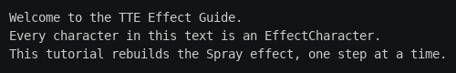

# Step 1: Scaffold

In this tutorial you rebuild the built-in [Spray](../../effects/spray.md) effect, one feature per step. Spray releases
characters a few at a time from one point on the canvas and sends each one to its place in the text, fading it into
a color gradient as it travels.


Your copy is called **MySpray** and runs as `tte myspray`. TTE rejects two effects with the same command name, so it
can't be called `spray`.

In this step you write the smallest effect that runs: it shows the input text for one frame and stops.

**Engine chapters used:** [Architecture](../engine/architecture.md), [Frame loop](../engine/frame-loop.md).

## Create the module

Create `myspray.py` in your community effects directory:

```bash
mkdir -p "${XDG_CONFIG_HOME:-$HOME/.config}/terminaltexteffects/effects"
cd "${XDG_CONFIG_HOME:-$HOME/.config}/terminaltexteffects/effects"
```

Then add this code. Each part is explained below.

```python title="myspray.py"
--8<-- "docs/effectguide/examples/myspray_step1/myspray.py"
```

## What each part does

### `get_effect_resources()`

TTE calls this function when it loads your module. It returns three things: the command name, the effect class, and
the configuration class. The command name must match `parser_spec.name` in the configuration.

### `MySprayConfig`

The configuration is a dataclass that subclasses `BaseConfig`. It has no options yet, only `parser_spec`, which
describes the `myspray` subcommand: its one-line `help` in `tte -h`, and the `description` and `epilog` shown by
`tte myspray -h`. You add options in Step 6.

### `MySprayIterator`

The iterator does the work. Its `__init__` runs once, before the first frame:

- `super().__init__(effect)` copies the configuration and builds `self.terminal`, which holds one character for
  each symbol of the input.
- The loop makes every character visible. Characters start hidden, so without this the frame would be blank.

`__next__` returns `self.frame`, the rendered canvas, the first time it is called, then raises `StopIteration` to end
the effect. It never calls `self.update()`, because no character has anything to animate yet. The
characters stay inactive, but the terminal draws every visible character whether or not it is active, so the
text still appears. See [Active and visible are separate](../engine/frame-loop.md#active-and-visible-are-separate).

### `MySpray`

The effect class is the public face of your effect. Its two properties tell `BaseEffect` which configuration and
iterator classes to use. You rarely add anything else to it.

## Run it

```bash
printf 'Hello, TTE!\n' | tte myspray
tte myspray -h
```

The text appears at once and the command exits. Here it is with the input used throughout this tutorial:



If `tte myspray` reports an invalid choice, TTE didn't load your module. Check that the file is directly inside the
effects directory and that `get_effect_resources()` is spelled correctly.

## Next step

Step 2 holds the characters back and releases a few each frame, so the text builds up over time.
