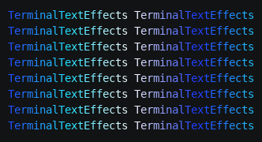

# Looping and infinite effects

Some effects play a cycle that repeats: a color wave, a pulse, a rotation. They usually let the user choose how many
cycles to play, and treat `0` as "forever". This page shows how to count cycles, how to end a looping effect cleanly,
and what an infinite effect means for the people running it. Built-in effects with this option include ColorShift,
whose `--cycles 0` loops until interrupted.

## The Wave example

Wave gives every character a looping scene that cycles through a looping gradient. Each character starts at a
different point in the cycle, offset by its column, so a band of color sweeps across the text from right to left.
After the last cycle, every character settles to a final color. Save it as `wave.py` in your community effects
directory:

```python title="wave.py"
--8<-- "docs/effectguide/examples/wave/wave.py"
```

```bash
tte --input-file concept_input.txt wave
```



With `--cycles 0`, the wave keeps sweeping until you press Ctrl+C:

```bash
tte --input-file concept_input.txt wave --cycles 0
```

## Looping scenes and gradients

Two looping options work together here:

- `Gradient(..., loop=True)` adds a transition from the last stop back to the first, so the spectrum ends where it
  starts, and cycling through it has no jump (see [Gradients](../../engine/color.md#gradients)).
- `new_scene(is_looping=True)` starts the scene again from its first frame after the last one, forever (see
  [More scene options](../../engine/animation.md#more-scene-options)).

Rotating each character's list of colors by its column, `colors[offset:] + colors[:offset]`, is what turns the same
cycle into a moving wave: neighboring characters are one color apart at every tick.

## Ending a loop

A looping scene never completes, so its character never becomes inactive, and an iterator that waits for
`active_characters` to empty would never stop. The iterator has to decide when to stop, and Wave counts ticks:

- One cycle lasts `len(colors) * TICKS_PER_COLOR` ticks, the length of the scene.
- After `cycles` full cycles, `__next__` stops each character's scene with `deactivate_scene()`, gives it its final
  appearance with `set_appearance()`, and clears `active_characters`. It returns that settled frame, and the next call
  raises `StopIteration`.

`set_appearance()` changes what is drawn at once, without an `update()`, so the settled frame shows the final colors.
Ending on a deliberate final appearance, rather than wherever the loop happened to be, makes the effect look finished.

Other ways to end a loop:

- Replace the looping scene with a final, non-looping scene, and wait for it to complete as usual.
- For a looping path, call `motion.deactivate_path()` or activate a final path.

## Infinite effects

With `--cycles 0`, Wave never raises `StopIteration`. That is fine on the command line, where the user stops it with
Ctrl+C, but it changes how the effect can be used:

- Someone running the effect from Python must stop iterating themselves, as the
  [Library Guide](../../../libguide.md#infinitely-looping-effects) explains for the built-in effects.
- Tests and recordings need a finite setting, so make sure every option has a finite value, as Wave's default of 2
  cycles is.
- Say in the option's help that `0` loops until interrupted, as Wave does.

## Where to go next

- [Animation](../../engine/animation.md) covers scenes, frame durations, and looping.
- [Phases and staggered starts](phases.md) covers effects that end in a final stage.
