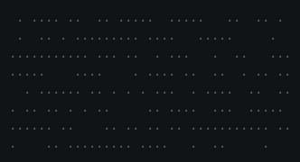
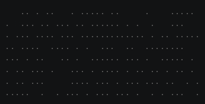

# Phases and staggered starts

Many effects happen in stages: characters appear, move into place, and then the finished text does something
together. Within a stage, groups of characters often start one after another rather than all at once. This page shows
how to structure both in an iterator. Built-in effects that use this pattern include Beams, Blackhole, and Middleout.

## The Gather example

Gather runs in three phases:

1. **Scatter:** every character sits at a random position as a gray dot, for 30 ticks.
2. **Gather:** groups of characters, one row at a time by default, travel home every 4 ticks, turning from dots into
   their symbols on the way.
3. **Flash:** when every character is home, the whole text flashes from white to blue.

Save it as `gather.py` in your community effects directory:

```python title="gather.py"
--8<-- "docs/effectguide/examples/gather/gather.py"
```

```bash
tte --input-file concept_input.txt gather
```



## A phase is state in the iterator

The iterator keeps two attributes: `phase`, the name of the current phase, and `ticks_in_phase`, the number of ticks
since that phase began. `__next__` runs the code for the current phase, updates the characters, and returns the frame,
so every phase still produces one frame per call.

Each phase decides when it ends, and starts the next one:

- **Scatter** ends after a fixed number of ticks. Nothing is active, so the scattered dots stay still: visible
  characters are drawn whether or not they are active.
- **Gather** ends when no groups are waiting and `active_characters` is empty, meaning every character has finished its
  path and scene.
- **Flash** gives every character a new scene and adds them all to `active_characters` again. When they are all
  inactive, the effect raises `StopIteration`.

Checking `active_characters` is the usual way to wait for a phase's motion and animation to finish. If a phase needs
to wait for something else, such as a particular character reaching a waypoint, set a flag from an event callback
(see [Events](../../engine/events.md#callbacks)) and check the flag in `__next__`.

Keep phase changes in one place, as Gather does with `start_flash()`, so the setup for each phase is easy to find.
For effects with many phases, an `Enum` of phase names avoids typos in the strings.

## Staggered starts

`terminal.get_characters_grouped(order=...)` splits the characters into groups, such as rows, columns, or diagonals
(see [Characters](../../engine/characters.md#getting-characters)). Gather reverses the list once, so `pop()` takes the
groups in order, and releases the next group every `TICKS_BETWEEN_GROUPS` ticks.

With `--gather-order`, any order can drive the stagger:

```bash
tte --input-file concept_input.txt gather --gather-order column_left_to_right
```



Other common ways to stagger starts:

- Release a fixed number of characters from a shuffled list each tick, as MySpray does in
  [step 2](../../tutorial/02-release.md).
- Start every character at once, but give each a different `speed` or a `hold_time`, so arrival times differ.
- Release a group when the previous group's path completes, using a `PATH_COMPLETE` callback.

## Where to go next

- [The frame loop](../../engine/frame-loop.md) explains when an effect ends and what `update()` does.
- [Animation](../../engine/animation.md#syncing-a-scene-to-a-path) explains the synced scene each character plays as
  it gathers.
