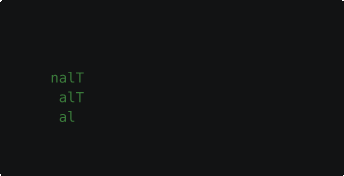
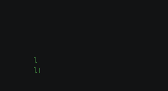

# Spanning trees

A spanning tree connects every character to its neighbors without loops, like a maze carved through the text.
Revealing characters in the order a tree links them makes the text grow outward in branches, and walking the finished
tree from its root sends a pulse down those branches. Built-in effects that use spanning trees include Burn,
Laseretch, and Smoke.

## The Grow example

Grow builds a spanning tree over the text, reveals the characters in the order the tree linked them, and then runs a
pulse from the tree's root out along its branches. Save it as `grow.py` in your community effects directory:

```python title="grow.py"
--8<-- "docs/effectguide/examples/grow/grow.py"
```

The algorithm that builds the tree decides the shape of the growth:

=== "prims_simple"

    ```bash
    tte --input-file concept_input.txt grow --algorithm prims_simple
    ```

    

    Prim's algorithm links a random character on the edge of the tree each step, so the tree grows outward evenly
    from its root.

=== "recursive_backtracker"

    ```bash
    tte --input-file concept_input.txt grow --algorithm recursive_backtracker
    ```

    

    The recursive backtracker follows one branch as far as it can before backing up, so the tree has long corridors
    and the pulse takes winding routes.

=== "aldous_broder"

    ```bash
    tte --input-file concept_input.txt grow --algorithm aldous_broder
    ```

    

    Aldous-Broder wanders at random and links each character the first time it visits it, so growth appears in
    patches and slows down as fewer unvisited characters remain.

## Building the tree

The generators are in `terminaltexteffects.utils.spanningtree.algo`. Each one takes the terminal and, optionally, a
starting character:

```python
tree = PrimsSimple(self.terminal, limit_to_text_boundary=True)
while not tree.complete:
    tree.step()
```

Each `step()` links at most one more character. You can step a generator once per frame to animate the tree as it is
built, or, as Grow does, build the whole tree during setup and replay `char_link_order`, the characters in the order
they were linked. Building up front keeps `__next__` simple and lets you change the reveal rate freely.

Without a starting character, the generator picks a random one, inside the text bounds with
`limit_to_text_boundary=True`. That option also keeps the tree from linking characters outside the text.

### Fill characters

Trees link neighboring cells, and spaces inside the text are cells too. The engine fills them with **fill
characters**, so a tree can pass between words (see [Fill characters](../../engine/characters.md#fill-characters)).
Fill characters have `is_fill_character` set and a space as their symbol. Grow skips them when revealing and pulsing.

### Links are permanent

A generator records the tree in each character's `links`, the set of neighbors it is linked to. A character that
already has links can't be part of a new tree: the generators raise `ValueError`. Build one tree per effect run.

## Walking the tree

`BreadthFirst(terminal, starting_char)` traverses a tree that is already built. Each `step()` moves one layer out from
the start, and `explored_last_step` lists the characters reached by that step. Grow starts a pulse scene on those
characters each tick, so the pulse moves one link per tick along every branch at once. The traversal is complete when
a step finds no new characters.

## Where to go next

- The [spanning tree Reference](../../../engine/utils/spanningtree/base_generator.md) lists the generator attributes
  each algorithm records, such as `edge_chars` in Prim's algorithm.
- [Phases and staggered starts](phases.md) covers effects that run in stages, as Grow does.
