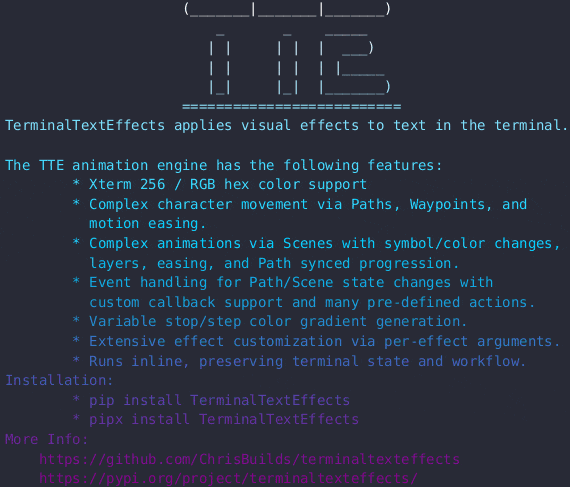

# Highlight



## Quick Start

``` py title="highlight.py"
from terminaltexteffects import Gradient
from terminaltexteffects.effects.effect_highlight import Highlight

effect = Highlight("YourTextHere")
effect.effect_config.final_gradient_direction = Gradient.Direction.HORIZONTAL
with effect.terminal_output() as terminal:
    for frame in effect:
        terminal.print(frame)
```

## Highlight Directions and Sorts

!!! info "New in 0.16.0"

    `CharacterOrder` directions and `--reverse-highlight-direction` are available on development `main` and are
    not in the published 0.15.0 package.

`--highlight-direction` accepts every `CharacterOrder`. Group directions activate
whole rows, columns, diagonals, or radial bands. Sort directions activate individual characters in the
exact order returned by `Terminal.get_characters()`, using their input coordinates. All text remains
visible while the highlight travels through it.

See [Spiral Sorting](../engine/terminal/terminal.md#spiral-sorting) for the six spiral orders, their starting
corners, and how multiple arms interleave.

Both grouped and sorted modes retain the same easing schedule, so multiple characters may start highlighting in one frame.
`highlight_width` controls the duration of each character's bright highlight; it does not set the
number of characters in a sorted trail. The default remains `diagonal_bottom_left_to_top_right`.

```bash
tte highlight --highlight-direction spiral_clockwise
tte highlight --highlight-direction spiral_counter_clockwise_quad --highlight-width 12
```

Use `--reverse-highlight-direction` to reverse the complete traversal while preserving group membership.
The flag defaults to off. Reversed spirals travel outward along the selected path; changing
clockwise to counterclockwise instead selects a different inward path.

```bash
tte highlight --highlight-direction spiral_clockwise --reverse-highlight-direction
```

Configurations normalize to `CharacterOrder`. Existing `CharacterGroup` and `CharacterSort`
values and their CLI spellings remain accepted as compatibility inputs.

For library use, assign a native enum or its CLI spelling:

```python
from terminaltexteffects.effects.effect_highlight import Highlight
from terminaltexteffects import CharacterOrder

effect = Highlight("YourTextHere")
effect.effect_config.highlight_direction = CharacterOrder.SPIRAL_CLOCKWISE_DOUBLE
```

::: terminaltexteffects.effects.effect_highlight
