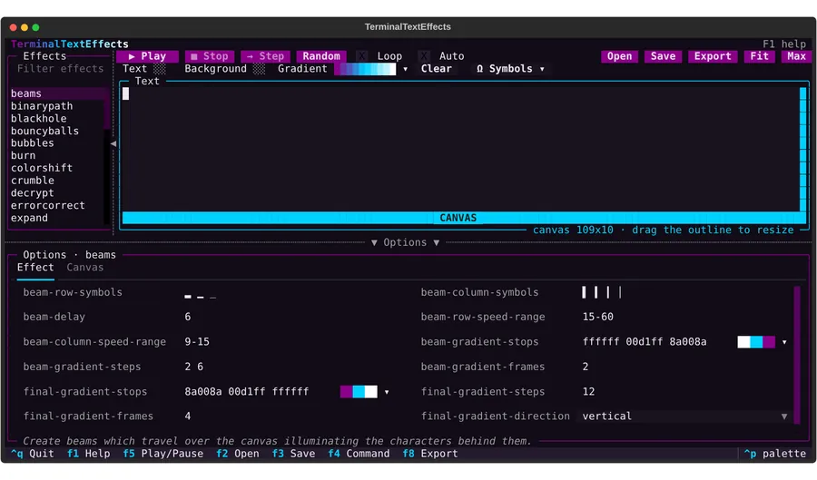

# Interactive Interface

The interactive interface lets you type and arrange text, pick an effect, adjust its options, and preview the effect
on your text, all in one terminal window. It is an optional extra built on [Textual](https://textual.textualize.io/),
so the core package keeps no third-party dependencies.



## Install

=== "pipx"

    ```bash
    pipx install 'terminaltexteffects[tui]'
    ```

=== "uv"

    ```bash
    uv tool install 'terminaltexteffects[tui]'
    ```

=== "pip"

    ```bash
    pip install 'terminaltexteffects[tui]'
    ```

## Start

| Command | What opens |
| --- | --- |
| `tte` | The interface with an empty text area. Without the extra installed, `tte` prints usage and the install command. |
| `ls -la \| tte` or `tte -i notes.txt` | The interface with that text loaded, when no effect is named. |
| `tte --tui` | The interface, with any piped or `-i` text loaded. Add an effect name to select it, such as `tte --tui decrypt`. |
| `tte decrypt < notes.txt` | The effect plays as usual. Naming an effect never opens the interface. |

The interface needs a terminal for output. When standard output is redirected, `tte` keeps its usual behavior and
`tte --tui` exits with an error.

## Layout

- **Effects** on the left lists every available effect, including [community effects](appguide.md#community-effects)
  and any [effects you are developing](#developing-effects). Type in the filter above the list to show only effects
  whose name or description contains every word you type, and press ++down++ or ++enter++ to move into the list.
  Highlighting an effect shows its options. Pressing ++enter++ on it plays it.
- **The playback bar** above the text has two groups. On the left, **Play** plays or pauses the effect, **Stop**
  returns to the text, **←** and **→** step back and forward one frame, and **Random** plays a random effect,
  followed by the **Loop** and **Auto** (auto-replay) toggles. On the right, **Open** and **Save** load and save the
  text, **Export** saves the effect as a file, and **Fit** and **Max** size the canvas.
- **The text toolbar** under the playback bar colors text and inserts symbols. See [Text toolbar](#text-toolbar).
- **Text** fills the rest of the top of the screen. Type, paste, and arrange text here. The subtitle shows the canvas
  size, and while an effect is shown, the frame number and the frame rate.
- **Options** at the bottom has two tabs. **Effect** holds the selected effect's options, and **Canvas** holds the
  terminal options that affect previews: canvas size and anchors, text wrapping, frame rate, color handling, and tab
  width.

Click the thin handle to the right of **Effects**, or above **Options**, to hide that panel and give the text more
room, and click it again to bring the panel back. ++ctrl+b++ and ++ctrl+o++ do the same.

The interface uses a TerminalTextEffects theme in purple, cyan, and white. Other Textual themes are available from
the command palette (++ctrl+p++).

Option inputs follow each option's type: a checkbox for on/off options, a list for fixed choices such as gradient
directions and easing functions, which opens inside the options panel and scrolls, and a text box for everything
else. Text boxes use the same spelling as the command line. Lists are space separated, such as `ff0000 00ff00
0000ff`, and colors show a swatch. Hover over an option to see its help, how to write its value with an example, and
its default. An invalid value turns its name and field red, with the reason in its tooltip, and the effect won't
play until it is fixed. Changed options have their names highlighted. Clearing a field and leaving it, or pressing
++shift+f6++ on an option, returns that option to its default. Each effect keeps its own values while the interface
is open. The selected effect's description is shown along the bottom of the options panel.

### Picking colors

Color options open a color picker when you press ++f7++ or ++enter++ in the field, or click the swatch, which shows
each color as a square. Choose from the 256 XTerm colors in the palette, type a hex value, or drag the hue,
saturation, and lightness bars. Palette colors stay XTerm colors on the command line, and any other change gives an
RGB hex color. For gradient options, the picker edits the list of stops: select a stop, change its color, and add,
remove, or reorder stops while a bar previews the gradient. Press ++ctrl+s++ or choose **Apply** to keep the colors,
or ++escape++ to discard them.

### Text toolbar

**Text** and **Background** open the color picker for the text color and the background color. A picked color
applies to the selected text and to text you type or insert afterwards. **No color** in the picker removes just that
color, keeping the other one. **Clear** removes both colors from the selected text and stops coloring new text. Each
chip shows its current color, or a hatched square when there is none.

**Gradient** shows the current gradient. Click it with text selected to spread the gradient across the selection:
the box around the selected characters runs from the first stop to the last in the gradient's direction. Click its
**▾**, or click it with nothing selected, to build the gradient: edit its stops in the color picker, set the steps
between stops and the direction (horizontal, vertical, diagonal, or radial), and choose whether it colors the text or
its background. With text selected, the dialog applies the new gradient right away.

**Symbols** opens a palette of blocks, single and rounded lines, double lines, shapes, and arrows. Click a symbol,
or move with the arrow keys and press ++enter++, to insert it at the cursor, replacing any selected text. The palette
stays open so you can insert several symbols, and ++escape++ or a click outside closes it.

Colors are kept with the text, as [input colors](#input-colors) are. Effects use them when
**existing-color-handling** on the Canvas tab is `always` or `dynamic`.

### Clipboard and right-click menu

++ctrl+x++, ++ctrl+c++, and ++ctrl+v++ cut, copy, and paste in the text area, using the system clipboard
(`pbcopy` and `pbpaste` on macOS, `clip` and PowerShell on Windows, and `wl-copy`, `xclip`, or `xsel` elsewhere).
Most macOS terminals keep ++cmd+c++ and ++cmd+x++ for their own selection, which mouse support in the interface
turns off, so use the Ctrl keys or the menu. ++cmd+v++ pastes as usual. Terminals that pass ++cmd++ through to
applications, such as kitty, WezTerm, and Ghostty, can use the ++cmd++ keys too.

Right-click the text, or the effect while it plays, for a menu with cut, copy, paste, and select all, the text
color, background color, clear colors, and insert symbol actions, play or pause, stop, and fit or maximize the
canvas. Right-clicking keeps the selection, so the menu can cut or copy it.

## Playback

++f5++ or **Play** plays the selected effect on a black background. While it plays, ++f5++ or ++space++ pauses and
resumes it. Once the effect has finished or been stopped, **Play** plays it again from the start, as does ++ctrl+r++
at any time. ++f9++ or **Random** plays a random effect from the listed effects. ++escape++, or a click on the effect,
returns to the text, and a click puts the cursor where you clicked.

++right++ or the **→** button pauses the effect and shows the next frame, and ++left++ or the **←** button pauses it
and steps back one frame, through the last 2,000 frames shown. After stepping back, ++right++ steps forward through
those frames again, and resuming plays them before the effect continues. Stepping back works after the effect has
finished too. While you are looking at an earlier frame, the subtitle shows its number and the number of the newest
frame shown.

Turn on **Loop** to replay the effect a second after it finishes. Loops replay the frames of the first run, so they
start at once, and stop reusing them when you change an option or the text. Turn on **Auto** to replay the effect
shortly after you change an option or highlight another effect, without leaving the field you are editing, or after
you save a [development effect](#developing-effects) you are working on.

Effects build their animations and draw their frames on a background thread, a few frames ahead of the screen, so
the interface stays responsive while a large effect is prepared. The frame rate in the subtitle is the rate the
interface manages to show, next to the **frame-rate** option.

## Developing effects

With `TTE_DEV_EFFECTS_DIR` set to a directory of effect modules, the effect list also shows each module in it. Keep
the interface open in another window while you work on an effect: it checks the files every second and imports a
saved file again, so the next play uses your edit. With **Auto** on, the selected effect replays as soon as you
save it. Options you changed keep their values while the effect still has them.

A module that can't be played is listed in red under its file name, for example because it raises an error while
importing or uses a command another effect already has. Playing it shows the error in place of the text, and the
entry turns back to normal once a saved fix imports. If the effect raises an error while it plays, the last frame
stays on screen and a notification names the file and line.

In a TTE checkout, `python -m tools.dev --tui` opens the interface with the `dev_effects/` directory.

## Export

**Export** (++f8++) renders the effect with the current options, without showing it, and saves it in the format
chosen in the dialog. A panel in the bottom-right corner shows the frames rendered and the elapsed time until the
file is written:

| Format | What you get | Needs |
| --- | --- | --- |
| tterec | A recording that `tte --play` replays in a terminal. See [recording and playback](appguide.md#recording-and-playback). | Nothing else. |
| GIF | An animation of the canvas, with the last frame held for two seconds, at up to 50 frames per second. Colors are reduced to one palette of 255. | [Pillow](https://python-pillow.org), which the `tui` extra installs on Python 3.10 or later. |
| WebP | The same animation as a lossless animated WebP, keeping every color and frame. | Pillow, as for GIF. |

Choosing a format changes the file's suffix, and typing a suffix chooses the format. When Pillow is missing, the
dialog says so and won't save GIF or WebP. Exporting needs a **frame-rate** above `0`, and GIF and WebP play at
that rate. The command line makes the same files with [`--export`](appguide.md#gif-and-webp).

## Keys

| Key | Action |
| --- | --- |
| ++f1++ | Show the keys and a few tips. |
| ++f5++ | Play or pause the selected effect. Once it has finished, play it again from the start. |
| ++space++ / ++left++ ++right++ | While an effect is shown: pause or resume it / show the frame before or after. |
| ++ctrl+r++ | Replay the effect from the start. |
| ++f9++ | Play a random effect. |
| ++escape++ | Stop the effect, or clear the finished effect, and return to the text. |
| ++ctrl+t++ / ++ctrl+g++ | Fit the canvas exactly around the text / grow it to the whole text area. |
| ++ctrl+b++ / ++ctrl+o++ | Hide or show the effect list / the options panel. |
| ++f2++ | Open a text file. |
| ++f3++ | Save the text to a file. |
| ++f4++ | Show the `tte` command for the current settings, or load a pasted command. |
| ++f7++ | Open the color picker for the selected color option. |
| ++shift+f6++ | Reset the focused option to its default. |
| ++f6++ | Reset the selected effect's options and the canvas options. |
| ++f8++ | Export the effect to a `.tterec`, GIF, or WebP file. See [Export](#export). |
| ++tab++ | Move between the effect filter, the effect list, the text, and the options. |
| ++ctrl+p++ | Open the command palette, including themes. |
| ++ctrl+q++ | Quit. |

## Canvas

By default the canvas is the whole text area and text is anchored to its top left, so the effect draws your text
where you typed it. To preview an effect on a smaller canvas, set **canvas-width** and **canvas-height** on the
Canvas tab. Setting either to `-1` sizes it to the text, as the command line does by default. **Fit** (++ctrl+t++)
sets the canvas to the size of the text, and **Max** (++ctrl+g++) sets it back to the whole text area.

A cyan outline of full blocks marks the canvas, one cell outside it, and stays visible while you edit and while an
effect plays, with **CANVAS** in the middle of its bottom edge, or of its top edge when only that one moves. Text
outside the canvas is dimmed because the effect won't show it. An edge lights up white under the mouse, and a corner
lights both of its edges. Drag the outline to resize the canvas, and **canvas-width** and **canvas-height** update
to match. The outline is drawn on the edges that move with **anchor-canvas**: with the default `nw` anchor, the
right and bottom edges. The text area keeps one free column or row beyond each of those edges, so effects draw in a
slightly smaller area than the text area, and the outline stays visible when the canvas fills that area. The text
area shows no scrollbars, so they never cover the outline: scroll with the mouse wheel or the cursor keys, and the
subtitle says when there is more text than fits. Dragging an edge all the way out sets that dimension to `0`, the
whole area.

## Commands

++f4++ shows the `tte` command that plays the effect with the current options, with a button to copy it. Copying
uses the terminal's clipboard and also the system clipboard command (`pbcopy` on macOS, `clip` on Windows, and
`wl-copy`, `xclip`, or `xsel` elsewhere), since many terminals ignore clipboard requests from applications. The
command includes the canvas settings when they differ from the command-line defaults, so the effect plays the same
way in your terminal.

The same dialog loads a command: paste a `tte` command, such as one copied from the docs, and choose **Load**. The
interface selects its effect and applies its options. Options the command leaves out take their command-line
defaults, so the preview matches what the command plays. Its `--input-file`, if any, is opened, and flags the
interface doesn't offer, such as `--reuse-canvas`, are listed in a notice and skipped.

## Files

++f2++, ++f3++, and ++f8++ open a file dialog with a folder tree and a path field. Browse the tree with the mouse or
arrow keys, or type a path. Choosing a file twice, such as with a double click, opens it. When saving, choosing a
folder keeps the file name you typed, and saving over an existing file asks for confirmation first. **Home** and
**Up** (++ctrl+up++) change folders, and the **Hidden files** checkbox (++ctrl+t++) shows dot files.

## Input Colors

Text with ANSI colors, such as `ls --color=always` or fetch output, keeps its colors in the text area. Colors stay
attached to their characters as you edit, and text typed inside a colored word takes that word's color. Effects use
the colors when **existing-color-handling** on the Canvas tab is `always` or `dynamic`, as with
`--existing-color-handling` on the command line. When saving, choose whether to keep the colors in the file.
